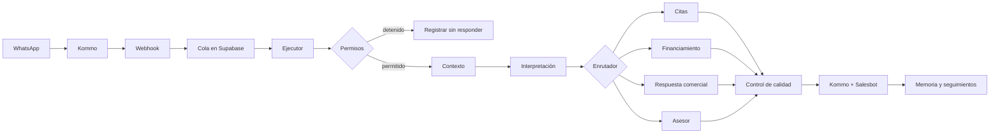

# Automatización de La Vilet: referencia canónica

**Correcciones de la auditoría, implementación local del 16/10/2026:** [Informe completo de lo anterior, los cambios y los resultados esperados](informe-correcciones-auditoria-2026-10-16.md). Reúne los 20 hallazgos, las reparaciones de continuidad descubiertas durante las pruebas y la separación entre código local y pendientes productivos. El revisor continúa desactivado; no se enviaron mensajes ni se aplicó SQL durante esta intervención.

**Panel de diagnóstico de conversaciones, implementación local del 16/10/2026:** [Recorridos, señales con evidencia, cohortes y revisión del equipo](panel-diagnostico-conversaciones-2026-10-16.md). Conserva la navegación y amplía el contenido central de Análisis de conversaciones. Requiere dos migraciones y despliegue; las pruebas de interfaz usan datos ficticios y no acreditan funcionamiento productivo ni precisión del modelo real.

**Corrección local posterior a la auditoría, 16/10/2026:** [Continuidad de reservas y memoria del 605](auditoria-integral-2026-10-16.md#11-corrección-posterior-continuidad-durante-una-solicitud-de-reserva). Las aclaraciones conservan decisiones, la solicitud guardada aporta contexto común y una consulta de seguimiento no vuelve a iniciar la calificación comercial. Se respetan búsquedas nuevas y rechazos entre turnos. Pasan 109 pruebas locales, TypeScript y ESLint; no se enviaron mensajes ni se reactivó el revisor. No agrega migraciones SQL. Falta desplegar y comprobar en producción.

**Auditoría integral, corte `36ecc00` del 16/10/2026:** el [informe con causas, ejemplos y pruebas](auditoria-integral-2026-10-16.md) y su [anexo estructurado](auditoria-integral-2026-10-16.json) registran 20 hallazgos de distinta naturaleza. Se reprodujo la pérdida de selección que reabre dormitorios durante una reserva; también se identificaron conflictos de prompts, seguimiento, contexto y análisis. Las consultas productivas confirman dos estructuras del embudo no disponibles y ausencia de mantenimiento reciente, cuya causa requiere comprobación administrativa. La batería general pasó 1.583 de 2.019 pruebas; sus 436 fallos están clasificados con límites y comparación histórica. Esta revisión no modificó el bot ni envió mensajes. Las entradas anteriores describen sus respectivos cortes y no certifican la resolución integral actual.

**Autoridad sobre el texto, 16/10/2026:** en la ruta principal, el redactor produce el mensaje completo y la IA revisora es la única que evalúa su significado factual y sus promesas comerciales. Esa ruta no extrae cifras, reconoce frases, compara superficies ni reconstruye preguntas para vetar o modificar el borrador. Con revisión desactivada se entrega sin evaluación semántica; en observación se conserva aunque el revisor señale hallazgos. La continuidad utiliza metadatos del redactor. Se mantienen transporte, permisos de contacto, validación de datos estructurados y autorización independiente de acciones. La auditoría integral detectó lecturas de prosa todavía presentes en rutas de citas y consentimiento financiero: no se declara eliminada esa práctica de todo el sistema. Véase [Autoridad del redactor y del revisor IA](06-configuracion-y-codigo.md#autoridad-del-redactor-y-del-revisor-ia). El ajuste del proyecto permanece desactivado.

**Implementación local del 16/10/2026:** [Continuidad de selección, reservas, showroom y análisis](diagnostico-continuidad-showroom-2026-10-16.md#cierre-de-implementación-local). Asignación automática de reservas y alerta privada urgente, actualización sin interrumpir la ficha, decisiones de unidad y categoría junto con precio, fuentes compartidas, entrada del showroom con Salesbots 26428/26430 y panel de análisis en la barra lateral. Requiere tres migraciones y despliegue. El contacto real depende de comprobar la vinculación y las plantillas/botones aprobados; «escribiendo» requiere acceso al canal y `wamid` de Meta. Los renders quedan aplazados. No se enviaron mensajes a leads durante las comprobaciones.

**Showroom, renders y análisis, corte histórico del 15/10/2026:** [Contacto del showroom y análisis de conversaciones](showroom-contacto-renders-y-analitica-2026-10-15.md). Documenta la conexión parcial que existía con el 360 y las propuestas de primer contacto y análisis. El cierre del 16/10 anterior recoge su implementación local; los renders siguen aplazados. Se crearon los borradores Kommo `19938` y `19940` con tres botones; falta seleccionar WABA, obtener aprobación y vincularlos a los Salesbots.

**Guía de etapas y correcciones del resumen, 15/10/2026:** [Etapas de los leads y lectura del resumen comercial](etapas-leads-y-resumen-2026-10-15.md). Define las seis etapas con ejemplos. La ficha compartida entre Leads y Automatización, la carga autorizada de reservas, los avisos con diagnóstico y reintento y los eventos en español con su incremento de puntos están implementados localmente, pendientes de despliegue y validación con la sesión afectada.

**Embudo y ficha comercial, implementación local del 15/10/2026:** Leads incorpora las vistas Lista y Embudo con seis etapas, nutrición independiente, citas, atención y próxima acción. Monitoreo usa la misma proyección. La definición vigente de nutrición es interés futuro expresado con acuerdo de contacto, no el saludo ni el silencio. Véase el [alcance y despliegue](mapa-conversacion-y-pendientes-2026-10-12.md#embudo-y-ficha-comercial-implementación-local--15-de-octubre). Requiere aplicar `20261015210000_lead_commercial_pipeline.sql` antes de habilitar el guardado y el historial de observaciones en producción.

**Auditoría ampliada de reglas, corte `17615fc` del 15/10/2026:** [29 familias documentadas](mapa-conversacion-y-pendientes-2026-10-12.md#auditoría-de-reglas-antiguas-y-nuevas--corte-17615fc-15-de-octubre): 18 corregidas en código, 4 parciales con restos secundarios, 6 pendientes y 1 aplazada. El [inventario estructurado](auditoria-reglas-2026-10-15.json) registra fuentes, método, métricas y evidencia histórica de depuración. Amplía el inventario inicial de 25; no equivale a miles de reglas contradictorias, a fallos productivos actuales ni al número de pruebas.

**Registro de incidentes para regresión, 16/10/2026:** [118 casos estructurados](casos-regresion.json), con mensajes, estado inicial, comportamiento observado, resultados esperados y variantes. AUT-107 a AUT-118 reúnen la continuidad del 605, presentación, revisión, nombre visible, reservas, prioridad, actualización y entrada del showroom. Se distinguen incidentes observados de controles derivados; varios pertenecen a una misma cadena causal. Hay regresiones locales controladas, pero siguen pendientes las simulaciones completas del corpus con modelos y la comprobación productiva. El total de escenarios no equivale a pruebas ejecutadas ni familias independientes de reglas.

**Ajustes adicionales del 15/10/2026:** AUT-099, AUT-100, AUT-102 y AUT-103 a AUT-106 tienen cambios locales de orientación financiera, redacción, galerías de locales y manejo de objeciones, pendientes de despliegue y validación del texto generado. La entrega del brochure conserva sus excepciones y el flujo de nombres/cédula no cambia. AUT-101 (presentación inicial de dos o tres locales) sigue aplazado. Se contrastaron trazas y fuentes y se ejecutaron comprobaciones locales sin llamadas a modelos ni mensajes a leads. El [cierre de objeciones y revisión de adjuntos](mapa-conversacion-y-pendientes-2026-10-12.md#implementación-local-manejo-de-objeciones-y-revisión-de-adjuntos--15-de-octubre) documenta el alcance; los adjuntos siguen pendientes porque la cuenta consultada no tiene disponible la función de Chats API requerida.

**Corrección local del 15/10/2026:** apertura y brochure sin frases obligatorias, presupuesto con lenguaje natural y fase informativa persistente. AUT-089 a AUT-098 están implementados localmente, pendientes de simulaciones y validación en ejecución real. Véase el [detalle de implementación](mapa-conversacion-y-pendientes-2026-10-12.md#implementación-local-apertura-libre-y-fase-informativa-persistente--15-de-octubre).

**Informe para presentación del 07/10/2026:** [Automatización y cambios realizados](informe-cambios-presentacion-2026-10-07.md). Describe las funciones del código versionado, la cronología, las pruebas repetidas y un guion de exposición. Los estados locales o productivos descritos más abajo corresponden a sus fechas históricas; el informe nuevo distingue código versionado y despliegue verificado.

**Cambio local del 29/09/2026:** [Interpretación compartida, solicitud de reserva y libertad de redacción](interpretacion-reserva-y-redaccion-20260929.md). Requiere las dos migraciones indicadas antes del despliegue del ejecutor.

**Actualización del 26/09/2026:** [Validación con evidencia compartida](validacion-evidencia-compartida-20260925.md), incorporada en `22ad84f`, y [auditoría de casos pendientes, visibilidad de mensajes y caché](auditoria-visibilidad-cache-20260926.md).

**Revisión:** 22 de septiembre de 2026. El motor conversacional v2 y el Workflow base están versionados en `c1149bb`. La vista **Por mensaje**, su nueva instrumentación y las correcciones de continuidad descritas en el documento 11 son cambios locales pendientes de despliegue; no se ha verificado su funcionamiento en producción.
**Alcance:** mensajes de WhatsApp recibidos mediante Kommo, respuestas del bot, citas, financiamiento, nutrición y traspasos a asesores.
**Propósito:** explicar el comportamiento real sin mezclar reglas activas, cambios locales y propuestas futuras.

## Cómo leer el estado de una regla

| Estado | Significado |
| --- | --- |
| **Versionada** | Está en el `HEAD` de `main`. Aun así, su funcionamiento en producción depende de que el despliegue y las migraciones correspondientes hayan terminado correctamente. |
| **Configurada** | Depende de datos de Supabase, Kommo o variables del entorno. El código existe, pero puede estar apagada o limitada por configuración. |
| **Local pendiente** | Existe en este espacio de trabajo, pero todavía no se ha confirmado ni subido al repositorio. No se debe asumir que funciona en Vercel. |
| **Planificada** | Es una regla acordada o documentada que aún no está implementada por completo. |

La fuente de verdad se consulta en este orden:

1. Estado operativo en Kommo, Supabase y variables de Vercel.
2. Código y migraciones realmente desplegados.
3. Esta documentación, que explica esos componentes.
4. Los documentos antiguos de `docs/`, que quedan como historial y pueden describir estados anteriores.

## Por qué `/cuenca-azuay` devuelve 404

`/cuenca-azuay` no tiene un archivo `page.tsx` en el App Router, por lo que Next.js responde correctamente con **404**. La vista del flujo está en:

```text
http://localhost:3000/inmobiliaria/automatizacion/workflow
```

Esa ruta es privada. Se necesita una sesión válida y permiso para `/inmobiliaria/automatizacion`. La API de ejecuciones reales exige además rol `admin` y acceso a la organización correspondiente. La página Workflow y sus mapas ya están versionados. La nueva vista **Por mensaje** permanece en estado **local pendiente**; su presencia en este espacio de trabajo no demuestra que esté disponible en un despliegue remoto.

## El modelo mental correcto

La automatización no es una sola función. Es una cadena coordinada:



## Cinco estados que nunca deben confundirse

| Eje | Pertenece a | Ejemplos | Qué controla |
| --- | --- | --- | --- |
| Etapa comercial del proyecto | Proyecto | Lanzamiento, Preventa | Cómo se presenta y comercializa el proyecto. |
| Estado físico de la obra | Proyecto | Sin iniciar, En construcción, Terminado | Qué se puede afirmar y qué lugares se pueden visitar. |
| Etapa comercial del lead | Lead | Contacto inicial, Calificado, Oportunidad, Reserva/cierre | Avance del proceso comercial. |
| Temperatura | Lead | Frío, Tibio, Caliente | Prioridad calculada con puntos. |
| Estado de seguimiento | Lead/conversación | Activo, nutrición, pausado, recuperación, finalizado | Qué contacto automático debe ocurrir después. |

Un lead puede estar al mismo tiempo en **Oportunidad**, **Tibio** y con **nutrición programada**. “Lanzamiento” no describe al lead y “Nutrición” no debería utilizarse como etapa comercial.

## Documentos de esta referencia

1. [Flujo completo](./01-flujo-completo.md): recorrido técnico y operativo de cada mensaje.
2. [Reglas de decisión y respuesta](./02-reglas-de-decision.md): prioridades, clasificador, extractor, pausas y validadores.
3. [Reglas comerciales](./03-reglas-comerciales.md): catálogo, precios, alternativas, ubicación, materiales y tours.
4. [Citas y financiamiento](./04-citas-y-financiamiento.md): estados, notificaciones, recordatorios y precalificación.
5. [Leads, temperatura y seguimiento](./05-leads-y-seguimiento.md): etapas, puntos, nutrición y recuperación.
6. [Configuración y mapa del código](./06-configuracion-y-codigo.md): pantallas, tablas, Salesbots, campos y módulos responsables.
7. [Motor conversacional y diagnóstico por turno](./07-motor-conversacional.md): contrato común, catálogo, memoria, trazas y pruebas.
8. [Caso de continuidad del 22 de septiembre](./08-regresion-conversacional-2026-09-22.md): fallos observados, correcciones y límites de la validación local.
9. [Propuesta de bitácora comprensible](./09-propuesta-bitacora-explicable.md): historial de la propuesta previa a su implementación; conserva el estado y los límites de aquella revisión.
10. [Diagnóstico del chat de las 10:58–11:24](./10-diagnostico-conversacion-1058-1124.md): historial del análisis sobre pérdida de filtros, aceptación de alternativas, plantillas y posibles derivaciones innecesarias.
11. [Cambios de trazabilidad y continuidad](./11-cambios-trazabilidad-y-continuidad.md): guía de la nueva vista **Por mensaje**, correcciones implementadas localmente, límites de la evidencia y comandos de validación.

## Qué permite ver el flujo visual

La revisión de selección explícita, enlaces 360 y validación numérica está documentada en [Selección y validación unificada — 26 de septiembre](./seleccion-validacion-unificada-20260926.md), con archivos, líneas y pruebas.

La corrección de alcance, consulta de precios y continuidad entre capas está documentada en [Objetivo compartido del turno — 28 de septiembre](./contrato-intencion-20260928.md), con decisiones, archivos, líneas y pruebas.

La conservación del lugar declarado, confirmación de residencia y reconocimiento del nombre está documentada en [Perfil y confirmación de residencia — 28 de septiembre](./perfil-residencia-confirmacion-20260928.md), con estados, controles, archivos, líneas y pruebas locales.

La conservación de opciones de interés, cambios solicitados de dormitorios/precio y continuación del 360 está documentada en [Opciones progresivas — 28 de septiembre](./opciones-progresivas-20260928.md), con transiciones, controles, interfaz y mapa del código.

La pantalla de Workflow es de solo lectura. Contiene mapas para:

- recorrido principal;
- pausas de la IA;
- citas y visitas;
- financiamiento;
- nutrición.

La instrumentación base permite registrar pasos, duración, resultado y módulo responsable. Su disponibilidad en una ejecución depende de la versión que la procesó y de que sus registros se hayan guardado correctamente.

La ampliación local añade **Por mensaje**: conversaciones y lotes identificados, datos consultados, unidades con sus números, decisiones con su causa registrada, cambios de filtros y vistas previas de la respuesta base, propuesta y conservada. Los ajustes editables se enlazan cuando están identificados; las reglas de código se distinguen de esos ajustes. La pantalla no modifica ejecuciones pasadas.

Los mapas explican la estructura general. La vista por mensaje muestra únicamente pasos registrados: no reconstruye retrospectivamente intenciones, datos ni causas ausentes. Consulte el [documento 11](./11-cambios-trazabilidad-y-continuidad.md) para saber qué puede comprobar y qué sigue pendiente de despliegue y verificación.
