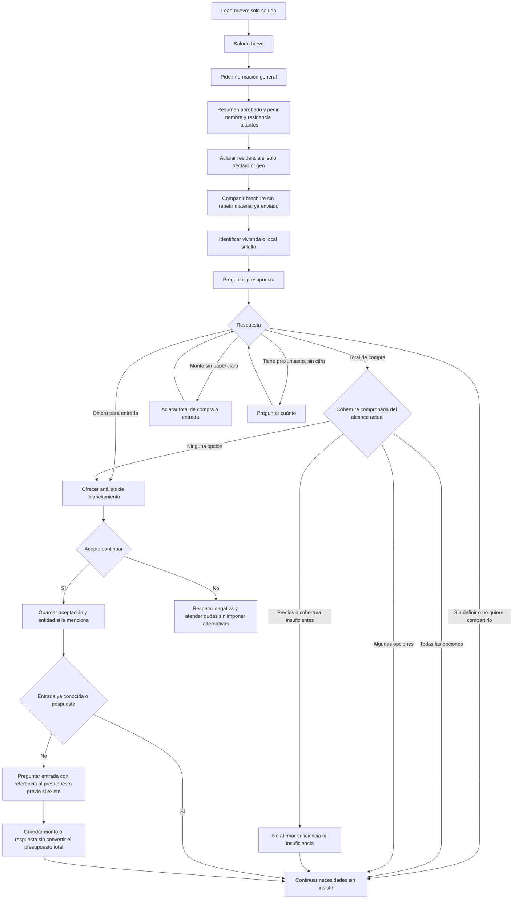
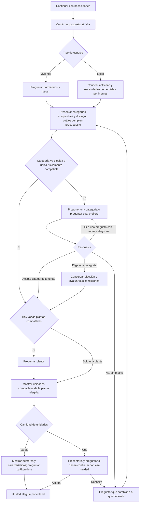

# Mapa de conversación y correcciones pendientes

Referencia del 12 de octubre de 2026 para definir el recorrido de un lead nuevo. Las seis correcciones autorizadas de presupuesto, aceptación con JEP, seguimiento en demostración, planificación antes de proyección, entrada independiente y aviso de precios están incorporadas al código. Los cinco ajustes posteriores de pregunta neutral, presentación y recomendación, dimensiones pertinentes, entrada antes de selección y pregunta contextual sobre el presupuesto también están implementados localmente; su despliegue y las pruebas del chat real siguen pendientes.

El recorrido principal coincide con presupuesto antes de dormitorios, categoría antes de planta y planta antes de unidad. El código permite saltar preguntas respondidas espontáneamente y continuar sin presupuesto. Después de aceptar financiamiento, pregunta la entrada si falta y retoma las necesidades y la selección pendientes; conserva una unidad o entidad ya elegidas. Las verificaciones locales cubren los fallos observados de selección con JEP, evaluación parcial del presupuesto y las nuevas etapas; las conversaciones reales serán la siguiente comprobación.

## Inicio y presupuesto

Este mapa distingue el saludo solo de una solicitud de información general. Se conserva el comportamiento aprobado: un «hola» recibe un saludo breve, como «Hola, ¿en qué podemos ayudarle?». La presentación y la solicitud de nombre y residencia comienzan ante una petición del lead. No se propone cambiar esta regla.

«Todas» y «algunas» corresponden únicamente al conjunto comprobado en ese momento. Todavía no se conocen todos los requisitos del lead. La comparación se actualiza al conocer dormitorios, categoría, planta y unidad; no se vuelve a preguntar el importe conocido. Una búsqueda inicialmente dentro del presupuesto puede quedar fuera al elegir penthouses de tres dormitorios.

Si cubre todas las opciones, se continúa con necesidades sin decirle que puede comprar cualquier cosa. Si cubre algunas, se recomiendan las compatibles con sus necesidades y presupuesto; puede pedir otras categorías. La comprobación corresponde a cada unidad y sus dormitorios, sin excluir una categoría entera por el precio de una de sus unidades. Si no cubre ninguna, se ofrece analizar financiamiento sin prometer aprobación. Aceptar financiamiento conserva preferencias: primero se conoce la entrada si falta y después se retoma la selección. No confirma una unidad ni transforma el presupuesto total en entrada.

Un máximo expresamente indispensable del precio del inmueble se conserva incluso con financiamiento. El presupuesto orientativo y la entrada son datos diferentes. La falta de presupuesto no equivale a insuficiencia.

## Necesidades, categoría, planta y unidad

Vivienda o local identifica el espacio; vivir, invertir o utilizarlo para su negocio identifica el propósito. La pregunta de espacio es neutral: «¿Le interesa una vivienda o un local comercial?». «Busco vivienda» no confirma que vaya a vivir allí; también puede comprarla para arrendarla. El extractor conserva por separado espacio y propósito. En la ruta actual el propósito que falta puede preguntarse después del presupuesto. Si el lead solo dice «inversión», el código puede preguntar presupuesto y aclarar después vivienda o local. Establecer que ambos se aclaren siempre antes del presupuesto es una decisión de flujo aún pendiente.

«Quiero invertir» y «quiero comprar para arrendarlo» pueden declarar propósito de inversión sin identificar el espacio. El extractor interpreta la intención en contexto y debe sustentarla con evidencia del mensaje actual, no solo detectar una palabra. «Quiero un departamento para invertir» declara además una categoría residencial. «¿Es una buena inversión?» es una consulta y no confirma por sí sola el propósito personal de compra. «Quiero arrendar un local para mi negocio» no equivale a comprar un local para arrendarlo a terceros. Un propósito nuevo no borra una categoría o unidad ya elegida.

La suite ya identifica una vivienda de un dormitorio; no hace falta preguntarlo de nuevo. Un local no sigue la rama de dormitorios. Cualquier dato ya declarado se conserva y permite omitir su pregunta.

La presentación y la recomendación tienen alcances distintos. Fuera del resumen inicial aprobado, si se enumeran las opciones residenciales generales se incluyen suites, departamentos y penthouses disponibles y verificados, sin desplegar fichas. Una recomendación con presupuesto y necesidades conocidos puede centrarse en unidades compatibles, sin añadir siempre las categorías que superan el importe. El tipo y los dormitorios se comprueban por unidad; los penthouses de dos y tres dormitorios no constituyen un mismo conjunto de precios.

Al preguntar presupuesto o dormitorios, el escritor recibe una presentación breve sin áreas estructuradas para evitar repetir fichas, salvo una consulta actual de características, cabida, accesibilidad, visualización o comparación pertinente. Las fuentes completas permanecen disponibles para el cálculo y la revisión. Las dimensiones pueden retomarse si el lead las solicita o si ayudan a comparar; no se obliga a repetirlas en cada paso.

«Sí» a «¿Le gustaría explorar los departamentos?» acepta esa categoría para explorar; no elige una unidad. «Sí» a «¿Prefiere departamentos o penthouses?» no identifica cuál. Si el lead ya pidió una categoría o una unidad concreta, no necesita otra aceptación genérica para volver a revisarla.

Cuando el presupuesto recomienda una sola categoría pero existen otras físicamente compatibles, se propone esa recomendación y se pide aceptación antes de planta. Si solo existe una categoría físicamente compatible, el código puede pasar directamente a planta. Exigir una confirmación de categoría en todos los casos sería una regla nueva.

La planta solo se pregunta si existen varias compatibles. Para penthouses exclusivamente en sexta planta, se indica la planta y se pasa a las unidades. Si pide una planta no disponible, se propone una alternativa específica verificada manteniendo dormitorios y presupuesto, y se solicita aceptación del cambio. Rechazar esa planta no permite reducir dormitorios automáticamente. No se pregunta nuevamente planta cuando ya está elegida.

Si no hay coincidencias físicas, financiamiento no resuelve dormitorios, dimensiones o plantas inexistentes. Se explica el requisito no disponible y, si existe una alternativa verificada y no contradice un requisito indispensable, se propone ese cambio concreto antes de avanzar. Una invitación genérica no cambia la búsqueda ni confirma unidad.

Esta aclaración y la aceptación de un ajuste pendiente preceden a la pregunta de entrada. Si una cantidad previa todavía no tiene un papel definido, se aclara si es presupuesto total o entrada antes de proponer reutilizarla; un total ya confirmado no necesita otra aclaración.

La indecisión significa dificultad explícita para elegir entre varias opciones compatibles identificadas. Puede justificar invitar a orientación en el lugar habilitado. Preguntar por precios, distribución o camas no constituye por sí solo indecisión.

## Después de elegir unidad

| Situación | Continuación actual |
| --- | --- |
| Ya aceptó financiamiento | Conservar unidad y entidad conocida. Preguntar entrada si todavía falta; después solicitar la entidad solo si falta y continuar con los datos pendientes. |
| Presupuesto total verificado cubre la unidad y perfil completo | Ofrecer iniciar la solicitud de reserva antes de ofrecer visita por rutina. |
| Presupuesto insuficiente y todavía no aceptó financiamiento | Ofrecer analizar financiamiento. Si acepta, conservar la unidad; si rechaza, respetar la negativa y atender sus dudas. |
| Presupuesto sin definir o pospuesto | Seguir orientando sin exigir cifra ni afirmar cobertura para ofrecer reserva. |
| Revisión financiera favorable vigente que cubre la unidad | Continuar hacia solicitud de reserva; datos recopilados por sí solos no equivalen a revisión favorable. |
| Rechaza la reserva | Puede ofrecerse atención o visita autorizada; no repetir la reserva rechazada. |

El procedimiento financiero actual pide entidad, nombre legal completo, cédula, tipo de trabajo y los datos laborales e ingresos que correspondan. Conserva lo ya respondido y valida lo incompleto. Una entidad elegida espontáneamente, como JEP, no debe volver a preguntarse.

El monto propio para la entrada se solicita como paso independiente después de aceptar continuar con financiamiento, antes de retomar la selección pendiente, únicamente si falta. Después se identifica la unidad de interés y se continúa con la entidad y los datos personales pendientes. Una unidad o entidad ya elegidas se conservan. Una entrada no definida o no compartida queda registrada y permite continuar orientando sin insistir ni inventar cero. No se transforma automáticamente un presupuesto total de 400 mil dólares en una entrada del mismo valor. Si el significado del monto inicial era ambiguo, se aclara al conocerlo, antes de compararlo con precios.

Cuando existe un presupuesto total previo, la pregunta recupera su importe real como referencia: «Antes nos comentó que tenía un presupuesto de $400.000. Para orientar el financiamiento, ¿destinaría ese monto a la entrada inicial del crédito o tendría prevista otra cantidad?». Si no hay un importe previo confirmado, se pregunta directamente cuánto tendría disponible para la entrada. La respuesta registra la entrada por separado; solo una respuesta explícita permite reutilizar como entrada el presupuesto citado.

Aceptar reserva inicia una solicitud para que el equipo gestione condiciones; no confirma una reserva del inventario. Aceptar una invitación a visita tampoco confirma una cita. Las solicitudes expresas de visita o de asesor mantienen sus propias rutas y no necesitan esperar a completar el recorrido comercial.

## Reglas que atraviesan todo el recorrido

- Responder las dudas actuales y retomar después el siguiente dato pendiente.
- Conservar nombre, residencia, propósito, presupuesto y papel del dinero, dormitorios, categoría, planta, unidad, entidad y decisiones válidas ya declaradas.
- Preguntar espacio sin presuponer finalidad: vivienda no significa automáticamente uso personal y local no significa automáticamente negocio propio.
- No convertir una confirmación del lead en una petición de repetir fichas o volver a elegir.
- Comunicar precios cuando se soliciten o cuando una diferencia comprobada sea indispensable para explicar la opción; no recitar precios, ubicación o lanzamiento por costumbre.
- Razonar con datos técnicos verificados sin garantizar cabida a partir de superficie total. Para dos camas hacen falta medidas de la habitación y las camas; puede ofrecerse consulta con el equipo en la oficina sin prometer planos disponibles.
- La demostración mantiene interpretación, flujo y permisos; las observaciones del borrador se registran sin bloquear su envío en el alcance autorizado.

## Correcciones implementadas localmente

1. Unificar afirmaciones de presupuesto por el conjunto exacto de unidades: opciones físicas, opciones dentro del importe, opciones fuera y precios pendientes de verificar. Evitar extender una cobertura parcial a todas las categorías.
2. Reconocer la aceptación actual de continuar con financiamiento y conservar la entidad indicada. Recuperar el acto de la pregunta realmente enviada cuando sus metadatos discrepen, sin convertir cualquier «sí» en autorización.
3. Separar seguimiento conversacional y calidad del borrador en demostración. Un desacuerdo de metadatos no debe borrar decisiones claras del lead ni alterar el flujo del extractor.
4. Planificar con evidencia canónica antes de compactar el contexto. Un catálogo omitido para el redactor no demuestra ausencia de opciones; no debe producir una invitación a flexibilizar requisitos.
5. Separar presupuesto orientativo, capital propio o entrada y límite indispensable de precio. Financiamiento no convierte uno en otro ni elimina un máximo expresamente obligatorio.
6. Incorporar monto de entrada como dato independiente después de aceptar financiamiento y antes de retomar la selección, si falta, sin repetir un papel monetario ya confirmado. La pregunta menciona el presupuesto total previo como referencia cuando existe, sin asumir que sea dinero propio. Presupuesto total, entrada y préstamo mantienen roles separados; la respuesta a la pregunta de entrada no sobreescribe el presupuesto comercial.
7. Añadir un interruptor central del aviso automático de precios referenciales y cambios, separado de mostrar precios y de su condición comercial real. Debe gobernar redactor, plantillas, revisión e inserción automática. Las condiciones se explican si el lead las pregunta.
8. Separar espacio y finalidad tanto en la extracción como en la pregunta: vivienda o local se identifica sin añadir uso personal o negocio propio no declarados.
9. Distinguir presentación general y recomendación según presupuesto y dormitorios. Si enumera la oferta residencial general, incluye las categorías disponibles verificadas fuera del resumen aprobado; una recomendación puede limitarse a las unidades compatibles.
10. Omitir medidas estructuradas del contexto del escritor durante las preguntas de presupuesto o dormitorios cuando no se pidan detalles. Conservar las fuentes completas para planificar y revisar, y permitir dimensiones ante una consulta concreta o comparación pertinente.

El aviso se configura en Automatización → Precios → Mostrar aclaración automática de precios referenciales → Guardar aclaración. Se conserva activado por defecto. Guardarlo controla las próximas respuestas; no modifica mensajes anteriores ni las cifras publicadas. El guardado exige permisos de administrador y evita sobrescribir cambios concurrentes del proyecto.

Las comprobaciones locales están agrupadas en `npm run test:flow-corrections`, además de `test:conversation-regression`, `test:extractor-model` y `test:price-notice`. Incluyen respuestas de IA simuladas, guardado con cliente de datos simulado y controles de interfaz aislados; no certifican la entrega en WhatsApp ni todas las futuras variaciones del modelo. TypeScript y ESLint forman parte de la verificación local. No se realizaron escrituras remotas, commit, push ni despliegue.

## Pendientes para la siguiente revisión

Actualización del 13 de octubre: se implementó únicamente la resolución estructurada de referencias monetarias. El extractor recibe `referencias_monetarias_confirmadas` desde la memoria canónica y devuelve `amount_reference_id` en presupuesto y cantidades financieras. Una referencia como «esos 100» puede conservar el importe confirmado de 100.000 sin repetir «mil»: el código valida el ID, el importe, la evidencia actual y la coherencia entre roles, sin volver a interpretar la cantidad abreviada. Los importes nuevos conservan sus controles y una referencia inexistente o contradictoria requiere reparación. La corrección no añade llamadas de IA; las pruebas usan salidas simuladas. Las demás correcciones de conversación, memoria, redacción y revisión siguen pendientes. Este cambio requiere despliegue del código y no necesita una migración de base de datos.

Revisión posterior del 13 de octubre: el lote «soy carlos» y «pero y que precio tienen los espacios??» confirmó el nombre y mantuvo residencia desconocida, pero `leadIntroductionTurn` planificó simultáneamente `brochure_required=true` y el recordatorio de residencia. La regla actual difiere de esperar hasta recibir la residencia; ajustar esa secuencia sigue pendiente. Los cambios autorizados en esta revisión muestran los datos originales del lead en las capturas nuevas (incluido `null`), conservan el filtro de credenciales y explican fallos de transporte/mantenimiento en la interfaz. El lote de las 12:59 generó tres registros de `KOMMO_UNAVAILABLE` para un único intento de iniciar Salesbot; no se conserva la causa de conexión específica del intento antiguo. Los nuevos registros distinguen conexión, timeout, lectura del cuerpo y respuesta HTTP, sin repetir automáticamente una escritura incierta. La configuración financiera continúa sin cambios: las referencias por defecto no permiten calcular una cuota mensual sin resolver los datos que faltan.

Actualización siguiente del 13 de octubre: se autorizó e implementó la secuencia de perfil antes del brochure. Cuando se pide el dato de presentación faltante, se difiere la entrega automática del material: nombre sin residencia pide solo residencia y entrega después de recibirla. También se aplica a residencia sin nombre. Se conservan las excepciones de solicitud directa del brochure, material previamente enviado, rechazo de datos y límite de un recordatorio. La corrección comprende decisión del servidor, instrucciones compartidas y pruebas; no modifica el cálculo de cuotas ni la recuperación de envíos inciertos. La cuota debe orientarse como crédito de la entidad elegida, que determina las condiciones finales, y no como crédito directo de La Vilet. Los ejemplos de simulación propuestos aún no cambian la política de cálculo.

Pendientes vigentes tras estos cambios:

- Guardado fiable de memoria, evitando el filtro HTTP que incluye todo el resumen; los fallos observados en las aceptaciones de tres dormitorios siguen sin corregirse.
- Conservar las decisiones actuales del lead aunque otro mensaje interrumpa el borrador o falle el envío.
- Registrar la propuesta exacta aceptada y distinguir necesidad original de cinco dormitorios de alternativa activa de tres; preguntar categoría o siguiente dato sin repetir el consentimiento.
- Conservar unidad, presupuesto, entrada y entidad ya confirmados; después de elegir 502/602, completar únicamente el trámite o dato pendiente y avanzar hacia solicitud de reserva o financiamiento según el caso.
- Reducir repeticiones de características y preguntas, conservar lo ya comunicado y no volver a pedir nombre o dormitorios confirmados.
- Validar el significado de las solicitudes del extractor; una petición general no pide automáticamente precios, entrega, financiamiento o recorrido. Reforzar la separación entre memoria histórica y novedades en los demás bloques.
- Asegurar una presentación inicial breve y completa, con su registro según el texto realmente enviado, y simplificar instrucciones y contexto por tarea.
- Mantener la secuencia comercial y las alternativas pertinentes; aún se debe definir si espacio y propósito siempre preceden al presupuesto y si se pide confirmación con una sola categoría compatible.
- Definir cuándo comunicar el precio de una unidad y mantener independientes la consulta atendida, la pregunta pendiente y las observaciones del revisor.
- Vincular precios, características y recomendaciones al conjunto correcto: rangos de dos frente a tres dormitorios, estudio solo donde existe, penthouses compatibles con el presupuesto y filtros exactos de las fuentes.
- Corregir falsos rechazos y reparaciones del revisor que cambian el alcance de una fuente; definir qué contradicciones verificadas bloquean incluso en demostración.
- Reconciliar intentos históricos inciertos, incluido Nathaly, y completar una recuperación de transporte que compruebe el historial antes de reintentar sin duplicados. El intento de Carlos de las 12:59 sigue incierto y su mensaje de las 13:35 quedó pendiente; los diagnósticos nuevos no lo resolvieron.
- Probar ciclos completos con mensajes agrupados, presupuesto, entrada, aceptación de alternativas, elección de unidad, revisión y continuación.
- Definir y autorizar la política de estimaciones mensuales con sus supuestos y límites, dejando la cuota final a la entidad financiera. Los textos más amables siguen como propuestas de estilo.

1. Asegurar la presentación aprobada en la petición inicial general y su registro según contenido efectivamente enviado. El brochure por sí solo no acredita que se haya presentado el resumen. Resolver instrucciones de estilo contradictorias con el resumen aprobado.
2. Continuar la reducción general de instrucciones y datos por tarea con un estado compartido, preservando todas las solicitudes, evidencias actuales y permisos. La planificación ya ocurre antes de la proyección; una reparación parcial debe seguir sin reinterpretar el historial como declaraciones nuevas.
3. Probar chats completos que recorran presupuesto parcial, cambio a penthouse, aceptación con JEP, entrada, elección de unidad y continuación, además de saludos, inversión, preguntas de medidas y rechazos. Las comprobaciones locales no demuestran que se eliminaron todas las posibles variaciones del modelo.

También permanece por definir, sin implementar: si espacio y propósito siempre preceden al presupuesto; y si se requiere confirmar exploración incluso cuando hay una sola categoría físicamente compatible. El saludo breve ante un saludo solo queda confirmado y no requiere modificación.

## Fuentes de código para contrastar el mapa

- `src/lib/integrations/automation/lead-introduction.ts`: saludo solo, presentación, residencia y brochure.
- `src/lib/integrations/automation/commercial-journey.ts`: presupuesto, categorías, plantas, unidades, rechazos, financiamiento, reserva e indecisión.
- `src/lib/integrations/automation/budget-state.ts`: cifra pendiente, presupuesto sin papel claro, total y entrada.
- `src/lib/integrations/automation/purchase-evidence.ts` y `conversation-rules.ts`: separación de espacio y finalidad declarados.
- `src/lib/integrations/automation/financing-entry.ts`: pregunta de entrada, referencia al presupuesto total y conservación del monto independiente.
- `src/lib/integrations/automation/financing-stage.ts`: conservar aceptación y entidad mientras se elige unidad.
- `src/lib/integrations/automation/financing.ts`: consentimiento, entidad y datos pendientes del procedimiento.
- `src/lib/integrations/automation/budget-orientation-rules.ts` y `response-content-scope.ts`: alcance de presentación, recomendaciones y dimensiones pertinentes para el escritor.
- `src/lib/integrations/automation/task-context.ts` y `turn-completeness.ts`: planificación canónica antes de proyectar el contexto enviado al modelo.

El estado de implementación es local. No confirma un nuevo despliegue ni modifica las ejecuciones anteriores.

## Actualización: Luna, cuotas y recuperación de envíos (13 de octubre)

El cambio de modelo no resuelve el guardado fallido de memoria ni sustituye las decisiones del flujo. Siguen siendo necesarias la persistencia fiable, conservar decisiones aunque se interrumpa una respuesta, registrar la propuesta aceptada, avanzar tras elegir unidad y usar precios/características del conjunto correcto. La regla de comunicación de precios y la presentación breve son decisiones comerciales que deben existir con cualquier modelo.

Los antiguos errores de clasificación de solicitudes, uso de historia como evidencia actual, redacción repetitiva y falsos rechazos del revisor deben evaluarse con Luna sobre las mismas conversaciones y el estado real. No se añaden por ahora nuevas reinterpretaciones literales del mensaje ni más remiendos de prompts para casos que Luna ya resuelve. Las repeticiones acreditadas por MEMORY_SAVE_FAILED siguen pendientes de corrección estructural.

Implementado localmente en esta actualización:

- La comprobación exige 3–300 caracteres tanto en pantalla como en servidor y muestra ese requisito. La observación de seis caracteres del caso ya no bloquea el botón.
- Una comprobación resuelve el lote de la misma respuesta, sin confundir otras incidencias del contacto. Puede encolar un solo reintento tras confirmar que no se envió. Guardar de nuevo la misma comprobación no duplica el trabajo.
- El reintento reutiliza el borrador conservado y no repite llamadas a IA ni operaciones comerciales. Respeta pausas, intervención humana, opt-out, ventana original de WhatsApp y cambios de memoria. Un nuevo resultado incierto necesita una nueva comprobación; se admiten como máximo dos reintentos comprobados por cadena.
- Las consultas y la asignación de los mismos campos de Kommo reciben reintentos limitados ante fallos temporales. Un lanzamiento de Salesbot solo se repite automáticamente tras un rechazo HTTP 429 explícito; una respuesta perdida del POST sigue requiriendo comprobar el historial.
- La pantalla muestra los reintentos pendientes y explica los motivos por los que un borrador dejó de ser reenviable. El guardado de memoria por RPC afecta solo a los nuevos reintentos; la corrección global de persistencia continúa pendiente.
- Política de cuotas: La Vilet no ofrece crédito directo; la entidad determina las condiciones y la cuota definitiva. Las cifras se calculan en servidor solo con unidad/precio, monto financiado, tasa y tipo de tasa y plazo verificables. No se configuraron tasas ni plazos hipotéticos. Sin datos suficientes se explica lo pendiente, sin iniciar una solicitud ni pedir documentos por una consulta informativa.

Para activar la recuperación se necesita aplicar `supabase/migrations/20261014100000_confirmed_delivery_retry.sql` y desplegar el código. La preparación local no cancela ni reenvía el intento histórico de Carlos ni otros mensajes. Queda pendiente comprobar esos intentos en producción y validar su recuperación después del despliegue. La búsqueda automática de prueba suficiente en el historial para resolver un POST incierto sigue pendiente; la ausencia de un webhook por sí sola no acredita que no se envió.

## Análisis del recorrido de las 14:00–14:22 (13 de octubre)

Las llamadas registradas usan Luna en extractor, redactor y revisor; el clasificador inicial de alcance conserva 4o-mini. Los turnos observados guardaron memoria correctamente y la aceptación de los $100.000 como entrada avanzó a dormitorios. Este caso no acredita que el problema de memoria de conversaciones más largas esté resuelto.

- Planos: la invitación aprobada del código ya dice «brochure digital completo con los planos». El redactor omitió «planos» en su propuesta inicial, pero el ajuste del código restauró la pregunta aprobada antes de revisar. La fuente `materiales_configurados.brochure` que recibió el revisor solo contiene tipo y URL. Sigue pendiente unificar la descripción aprobada del material entre redactor, ajuste del código y revisor. Declarar que contiene planos no acredita medidas de dormitorios ni que la IA haya examinado esos documentos.
- Aviso de precios: la ejecución conserva `aviso_precios_referenciales=true`; el ajuste guardado de `bot_pricing` solo especifica `launch_prices_visible=true`. La capacidad de desactivar el aviso ya existe, pero en este recorrido se aplica el valor predeterminado activo. No hay todavía una política de aviso único por conversación. Está pendiente resolver la repetición según la preferencia del usuario.
- Calidez: el perfil efectivo ya era elegante, calidez alta y detalle alto. La instrucción transversal, sin embargo, excluía introducciones y justificaciones de preguntas. Se ajustó localmente para permitir reconocer una decisión y explicar brevemente el siguiente paso real, sin imponer una frase ni repetir fichas, importes o muletillas.
- Invitación: se ajustaron el plan comercial y su obligación compartida para preguntar si le gustaría continuar con el financiamiento, sin preguntar por continuar el chat o por un análisis genérico. La función de consentimiento y los datos necesarios mantienen su significado.
- Comparación de precios: el extractor clasificó «los departamentos me interesan más porque los penthouses deben ser más costosos» solo como `property_options`. El contenido de precios quedó prohibido en el turno y el redactor recibió departamentos sin precios y ningún penthouse. Sigue pendiente reconocer comparaciones implícitas relevantes y recuperar un resumen verificado de los conjuntos comparados, conservando la preferencia por departamentos. No requiere enviar el catálogo completo. Al consultar la base, las opciones publicadas y disponibles de tres dormitorios eran departamentos de $250.000–$310.000 y penthouses de $539.900–$550.000. La entrada de $100.000 no acredita que el saldo esté financiado ni se trata como límite del precio total.

El revisor vigente (`business-risk-v2`) excluye tono, elegancia y longitud sugerida. Contrasta hechos del negocio, restricciones/promesas comerciales y obligaciones explícitas del turno; no reescribe el borrador. Quitar sus controles de operación, consentimiento o siguiente paso dejaría pasar respuestas con cifras correctas que prometen trámites no realizados o reinician decisiones ya confirmadas. La propuesta de reducir sus facultades permanece para evaluación; no se modificó su alcance en esta actualización.

## Correcciones anteriores autorizadas y caso de quinta planta

Se implementaron localmente las tres correcciones autorizadas después de ese análisis:

- La descripción aprobada del brochure declara que contiene planos y se comparte con redactor y revisor. No afirma acceso de la IA al PDF ni medidas de habitaciones verificadas.
- El aviso rutinario sobre precios se comunica una vez por conversación, tomando como comprobante las respuestas del bot registradas en el historial y conservando `_price_notice` en la memoria después de aceptar la respuesta. El marcador evita repetirlo cuando el mensaje inicial sale del historial reciente. Un mensaje del cliente o un borrador no lo suprime. Los permisos de precios y su naturaleza aproximada permanecen; las consultas expresas de vigencia y cambios se siguen atendiendo. Una conversación nueva tiene su propio primer aviso.
- El extractor dispone de `catalog_request.price_comparison` para identificar comparaciones de costo por categoría, incluidas las que justifican una preferencia sin signos de pregunta. El código conserva la preferencia y calcula rangos del inventario publicado disponible para los dormitorios conocidos. Los modelos reciben los dos rangos pertinentes; el inventario completo se conserva para verificar sus miembros. Una comparación no autoriza recomendar categorías rechazadas, cambiar unidad ni tratar una entrada como presupuesto total. No se calculan rangos completos con inventario parcial ni precios desconocidos.

Estos cambios son de código y no necesitan una migración nueva. No se ejecutaron llamadas a IA ni se enviaron mensajes al lead durante las pruebas locales.

El nuevo caso de las 14:42–14:44 se analizó solo para opinión, como solicitó el usuario. Los hechos confirmados conservaban tres dormitorios, pero la consulta anterior y la nueva consulta de quinta planta tenían `bedrooms=null`. Por eso se devolvieron el 502 de tres dormitorios y el 504 de dos. El plan ordenó `discover_bedrooms` pese al dato conocido; el redactor intentó resolver la contradicción con «¿mantengo esa preferencia?», y el revisor comparó esa pregunta con la captura errónea del plan. Sigue pendiente resolver esa pérdida del filtro y la coherencia entre hechos confirmados, consulta y siguiente paso; no se corrigieron en esta actualización. Tampoco se modificaron las facultades del revisor ni se añadió una promesa de mejores vistas.

# Ajustes autorizados de descuentos, precio con recorrido y tono — 13 de octubre

El responsable confirmó un descuento de lanzamiento del **10 % ya incluido en los precios publicados**, editable en Automatización → Conocimiento y reglas → Políticas comerciales → Descuentos (`/inmobiliaria/automatizacion/descuentos`). La migración `20261013180000_launch_discount_included_in_catalog.sql` registra esa regla para La Vilet desde el 13 de octubre, durante lanzamiento, sin modificar los precios de las unidades ni otras políticas. Conserva reglas existentes y las ediciones posteriores del administrador; una regla general activa incompatible debe resolverse en el editor antes de migrar. No se ejecutó la migración contra producción.

- Las consultas sobre existencia, porcentaje y aplicación de descuentos usan la política vigente. El porcentaje incluido no se resta otra vez y no requiere una reserva para explicar el precio. Sin precio original autorizado no se inventa el ahorro en dólares ni se reconstruye un precio anterior mediante cálculo inverso.
- El extractor distingue una consulta sobre ofertas publicadas de negociar una rebaja personal. La segunda inicia una derivación real al equipo, incluso con revisión en modo demostración. La consulta informativa no deriva por sí sola ni autoriza reserva, cita o revisión financiera.
- Al enviar el recorrido 360 de una unidad efectivamente seleccionada se exige comunicar su precio publicado autorizado. No abre los precios de otras unidades, no se activa con un recorrido general o una simple propuesta y conserva el aviso referencial una vez por conversación.
- No se añade por rutina la aclaración de que mencionar una reserva no reserva el inventario. Se conserva el estado real y se explica cuando el cliente pregunta por él, supone una reserva inexistente o hay que aclarar una gestión efectuada.
- El redactor no debe sugerir que una distribución podría no cubrir las necesidades de una familia numerosa. Describe características comprobadas para que el cliente valore su adecuación.
- El tono permite dos a cuatro frases y una transición útil, con trato cálido de usted, sin saludo repetido, pregunta de formulario ni relleno para alcanzar una longitud.

Las facultades del revisor y el caso de quinta planta se mantenían pendientes en esta actualización del 13 de octubre. Estos ajustes no sustituyen las correcciones pendientes de continuidad, propuestas y filtros. Se conservan las correcciones anteriores del brochure y de precios. Las pruebas simulan servicios: no realizan llamadas pagadas a IA ni envían mensajes a WhatsApp.

## Revisor limitado a hechos y promesas — 14 de octubre

El usuario autorizó aplicar la separación de responsabilidades. El revisor recibe el alcance `facts-and-promises-v1` y comprueba únicamente datos afirmados y condiciones o promesas comerciales: precios, unidades, superficies, dormitorios, plantas, ubicación, estado publicado, descuentos, financiamiento y operaciones realizadas. El esquema de la revisión comercial excluye `turn_goal` y exige `question=null`. Los controles de flujo y los datos pendientes no se suministran como obligaciones del revisor ni como fuentes factuales.

La pregunta guardada procede del redactor y de los controles del sistema. El revisor ya no puede cambiarla ni activar reparaciones por su clasificación. La captura autorizada y la continuación que el sistema sí puede comprobar se validan antes de llamar al revisor. Los avisos, el brochure, la presentación aprobada y los pasos definidos conservan sus instrucciones y controles propios; el revisor no decide cuándo comunicarlos.

Se limitan también las rutas antiguas: sus campos de pregunta, captura, cobertura, omisiones, presentación y datos faltantes no pueden reintroducir esas facultades ni producir una derivación. Un `turn_goal` histórico devuelto fuera del contrato se registra como ignorado; contradicciones numéricas y promesas sin respaldo conservan sus validaciones y reparación de redacción. Las faltas de información que el redactor identifica siguen pasando por la comprobación de fuentes y las políticas del sistema; no las inventa el revisor.

La interfaz de Pruebas y revisión explica el nuevo alcance. Esta modificación no requiere migración ni cambia los modelos. Las demás correcciones pendientes de propuestas, filtros y planificación, incluido el caso de quinta planta, siguen pendientes. Los tests anteriores que exigían al revisor dirigir el flujo se actualizaron para verificar que esa responsabilidad permanece en el redactor/sistema y que los hechos siguen protegidos.

## Calidez y conservación de la redacción inicial — 14 de octubre

En la ejecución de las 10:35, el redactor escribió «Hola, con gusto le comparto información» y el revisor aprobó el borrador. `protectInitialProjectPresentation` reconstruyó después el mensaje con el resumen y la pregunta fijos, eliminando esa cortesía y la redacción del modelo. La protección se aplicaba también después de la revisión final.

El resumen aprobado sigue siendo fuente de hechos y el contrato exige una presentación breve y la pregunta de perfil pendiente, con redacción libre. La preparación conserva los borradores producidos por el redactor y su procedencia en `initial_presentation`, tanto con revisión activa como en demostración o desactivada. Los controles de datos, enlaces, perfil y continuación mantienen su política habitual; la demostración no certifica aprobación factual. Las plantillas de ruta y recuperación todavía se completan con el resumen aprobado, una apertura amable y los datos realmente pendientes. No se añaden llamadas a IA para comprobar el tono ni se devuelve esa facultad al revisor.

La calidez alta ahora pide una disposición visible al ayudar, una apertura amable en la primera solicitud de información y transiciones útiles en las continuaciones. No exige cortesías en todos los turnos. Se elimina la instrucción obsoleta que pedía al revisor aceptar el estilo. El usuario autorizó seleccionar Cercano con calidez y detalle altos en la configuración editable, conservando el perfil anterior para restaurarlo. Este ajuste no requiere migración.

Verificación reproducible: `npm run test:warm-opening` incluye la redacción original, una paráfrasis de los hechos, las tres modalidades de revisión, las dos preparaciones finales, la pregunta de perfil y la recuperación de una plantilla inválida. Las otras correcciones pendientes continúan registradas sin cambiar su estado.

## Contado, avisos de reserva y diagnóstico de descuentos — 14 de octubre

- Nueva sección Conocimiento y reglas → Políticas comerciales → Pagos al contado (`/inmobiliaria/automatizacion/contado`). Permite definir significado, momento del pago, tratamiento de reserva, gastos y política de descuentos adicionales, con etapa y fuente comprobada. Parte desactivada y sin condiciones financieras inventadas. Un campo vacío queda por confirmar; el proyecto conserva `credito_directo=false`. Los porcentajes siguen en Descuentos: no hay una segunda fuente ni acumulación automática. Los guardados son de administrador y comprueban la versión para conservar otras políticas.
- El bot y su revisión factual reciben `politica_pago_contado`. La configuración desactivada, fuera de etapa o con fuente pendiente de revisión no autoriza comunicar sus condiciones. La política distingue un descuento adicional por contado de un beneficio de lanzamiento ya incluido.
- La pantalla de descuentos añade el diagnóstico de las reglas guardadas, con etapa actual, vigencia, cantidad de unidades aplicables y motivos por los que no pueden comunicarse. Incluye instrucciones para configurar el 10 % ya incluido sin descontarlo dos veces. Un error del diagnóstico no convierte un guardado exitoso en fallido.
- En la prueba de 11:12, el escritor recibió descuentos desactivados. A las 11:14 y 11:17 recibió activación global pero `rules=[]` en las ofertas aplicables. Al revisar después, la configuración guardada tenía `enabled=true` y ninguna regla. Estas observaciones no demuestran cuál de los campos de una eventual regla anterior causó su exclusión; no se reactivó ni se sobrescribió la política del administrador.
- Nueva alerta modal urgente para solicitudes de reserva persistidas y cambios del lead a `reservado`. Solo la recibe su asesor activo dentro del mismo proyecto. Si la solicitud está en cola, avisa al asignar un responsable. El modo de pruebas conserva el destinatario real del flujo existente. No se envían avisos externos ni se reserva inventario al mostrar el modal.
- La alerta se cierra al reconocerla y guardar su lectura, sin Escape ni clic fuera. Un fallo al guardar mantiene el aviso. Las notificaciones se deduplican por evento y destinatario; el listado incluye reservas no leídas aunque sean anteriores a las últimas asignaciones. El borrado de una solicitud durante el reinicio elimina su alerta asociada por clave foránea. Un cambio que deja atrás el estado reservado retira la alerta de confirmación pendiente. Se mantiene el acceso privado de las notificaciones existentes.
- Requiere la migración `20261014180000_urgent_reservation_notifications.sql`, preparada y comprobada localmente, sin ejecutar en producción ni generar notificaciones reales. Las reglas de contado y el diagnóstico usan la estructura de políticas existente.

La forma de retomar el flujo quedó solo analizada, como solicitó el usuario: conservar una aceptación de financiamiento al responder una duda; distinguir una consulta por contado de una elección de esa modalidad; no repetir la captura de entrada tras cada aclaración; y no introducir una estimación de cuotas cuando la duda actual es sobre aprobación. Se propone resolver la duda y usar una transición pertinente cuando corresponda retomar, o responder sin otra pregunta si el cliente sigue aclarando. Esos cambios de planificación y continuidad siguen pendientes; este turno no modifica ese recorrido.

Pruebas: `npm run test:cash-reservation` verifica reglas, acceso, concurrencia, diagnóstico, fuentes para revisión y migración en PostgreSQL aislado. `npm run test:cash-reservation-ui` verifica el editor en escritorio/móvil y el modal, incluido fallo de guardado de lectura, sin usar servicios reales.

## Recomendación, calidez y bucle de dormitorios — análisis y aplicación del 14 de octubre

El usuario pidió primero analizar los casos de 11:47–12:09 y de 12:22–12:27 y guardar sus correcciones. En ese turno solo se documentaron. Posteriormente autorizó aplicar juntas todas las correcciones de estos análisis y las cuatro de continuidad financiera descritas arriba. La implementación local queda descrita al final de este bloque; las demás pendientes anteriores conservan su estado.

### Evidencia del caso anterior: cinco dormitorios y elección de penthouse

- A las 11:47, el extractor entendió cinco dormitorios y dejó `bedrooms_required=null`; «unos cinco cuartos más o menos» no fue declarado indispensable. El plan no creó una alternativa: evaluó los USD 50.000 como `maximum_total` y los usó como límite del precio al proponer otras opciones, pese a que `financiamiento.entry.amount=50000` y el financiamiento estaban aceptados. La pregunta de flexibilización fue una instrucción del plan, no una recomendación omitida espontáneamente por el redactor.
- A las 12:05, el lead aceptó revisar tres dormitorios. La ejecución presentó las opciones 602 y 605, publicadas y disponibles, con 142,09 y 140,53 m² interiores. El revisor produjo un `block/hard_fact` cuya propia justificación decía que los datos estaban respaldados y no había afirmaciones falsas; fue una revisión contradictoria y se observó sin bloqueo.
- A las 12:08, el extractor entendió `category=penthouse`, `operation=select` y una respuesta a `property_category`. La elección llegó junto con comentarios sobre amplitud y familia. La condición de reconocimiento del código dependía de formulaciones literales/cortas, no trató ese conjunto como la elección de categoría ofrecida y devolvió `category_change` con opciones vacías. La consulta posterior mantuvo `scope=offered` sobre ese conjunto vacío. La afirmación de ausencia de penthouses de tres dormitorios procedió de ese resultado defectuoso, no de una comprobación correcta del inventario.
- El estilo Cercano, calidez 2 y detalle 2 sí estaba en las instrucciones efectivas. Seguía habiendo una contradicción: `dialogue-writing-rules.ts` permitía decir que «una distribución puede resultar ajustada según las necesidades», mientras `needs-guidance.ts` prohibía sugerir insuficiencia para una familia numerosa. Las precauciones sobre adecuación se convirtieron en advertencias no solicitadas. El revisor no reescribió ese mensaje; en demostración se envió el borrador.

### Evidencia del caso nuevo: elección del 605 y confirmación repetida

- A las 12:22, «pero si ya escogí los penthouse» llevó a consultar el alcance del catálogo y el escritor presentó correctamente 602 y 605. La pregunta entregada fue cuál de las dos revisar.
- A las 12:24, los dos mensajes «prefiero el que tiene más baños» y «¿qué precio tiene?» se procesaron juntos. El extractor identificó correctamente una selección relativa de `unit_numbers=[605]`, con confianza alta, y la consulta de precio. No era necesario que el lead escribiera el código 605: las opciones ofrecidas diferenciaban inequívocamente dos y tres baños.
- La resolución del código devolvió `category_change`, sin coincidencias ni `selected_ids`, aunque la consulta de precio pudo identificar el 605 y responder USD 539.900. Nombrar correctamente una unidad en el texto no dejó su elección confirmada en el estado.
- Los tres dormitorios seguían en los hechos: `qualification.dormitorios_texto="de 3 opciones me parece bien"` y `housing_quantities` contenía un requisito de tres dormitorios con confianza media aceptada. Sin embargo, la última declaración de categoría había sustituido `memory.property` completo por un objeto con filtros nulos. La consulta activa también tenía `bedrooms=null` y el CRM `preferred_bedrooms=null`. El plan no usó aquella cantidad confirmada y ordenó `discover_bedrooms`.
- El escritor convirtió esa orden en «¿Le funciona esa cantidad de dormitorios?», pese a que ya se estaban revisando tres. La pregunta se guardó como `property_bedrooms/confirm_bedrooms`, sin `proposed_query`, cantidad estructurada, `candidate_ids` ni `target_ids`: quedó sin el referente que un sí necesita confirmar.
- A las 12:26, el extractor reconoció correctamente «si si est abien» como `answer_to_previous.kind=affirmative`, confianza alta, para `property_bedrooms`. La rama de aceptación del código requiere una propuesta estructurada; al faltar, no recuperó los tres dormitorios. El plan volvió a ordenar `discover_bedrooms` y el escritor respondió «Perfecto. ¿Cuántos dormitorios necesita?». El revisor aprobó los hechos de estos mensajes y no fue quien decidió repetir la captura.

### Correcciones autorizadas e implementadas localmente

1. **Roles del dinero:** impedir que una entrada confirmada siga excluyendo alternativas por el viejo límite de precio total. Conservar el historial de declaraciones, pero usar el rol vigente para la decisión comercial, sin asegurar capacidad de crédito.
2. **Recomendación concreta ante ausencia real:** recuperar alternativas verificadas cercanas —por ejemplo, tres dormitorios y mayor amplitud— y explicar por qué merece revisarlas. Una búsqueda exacta sin resultados no debe dejar al cliente sin orientación cuando existen alternativas pertinentes. Respetar negativas y requisitos realmente indispensables, sin prometer que otra distribución satisface todas sus necesidades.
3. **Categoría en mensajes agrupados:** aplicar la elección semántica confirmada a las opciones ofrecidas aunque venga acompañada de comentarios, correcciones o varios mensajes. Mantener dormitorios, exclusiones y requisitos ya aceptados; no vaciar el conjunto al cambiar únicamente la categoría.
4. **Ausencia real frente a conjunto perdido:** distinguir un conjunto de referencias vacío o mal resuelto de una consulta completa sin stock. Recuperar la fuente autorizada pertinente antes de comunicar ausencia o forzar a elegir entre requisitos compatibles.
5. **Estado de preferencias por campo:** una declaración nueva de categoría no debe borrar dormitorios no modificados. Separar hechos confirmados, condiciones activas de búsqueda y preferencias originales de las alternativas aceptadas. Si una consulta de unidad limpia filtros antiguos, los hechos aceptados siguen siendo utilizables para el siguiente paso.
6. **Selección relativa de unidad:** validar una elección como «la de más baños» dentro del conjunto ofrecido y persistir la unidad inequívoca, sin exigir su código literal. Procesar conjuntamente elección y consulta de precio; responder el precio no sustituye la actualización del estado de selección.
7. **Confirmaciones con referente:** guardar qué cantidad, unidad o propuesta corresponde a cada pregunta. Un sí validado debe resolver ese referente y avanzar; no convertirse en una captura abierta del mismo dato. No guardar preguntas de confirmación sin el dato que se confirma.
8. **Plan coherente con decisiones conocidas:** antes de pedir dormitorios, comprobar hechos aceptados, alternativa vigente y unidad seleccionada. No reabrir categoría, dormitorios o planta solo porque un campo transitorio esté vacío. Retomar el siguiente dato real del financiamiento o la gestión autorizada.
9. **Lenguaje comercial positivo:** comunicar una limitación real brevemente y ofrecer una vía concreta comprobada. Evitar narrar «catálogo», «búsqueda», «coincidencias», «filtros» o resultados técnicos al explicar disponibilidad. Esto no prohíbe responder sobre el material llamado catálogo cuando el lead lo pide.
10. **Calidez sin advertencias rutinarias:** eliminar las instrucciones contradictorias sobre familias, describir ventajas verificadas y reconocer sus preferencias con naturalidad. Usar cautelas concretas cuando son pertinentes a la consulta, sin desacreditar una elección ni emitir juicios sobre la familia. Recomendar no equivale a garantizar adecuación, financiación ni reserva.
11. **Revisión contradictoria:** registrar y tratar como defecto de revisión un hallazgo que bloquea mientras su justificación afirma que los mismos hechos son correctos. Mantener el alcance factual del revisor, sin devolverle decisiones de flujo, capturas o tono.

### Implementación conjunta

- Las alternativas usan un límite total declarado cuando corresponde. El importe antiguo que el lead confirmó después como entrada para un financiamiento aceptado no se reutiliza como techo del precio. Se mantienen separados ambos registros; un máximo total actual o independiente conserva su efecto.
- La memoria actualiza preferencias por campo y conserva dormitorios y planta al cambiar de tipo dentro de viviendas. Cambiar a locales inicia sus propias necesidades. La consulta y el plan recuperan los filtros confirmados y la alternativa aceptada cuando faltan en la consulta transitoria.
- La elección de una categoría ofrecida se aplica por su interpretación validada aunque incluya explicaciones o varios mensajes. Una categoría nueva consulta las opciones pertinentes; no busca dentro de la unidad anterior. Una selección relativa valida los identificadores interpretados contra las opciones ofrecidas y disponibles, y conserva la unidad aunque el mismo grupo también pregunte su precio.
- Una confirmación de dormitorios guarda una propuesta con la cantidad y el sujeto verificados. El sí posterior conserva esa cantidad y la unidad previa; no vuelve a abrir la captura. Un conjunto de referencias vacío se trata como referencia por aclarar, no como ausencia acreditada de stock.
- Se retira la instrucción sobre distribución ajustada y familias que comparten habitaciones. El redactor recibe una regla general de recomendación amable: limitación breve, alternativa comprobada y utilidad concreta; sin narrar búsquedas ni añadir cautelas familiares no solicitadas. Las garantías comerciales siguen exigiendo respaldo.
- La aceptación más una duda explicativa conserva el consentimiento, sin aceptar condiciones de aprobación. El extractor distingue consultas sobre contado, procedimiento, aprobación y cuota mensual. Las dudas consecutivas pueden suspender la repetición de la captura: se conserva la última pregunta realmente enviada y se retoma el dato pendiente después. Consultar contado no cambia la modalidad ni revoca el financiamiento. La transición tras la entrada explica que escoger una vivienda permitirá conocer su precio y el saldo por financiar.
- Si un hallazgo factual bloquea citando fuentes cuyos datos numéricos su propia revisión verifica, se solicita una única revisión de sus metadatos sobre el mismo borrador, también en demostración. No se aprueba automáticamente el mensaje ni se borra un rechazo persistente; el revisor debe identificar el error real o corregir su veredicto. Conserva exclusivamente sus facultades sobre hechos y promesas.

Verificación reproducible: `npm run test:conversation-continuity` reproduce cinco dormitorios aproximados → aceptar tres → penthouse con comentarios agrupados → elegir más baños y preguntar precio → sí, conservando USD 50.000 de entrada y el 605. Incluye quinta planta con tres dormitorios, límites totales independientes, referencias inválidas y reparación de revisión contradictoria. La prueba del recorrido real hasta el envío simulado responde dudas consecutivas de procedimiento, aprobación y contado, conserva la pregunta anterior y después avanza al recibir la entrada, tanto en revisión normal como en demostración. Pasaron 73 pruebas de continuidad, 1.125 de regresión general, 82 de controles comerciales y 92 de apertura y calidez; también TypeScript, ESLint y comprobación del diff. Estos conjuntos se superponen. Las pruebas simulan la IA y los servicios; no envían WhatsApp ni realizan llamadas pagadas. Los cambios no requieren migración ni cambian modelos o configuración publicada; necesitan desplegar el código para alcanzar las conversaciones reales. La calidez se orienta mediante instrucciones coherentes y sigue admitiendo redacción libre del modelo.

## Correcciones de saludo, materiales, objetivos y prioridad por amplitud (14 de octubre)

Autorizadas las dos propuestas posteriores al análisis de las capturas de las 12:40–13:24. Implementadas localmente:

1. **El redactor conserva el mensaje completo.** Las etapas posteriores ya no insertan saludos, preguntas del plan, brochure ni avisos de precio en una respuesta del redactor. Aplica a revisión normal, demostración y revisión desactivada. Los materiales necesarios forman parte del contrato del redactor; un enlace omitido se diagnostica y, con revisión normal, se solicita reparar al redactor. No se completa con texto del servidor. Las respuestas de recuperación y los mensajes de sistema que no proceden de un redactor conservan su tratamiento operativo.
2. **Objetivos en vez de preguntas literales.** La proyección enviada al redactor elimina `question`, `next_question`, `suggested_question` y las plantillas de respuesta de los planes. Conserva objetivos, campos pendientes, permisos, IDs y sujetos verificados. El historial real del diálogo permanece como evidencia, sin convertir sus preguntas en plantillas obligatorias. Las palabras de una nueva pregunta y su ficha corresponden al redactor; no se rechazan por comparación de palabras o por un acto deducido con el clasificador limitado del código. Las referencias antiguas sin ficha válida conservan su compatibilidad, sin reescribir el mensaje.
3. **Calidez y saludo único.** Se orienta a hablar de preferencias («le gustaría», «prefiere», «tenía pensado»), explicar la utilidad del siguiente paso cuando ayude y evitar preguntas de formulario. Las cortesías no son prefijos automáticos. Se recupera evitar exclamaciones innecesarias, sin una prohibición absoluta. «Saludos» ya no recibe otro «Hola» añadido después de redactar.
4. **Mención y solicitud de material separadas.** `material_request=none` con confianza aceptada prevalece sobre el antiguo detector de palabras; mencionar el brochure recibido no solicita reenviarlo. La misma decisión se usa al preparar la ruta y al construir el contrato de enlaces. Consultar cobros de acceso se interpreta como `common_area_access`, separado de precio de compra, presupuesto, entrada y envío de material.
5. **Prioridades y restricciones persistidas por separado.** El extractor entrega `selection_preferences` con evidencia actual: dormitorios indiferentes, requisito cambiado y prioridad de amplitud interior. Una indiferencia explícita elimina la restricción de dormitorios y evita resucitarla desde el CRM, la memoria o requisitos de consultas anteriores. El plan puede pasar a departamentos/penthouses y, elegido el tipo, presentar las dos opciones con mayor superficie interior verificada dentro de los requisitos reales. Sus dormitorios son características de las unidades, no una necesidad inventada. «Mínimo dos» conserva `gte=2`, admite tres y mantiene la prioridad de amplitud. Una confirmación de prioridad dispone de `property_priority/confirm_priority`; un sí no depende de una propuesta inexistente de dormitorios.
6. **Búsqueda y planificación comparten el alcance resuelto.** Un cambio actual de restricciones puede consultar el inventario cuando no hay opciones ofrecidas; todos los consumidores reciben ese alcance. Un conjunto relativo perdido sigue siendo una referencia sin resolver: no se convierte en ausencia de stock ni se amplía silenciosamente para responder un ranking entre «estas» opciones.
7. **Política aprobada de áreas comunes.** La migración `20261014160000_common_area_access_policy.sql` registra y publica, únicamente en el proyecto y tenant indicados, el acceso de residentes o propietarios sin cobro adicional por acceder. No define gratuidad de alícuota o mantenimiento ni permisos de visitantes. Se edita en **Conocimiento y reglas → Políticas comerciales → Acceso a áreas comunes**. La migración conserva las demás políticas y no sobrescribe una versión existente, editada o pausada al ejecutarse de nuevo. La antigua instrucción fija de que no existían condiciones verificadas se sustituye por consultar las políticas publicadas.
8. **Resultado de IA separado de controles del sistema.** El flujo muestra por separado la aprobación factual de la IA y las incidencias del control final. Los registros históricos de `commercial_next_question_mismatch` se identifican como observaciones del código; ya no aparentan un rechazo de la IA. El historial de intentos incluye también los códigos conservados en `final_validation.issues`. Una derivación realizada después del primer borrador solicita un mensaje completo actualizado al redactor con su resultado confirmado; no añade un aviso por concatenación.

Verificación: `npm run test:writer-ownership` cubre la secuencia de prioridades, elección de tipo, mínimo de dormitorios, referencias perdidas, texto intacto en los tres modos, mención del brochure, separación de resultados y migración editable e idempotente en PostgreSQL aislado. Pasaron las 1.125 pruebas de regresión conversacional, 92 de apertura/calidez, 82 de controles comerciales y 111 del registro de mensajes. La interfaz se comprobó en navegador aislado en escritorio y móvil, incluida la aprobación de IA con observación del código. No se enviaron mensajes reales ni se hicieron llamadas pagadas a modelos.

**Activación:** desplegar el código y aplicar la migración de áreas comunes. Los registros históricos no se reescriben; la nueva interfaz explica su procedencia. La calidez y la formulación son instrucciones para el redactor, no frases prefijadas ni una garantía de que todas sus respuestas usen las mismas palabras.

### Correcciones aplicadas el 15 de octubre: idioma, citas y recomendaciones

- El extractor identifica el idioma de respuesta y conserva una preferencia explícita. Las respuestas breves, cifras, nombres y códigos no deben cambiarlo. Se persiste por conversación y se entrega a todas las llamadas de redacción; las rutas financieras dejan de imponer español y la transcripción de audio detecta el idioma. El aviso operativo de recuperación dispone de versión inglesa cuando el idioma guardado es inglés.
- La validación de evidencia informativa admite mensajes actuales completos citados en orden aunque haya otros mensajes intermedios. Reconstruye el tramo literal completo, incluidas sus negaciones, y no convierte fragmentos históricos o inventados en fuentes. Presupuesto, selección, visitas y permisos conservan sus comprobaciones separadas. Esto resuelve el fallo reproducido al citar «Quiero lo más bonito» y «Y quiero tener la mejor vista» alrededor de la declaración de jubilación.
- Las instrucciones de redacción vinculan la cortesía con la ayuda concreta, evitan el saludo de nuevo ante una duda intermedia, la redundancia «vivienda para vivir», rangos con un solo extremo y la expresión «comparten sala» para interiores privados. Una intención inmobiliaria general recibe una presentación breve de la oferta real antes de los datos pendientes; «building» no autoriza ofrecer construcción por encargo o edificios enteros.
- Ante una cantidad deseada superior a tres dormitorios, sin condición indispensable ni rechazo previo, una alternativa verificada puede incluir penthouses de mayor superficie interior fuera del presupuesto. Se distinguen expresamente de las alternativas dentro del importe. Elegir una categoría ofrecida permite explorar esa distribución, conserva el presupuesto y no lo convierte en entrada, selección de unidad ni consentimiento financiero. No se infiere automáticamente una prioridad por amplitud de la cantidad de dormitorios.
- Una petición actual de recomendación puede presentar una unidad concreta sin exigir primero categoría o planta. La prioridad de vistas se conserva por separado y permite proponer una planta alta para comparar; no acredita una mejor vista por unidad. Las descripciones positivas de áreas comunes mantienen su alcance y llegan al redactor también si la preferencia se extrae como búsqueda.
- Una consulta de superficie o precio por metro conserva las fichas pertinentes en el contexto. Se entregan interior, exterior y su suma calculada, sin sustituir el total oficial. El promedio de precio sobre ambas áreas se distingue del promedio interior y de una tarifa oficial. La revisión comprueba los operandos y su pertenencia a la misma unidad; admite redondeo a centavos en USD/m², sin inventar ponderaciones, gastos ni precios de terceros. Un exterior sin registrar sigue siendo desconocido.

Pruebas reproducibles: `npm run test:language-guidance`, además de regresión conversacional, propiedad del mensaje y ensamblaje de prompts. Las llamadas de modelo se sustituyen en estas pruebas; no se envían mensajes reales. Se actualizaron las expectativas antiguas del ensamblaje para distinguir obligaciones factuales de editoriales y la protección de credenciales de la conservación de datos de negocio autorizados; ese comportamiento existente no se modificó.

Activación de este grupo: desplegar el código. No requiere una migración adicional ni cambia las fichas, precios o descripciones publicadas en la base de datos.

### Correcciones de continuidad, piscina y recuperación — 15 de octubre de 2026

- La presentación recibe los objetivos de nombre y residencia sin exigir una justificación fija sobre brochure o guía personalizada. El saludo aislado se redacta con IA, con hora verificada de Ecuador, nombre público y oferta de ayuda; se conserva el mensaje completo del redactor. Una consulta concreta se responde antes de pedir los datos autorizados. Un reinicio de prueba no recupera automáticamente decisiones de una conversación eliminada.
- En Conocimiento → Proyecto → Instalaciones y piscina se puede permitir o restringir el acceso de huéspedes de alquiler temporal. La regla inicial aprobada permite residentes y excluye huéspedes de Airbnb. Un inquilino que reside en el edificio se distingue de un huésped temporal. No modifica cobros, alícuotas ni permisos de otras instalaciones. El control requiere administrador, conserva otras políticas y detecta cambios concurrentes. La migración `20261015180000_pool_temporary_guest_access.sql` persiste el valor inicial sin sobrescribir un ajuste existente; el código también reconoce el valor aprobado por defecto.
- Una respuesta sobre entrada todavía no definida o no compartida queda separada del presupuesto total. La elección de unidad, dormitorios, entidad y aceptación se conserva. Con unidad y condiciones del procedimiento confirmadas, se continúa con los datos pendientes permitidos; solo el cálculo de saldo/cuota concreta espera el aporte. El plan consulta los mismos dormitorios resueltos que la búsqueda, aunque el campo de la consulta transitoria esté vacío.
- Las invitaciones a comparar categorías usan `property_comparison`/`compare_properties`, categorías y dormitorios de las opciones comparadas. La aceptación recupera ambas partes de la comparación, no elige una unidad ni pregunta otra vez si desea comparar. Una duda intermedia puede dejar la captura pendiente también fuera de financiamiento.
- El extractor puede citar mensajes actuales mediante IDs consecutivos. Se reparan diferencias de formato sin cambiar cifras, negaciones ni orden. Las selecciones con mensajes intermedios reciben una revisión enfocada que conserva la propuesta y vuelve a leer el turno completo. Una reparación certificada por IA puede reconstruir el tramo completo, incluidos sus mensajes intermedios. No se reconstruyen permisos, identidad o importes mediante estos IDs. Las citas rechazadas e históricas se excluyen del contexto de reparación.
- Si la IA identifica una preferencia inmobiliaria todavía ambigua después de reparar, puede autorizar una aclaración específica conservando los demás datos válidos. Esto no autoriza acciones, no acepta bloques monetarios o permisos fallidos y no convierte cualquier error en una respuesta válida. Las salidas vacías, JSON inválido o truncamiento del extractor tienen como máximo una recuperación adicional, dentro del mismo plazo. Los errores de autenticación no se reintentan como errores de formato. La lectura de inventario y financiamiento reintenta fuentes fallidas, sin presentar un fallo de lectura como falta de disponibilidad.
- El aviso de recuperación en español queda exactamente: «Permítanos revisar ese detalle con nuestro equipo para orientarle mejor.». No se le añade otro saludo ni una frase final sobre el asesor. Su entrega conserva la comprobación de derivación real, permiso de respuesta y mensajes pendientes.

Verificación local: `npm run test:extractor-recovery`, `npm run test:conversation-continuity` y `npm run test:conversation-regression`, además de TypeScript y ESLint sobre los archivos modificados. Se cubren citas divididas, CRLF, líneas vacías, comillas, Unicode, emojis, stickers, correcciones, negaciones, referencias ambiguas, PH605/JEP con entrada pendiente, comparación entre tipos y migración de piscina. Las llamadas externas se sustituyen; no se envían conversaciones reales ni se aplica una migración remota durante estas pruebas.

Comprobaciones heredadas: `test:conversation` conserva 82 fallos y `test:budget-financing-recovery` conserva 3. Se reprodujeron los mismos recuentos contra el código de HEAD anterior a estas correcciones mediante un cargador aislado, sin revertir archivos de trabajo. Estos conjuntos antiguos se distinguen de `test:conversation-regression` (1.125 pruebas), que pasa completo.

## Registro de incidentes y diagnóstico del 15 de octubre

Se consolidan **88 escenarios** en [casos-regresion.json](casos-regresion.json). Incluyen los incidentes de esta conversación, los del mapa y los del [registro del 7 de octubre](correcciones-pendientes-conversacion-2026-10-07.md). Cada caso conserva ID estable, fuente, estado inicial, mensajes agrupados, comportamiento observado y resultados esperados. Los UUID de eventos permiten localizar las evidencias internas sin copiar nombres, teléfonos, documentos personales ni prompts privados al repositorio.

El corpus es una especificación para pruebas futuras: **no se han ejecutado sus simulaciones**. Los casos históricos llevan `historical_requires_recheck`, aunque existan correcciones o pruebas anteriores; deben reproducirse contra la versión actual antes de declararlos resueltos o todavía activos. Incluye controles de negación, consentimiento, evidencia, roles monetarios, idiomas, reinicios y fallos de proveedores. Las expectativas evalúan significado y estado, no una frase de venta literal. Los datos de inmuebles son fixtures congelados de prueba, no precios actuales para comunicar a un cliente.

### Lo comprobado en las últimas capturas

| Caso | Evidencia y causa | Estado tras esta revisión |
| --- | --- | --- |
| `AUT-002`: aviso persistente | Evento de mantenimiento del **13/10 a las 06:51 de Ecuador**, `1a2aaa24-a9ae-49cc-967f-c24a9bdc3cb2`, con `TEST_CONTACTS_READ_FAILED`, `status=uncertain`, `requires_review=true`. `deliveryHealth` incluye todos los eventos inciertos salvo los de bloqueo. La interfaz solo permite cerrar `cancelled` o reconciliar tipos de envío; `maintenance/uncertain` no tiene ninguna de esas salidas. | Pendiente de una recuperación específica de mantenimiento. Refrescar consulta el mismo registro y no cambia su estado. No se borró ni cerró la incidencia. El registro antiguo no conserva el detalle original de la consulta fallida. |
| `AUT-003`: bancos sin consulta financiera | Turno de las **11:58–11:59**, versión `343793e`, evento `8f174ace-6358-435e-b720-e988a81c499b`. El extractor interpretó información del inmueble, sin consulta financiera. El contexto incluía `politica_financiera.informacion_bancaria_verificada`, incluso su cautela sobre arriendos futuros, y `etapa_financiamiento=explain_and_offer` sin aceptación. El redactor añadió la frase bancaria pese a la indicación de mencionarla solo si se pregunta por ese respaldo. `text_transformations=[]`. | Corregir pertinencia y alcance del contexto financiero. No fue una inserción literal del código después de redactar. No se modificó esa lógica en esta revisión. |
| `AUT-004`: preguntas de presupuesto repetidas | Turno anterior y consulta de precios de las **12:31–12:32**, evento `ecadd807-2c88-484e-86ae-0d93ba64e61c`, ambos en `343793e`. El redactor escribió el cierre; el contrato exigía `ask_budget`, `required=true` en ambos. El objetivo llega repetido en varios bloques del prompt. | La insistencia deriva también del objetivo rígido y su contexto, aunque no haya una plantilla pegada al final. En `f8cbcf7`, la consulta posterior de zona sí obtuvo `answer_current_question`, `required=false`, pero no llegó a redactarse por el esquema defectuoso. No se ha verificado todavía una conversación completa del modelo con ese cambio. |
| `AUT-006` y `AUT-007`: permiso no respaldado y revisión observada | El mismo turno afirmó que ninguna política impide alquilar o revender. El revisor devolvió **`block`** por falta de una política que respalde esa afirmación. El registro muestra `review_control.enabled=false`, `observationOnly=true`, `blocking=false`; por eso se envió el borrador. | No afirmar que el revisor aprobó. La ausencia de una condición bancaria no acredita autorización universal del proyecto. El modo de revisión se mantiene sin cambios. |
| `AUT-001`: `OPENAI_HTTP_400_INVALID_JSON_SCHEMA` | Consulta de zona de las **12:44**, evento `b94b1f5c-16b1-41b7-88a3-8f28d8aa0c8c`, y «claro» de las **12:45**, evento `259dc0f9-2ce9-4664-b447-3db6886c09d0`, ambos en `f8cbcf7`. Sus esquemas capturados incluyen `comparison_categories` y `comparison_bedrooms` en `question.properties`, pero no en `question.required`. El proveedor rechazó el primer intento HTTP 400 no reintentable antes de generar texto. El extractor y la consulta de datos habían terminado. | **Regresión del cambio anterior, corregida localmente**. La lista `required` se construye desde las propiedades compartidas de continuación para que no vuelva a omitir nuevos campos. Pendiente de despliegue y comprobación del proveedor real. |
| `AUT-005`: segundo fallback | El segundo turno conservó «¿cómo es la zona?» como consulta no respondida y añadió «claro». El redactor recibió nuevamente el esquema defectuoso y falló por la misma causa. | No es evidencia de otro carácter no reconocido ni de falta de información de la zona. La protección de la consulta pendiente funcionó; queda especificado comprobar que una aceptación del aviso no genere una cadena repetitiva de contingencias. |

### Verificación de esta revisión

Se añadió `provider-schema-contract.test.ts`, que captura los esquemas reales construidos por `completeTurnReply` y comprueba recursivamente la correspondencia de `properties`, `required` y `additionalProperties` de los objetos strict. Se reproduce tanto la consulta de zona como la consulta seguida de «claro» y se comprueban las solicitudes de redactor y revisor.

Antes de la corrección, **dos pruebas fallaron con las omisiones exactas** y el control del diagnóstico pasó. Después, las tres pruebas pasan; junto con el ensamblaje de prompts pasan siete. Esta comprobación local **no llama a OpenAI** y no equivale a una validación remota completa de todos sus límites de JSON Schema. Las pruebas previas simulaban respuestas exitosas sin comprobar esta condición del esquema enviado; por eso su aprobación no detectó la regresión.

Reproducir con `npm run test:provider-schema`. El resto del corpus queda preparado para futuras pruebas de estado, integración aislada y conversaciones con IA, con resultados registrados por ID y versión. No se enviaron mensajes, no se cambió la configuración de revisión ni se escribieron datos remotos durante este diagnóstico.

Resultado final: **1.128/1.128** comprobaciones en `test:conversation-regression`, que ahora incluye las tres del contrato del proveedor. `test:provider-schema` pasa sus siete comprobaciones de esquema y ensamblaje; comparten pruebas con el conjunto principal y no se suman como casos únicos. Se actualizaron únicamente los campos de metadatos ausentes en los datos simulados de tres archivos de pruebas, conservando sus verificaciones de hechos, cálculos y decisiones. TypeScript sin emisión y ESLint de los archivos modificados pasan. El corpus valida 88 IDs únicos en 40 grupos: ocho registros de incidentes actuales —uno reparado localmente—, 69 históricos por volver a comprobar, tres reproducciones locales históricas y ocho controles derivados. Los controles derivados no se presentan como errores acreditados en un chat real.

## Aplicación de las cinco correcciones autorizadas — 15 de octubre

Estado: implementación local sobre `ce760f8`. El usuario aplaza las pruebas de conversación y sus simulaciones. Esta aplicación no afirma que los casos estén validados en producción ni vuelve a ejecutar esos conjuntos.

1. **Mantenimiento separado de entregas (`AUT-002`).** El estado de salud devuelve incidencias de mantenimiento aparte de los envíos. El banner las identifica y permite a un administrador volver a comprobar la lectura de contactos de prueba. El mantenimiento periódico también intenta esa comprobación. Solo se retira el aviso cuando la misma fuente vuelve a leerse correctamente; se conserva el motivo original, fecha, autor de recuperación y `task_replayed=false`. Se retira el intento como cancelado, sin afirmar que toda la tarea original se completó. No se reconcilian ni repiten escrituras o envíos inciertos. Otros errores de mantenimiento con posibles efectos desconocidos conservan su incidencia.
2. **Contexto financiero pertinente (`AUT-003`).** Se elimina la cautela fija sobre arriendos futuros del contexto comercial. Antes de las llamadas de redacción se proyectan los detalles financieros según las solicitudes interpretadas y el siguiente paso autorizado. Una consulta inmobiliaria ajena no recibe procedimientos de crédito ni lista de entidades por defecto. Las consultas financieras reales, una diferencia de presupuesto que autoriza ofrecer orientación y los pasos financieros aceptados conservan sus fuentes. El estado canónico y las fuentes del revisor permanecen completos; esta proyección no modifica presupuesto, entrada, selección ni consentimiento.
3. **Capturas sin insistencia (`AUT-004`).** La continuación de descubrimiento puede ser opcional ante una consulta informativa. Si ya se pidió el mismo dato, se difiere conservando su referente; también se conserva la última pregunta de descubrimiento realmente enviada para cuando falte la referencia transitoria. El objetivo de presupuesto se expresa como información por conocer, sin obligar a copiar una pregunta ni impedir responder precios solicitados. El redactor puede contestar sin pregunta y retomar el dato cuando aporte una continuación útil. La instrucción general de diferimiento deja de afirmar una aceptación de financiamiento que podría no existir.
4. **Permisos sin respaldo (`AUT-006` y `AUT-007`).** Las reglas distinguen ausencia de política de permiso o prohibición. El revisor dispone de la categoría factual `unsupported_policy` para una afirmación de autorización, restricción o inexistencia de restricciones sin una política aplicable. Esa categoría exige una corrección del redactor, con un único intento, también en revisión observada. Si no se corrige, se conserva la consulta para recuperación y no se envía el borrador señalado. No se habilita un bloqueo editorial ni se cambia globalmente el modo de revisión. Se conservan los intentos y el límite de reparación en la auditoría; una revisión posterior inválida no elimina un bloqueo previo conocido.
5. **Un aviso por episodio pendiente (`AUT-005`).** La recuperación consulta el último mensaje saliente de la conversación y su recibo, sin clasificar por palabras el «claro» del cliente. Si el último saliente es un aviso de recuperación aceptado y la consulta sigue con el equipo, no vuelve a lanzar Salesbot ni a generar otra derivación. Si falta la derivación, la registra sin repetir el aviso ya entregado. Los mensajes del cliente siguen guardados y pendientes de una respuesta sustantiva. Una respuesta sustantiva del bot o del asesor termina ese episodio y permite un aviso ante un fallo posterior distinto.

La activación requiere desplegar el código. No requiere migración nueva ni modifica políticas comerciales en la base de datos remota. No se enviaron mensajes ni se cerraron incidencias remotas durante esta implementación. Los registros `AUT-002` a `AUT-007` quedan como implementados localmente y pendientes de validación; los hechos originales y las versiones diagnosticadas se conservan.

Comprobación de esta aplicación: TypeScript sin emisión y ESLint de los archivos modificados completados sin errores. No se ejecutaron pruebas de conversación ni simulaciones, de acuerdo con la instrucción del usuario. Los resultados de 1.128 pruebas descritos en la sección anterior pertenecen a la corrección anterior del esquema y no verifican estos cinco cambios.

## Diagnóstico de apertura, brochure y otras categorías — 15 de octubre, 13:14–13:35

Se añaden `AUT-089` a `AUT-095` al corpus, que suma **95 escenarios**. Son observaciones nuevas pendientes de corrección; no se cambia el comportamiento del bot en esta revisión ni se ejecutan simulaciones.

- **Versiones:** apertura, perfil, entrega del brochure, presupuesto y «solo quiero conocer el proyecto» ejecutaron `ce760f8`. La consulta final «aparte de departamentos qué más ofrece» ejecutó `fa56c8f`, posterior a las cinco correcciones anteriores. No atribuir todos los mensajes a la versión más reciente.
- **Consulta inicial de precios:** el extractor reconoció `ask_price`, categoría `departamento`, alcance de catálogo, sin números de unidad. El resumen enviado al escritor contenía siete departamentos y un rango verificado de USD 250.000 a 310.000. Correspondía ese rango de categoría, saludo inicial y datos de perfil autorizados; no hacía falta elegir unidad o dormitorios. El extractor no registró «cómo le va» como una consulta independiente; el redactor escribió «muy bien, gracias» por su propia interpretación de la cortesía. La identificación de La Vilet era opcional en las instrucciones de bienvenida, por lo que la omitió.
- **Captura rígida que sigue en el prompt:** `response-plan.ts` todavía transmite `proposito_captura=brochure_y_guia_personalizada` y ordena explicarlo. Compite con las indicaciones de libertad editorial y de no repetir esa fórmula. La regla nueva quitó añadidos posteriores, pero no eliminó todas las obligaciones de prosa dentro del contexto.
- **Nombre y brochure:** el primer reconocimiento está impuesto literalmente por `name_acknowledgement=Mucho gusto, Carlos.` y una regla que exige incluirlo. El texto que acompaña al enlace y la pregunta de presupuesto sí fueron redactados por IA, sin transformaciones posteriores. No se acreditó una plantilla completa del envío ni una comparación automática entre todas las sesiones que el usuario probó. La corrección de «guaqui» a Guayaquil se interpretó y conservó correctamente.
- **Repetición del reconocimiento:** al responder al presupuesto de USD 100.000, el extractor no declaró un nombre nuevo y ya no había `name_acknowledgement` pendiente. La IA volvió a escribir «Mucho gusto, Carlos» tras la cortesía recíproca del cliente. No lo añadió el código. Debe tratar esa cortesía como continuidad y atender el nuevo dato, sin otro reconocimiento ceremonial.
- **Presupuesto:** `budgetQuestion`, los objetivos y sus referencias todavía usan «presupuesto total aproximado». La redacción puede preguntar qué presupuesto tiene previsto para el departamento, conservando internamente la distinción entre precio previsto de compra, entrada y crédito. La palabra «total» solo hace falta si aclara una ambigüedad real.
- **Casas:** el contexto contiene `alcance_producto=La Vilet ofrece suites, departamentos y locales comerciales en Cuenca; no casas independientes`. El escritor trasladó la exclusión al mensaje sin que el cliente la preguntara. Debe quedar como límite interno que se comunica solo ante una consulta o confusión pertinente.
- **Ampliación de consulta todavía restringida:** en el último turno, el extractor entendió `search` sin categoría, pero las siete coincidencias y los grupos enviados al escritor seguían siendo de departamentos. Ese alcance parcial explica «no tengo precios verificados aquí para comparar las otras categorías»; no demuestra que el proyecto carezca de precios. Además, el cliente preguntó qué más existe, sin pedir una nueva comparación de precios ni reiterar insuficiencia de su presupuesto. La consulta informativa debe ampliar sus fuentes sin cambiar automáticamente la preferencia del cliente.

Objetivos de corrección: bienvenida natural sin contestar literalmente cortesías de saludo; identificación del proyecto una vez al inicio; oferta de brochure y datos pendientes sin justificación literal; reconocimiento del nombre libre y no repetido; presupuesto con lenguaje cotidiano manteniendo roles monetarios; oferta positiva sin exclusiones ajenas; alcance de consulta separado de la selección guardada. Los ejemplos de redacción del responsable son referencias de intención, no nuevas plantillas obligatorias.

## Análisis adicional: conocer el proyecto sin retomar calificación comercial

El mensaje «ahora solo quiero conocer el proyecto nomas», evento `5ebd5b48-0c48-4c9b-af05-7c117192efb5`, fue reconocido por el extractor como `project_information`, con solicitud `project_overview`. Aun así, el contrato final exigía `discover_bedrooms`, `required=true`. `commercial_engagement` conservaba `passive=false` y autorizaba preguntas de categoría, planta, dormitorios y unidad como continuación informativa. Esa autorización no distingue conocer el proyecto de empezar o continuar una búsqueda de compra.

En el turno siguiente, evento `0cecc036-7f12-4532-b2c3-b7878fce4f33`, se preguntó qué otras categorías existen, sin consultar precios. El plan marcó la mención del presupuesto como obligatoria por `indispensable_current_scope_gap`, y el alcance permitió precios por `changed_budget_scope_comparison`. Por eso el escritor volvió al mínimo de departamentos y al monto insuficiente. La frase sobre falta de precios de otras categorías está asociada al contexto parcial descrito en `AUT-095`; antes de ese problema, ya era incorrecto activar una comparación económica para esta consulta.

Regla propuesta, todavía sin implementar: cuando el cliente limite la interacción a conocer el proyecto, conservar una fase informativa explícita y persistente. Mantener internamente presupuesto, preferencias y selección, pero suspender capturas de calificación, comparaciones de suficiencia, financiamiento y propuestas de reserva o visita no solicitadas. Una duda nueva o una categoría consultada no reabre automáticamente ese flujo. Una petición expresa de búsqueda, recomendación de compra o trámite permite retomar el paso correspondiente sin volver a pedir datos conocidos; no exige permiso comercial para contestar dudas.

La continuación depende de si ya hay una consulta concreta:

- «Por ahora solo quiero conocer el proyecto»: preguntar qué le gustaría conocer, sin un resumen automático ni dormitorios. El nombre puede usarse si está confirmado y aporta cercanía; no imponer «Excelente», «estimado» o un tratamiento literal.
- «Aparte de departamentos, ¿qué más ofrece?»: responder brevemente las otras categorías verificadas. Esa respuesta específica no equivale a recitar un resumen completo del proyecto. Puede invitar a profundizar sin exigir selección de compra.
- «¿Cuánto cuestan las suites?» durante esa fase: responder los precios solicitados sin volver a pedir presupuesto ni ofrecer financiamiento automáticamente.

Se registran los incidentes `AUT-096` y `AUT-097` y el control derivado `AUT-098`; el corpus suma **98 escenarios**. Esta revisión solo amplía el diagnóstico y la especificación de comportamiento. No se modifica el bot ni se ejecutan pruebas de conversación.

## Implementación local: apertura libre y fase informativa persistente — 15 de octubre

Los diagnósticos anteriores describen las ejecuciones observadas antes de esta corrección. Ahora están implementados localmente los cambios de AUT-089 a AUT-098; su funcionamiento en producción sigue sin verificarse.

- La bienvenida identifica a La Vilet al primer contacto, en el idioma del cliente, y trata «cómo le va» como cortesía de saludo. No contesta cómo se encuentra ni repite «mucho gusto» ante la cortesía devuelta por el cliente.
- Se retiraron la fórmula literal de reconocimiento del nombre, su validación por texto exacto y el propósito obligatorio de «brochure y guía personalizada». El contrato comparte la intención de ofrecer el brochure y los datos pendientes autorizados; reconocer el nombre es opcional y se recuerda una vez. Los ejemplos siguen siendo referencias de intención, no plantillas.
- Las preguntas de presupuesto usan lenguaje cotidiano. La pregunta entregada conserva internamente budget_basis=total_budget cuando corresponde a la compra, sin exigir la palabra «total»; la entrada mantiene su rol separado.
- El alcance positivo del producto incluye suites, departamentos, penthouses y locales comerciales. Se conserva el tratamiento específico de consultas sobre casas, pero no se introduce esa exclusión al presentar otros productos.
- El extractor entrega interaction_goal con citas actuales: cambio de modo, tema concreto y alcance informativo del catálogo. El código conserva ese estado; no deduce «solo información» mediante palabras clave.
- El modo information_only persiste entre turnos y suspende capturas de presupuesto, dormitorios y perfil, comparación proactiva de suficiencia y propuestas financieras o de visita no solicitadas. Se mantienen el presupuesto, las preferencias, la selección y los consentimientos guardados. Consultar precios durante esa fase permite responder sus valores sin reanudar la calificación.
- Pedir conocer el proyecto sin indicar tema conduce a una pregunta abierta, sin resumen automático. Una consulta ya concreta se responde directamente. Una petición expresa de búsqueda, recomendación para compra o trámite permite retomar el paso correspondiente; el modo no sustituye los permisos operativos.
- Las consultas de todas u otras categorías usan un alcance temporal distinto de la búsqueda de compra. Se amplían las fuentes y se conserva la selección; una consulta no se convierte automáticamente en cambio de preferencia. Los grupos del catálogo distinguen coincidencias y datos desconocidos.

Se actualizaron los diez escenarios y se añadió el eje de variación de modo de interacción. En esa revisión el registro mantenía 98 escenarios, no 98 pruebas ejecutadas. Se comprobaron TypeScript, ESLint y consistencia del diff; las pruebas de conversación y simulaciones quedan pospuestas como pidió el responsable. No se ha desplegado ni modificado el estado de leads en servicios externos durante esta implementación.

## Implementación local: brochure, orientación financiera y galerías — 15 de octubre

El registro incorpora ahora 106 escenarios. AUT-099, AUT-100, AUT-102 y AUT-103 a AUT-105 tienen correcciones locales; el texto generado y el despliegue siguen pendientes. Se conservan estas decisiones expresas del responsable:

- La apertura conecta el ofrecimiento del brochure con la solicitud de nombre y ciudad o país de residencia actual. La redacción es libre y solo solicita datos pendientes. Se mantienen las excepciones actuales de entrega sin completar el perfil; no se convierte la presentación en una condición absoluta.
- No cambia el flujo de identidad: nombre de presentación al inicio; identidad legal completa y cédula durante la revisión financiera autorizada, con unidad y entidad definidas. Informarse sobre requisitos o cuotas no inicia una solicitud.
- Se conserva la aclaración de precios al concretar la categoría después de una consulta general de precios.
- Sigue aplazada la presentación inicial de dos o tres locales. La excepción visual responde con material antes de exigir una unidad y no modifica la presentación ordinaria del inventario.

La orientación financiera incorpora requisitos publicados por producto de Banco Pichincha y Cooperativa JEP, con fuentes consultadas el 15/10/2026 y revisión hasta el 15/11/2026. No se añaden documentos a la recopilación del chat. Las fuentes siguen sujetas al alcance, activación y vigencia de las fichas financieras; no se asignan a productos distintos ni se usan para afirmar elegibilidad. Fuentes: [Pichincha](https://www.pichincha.com/detalle-producto/personas-credito-hipotecario-de-vivienda) y [JEP](https://www.jep.coop/productos-servicios/creditos/credimivivienda).

La política `monthly-payment-orientation-v2` separa las referencias bancarias del ejercicio ilustrativo. Si no existe cuota bancaria calculable, una consulta de mensualidad puede recibir un ejemplo calculado con tasa nominal anual fija hipotética del 8 % y plazo de 20 años, o el plazo que haya pedido comparar. El ejemplo utiliza una unidad y precio autorizados y conserva aportes declarados o referencias de cobertura válidas. No convierte presupuesto en entrada, no se guarda como decisión del lead y no se atribuye la tasa al banco. Se desactiva con los cálculos financieros y no rellena unidades, precios o productos no verificados. La cifra básica excluye seguros, gastos, cargos y gracia. Para USD 216.000 a 20 años con ese supuesto, la cuota de capital e intereses es USD 1.806,71.

Las solicitudes interpretadas como `visualization` consultan las tipologías activas de los locales publicados resueltos y sus renders/planos. El mismo material llega al redactor, al contrato de enlaces y al revisor. La galería puede abrir una unidad como referencia de navegación de la tipología; no guarda esa unidad como elección del cliente ni acredita que cada render sea su diseño exacto. Una lectura incompleta no se interpreta como ausencia de imágenes. La comprobación real sin escrituras resolvió nueve locales y diez renders de planta alta. Se comparten enlaces a galería e imágenes; **el envío dinámico de imágenes adjuntas no se implementó ni se anuncia como capacidad disponible**.

Se ajustaron las reglas comunes de cortesía, brevedad, lenguaje natural y formato de chat. El redactor sigue entregando el mensaje completo; no se añadió un posprocesador de saludos, preguntas, enlaces ni Markdown.

Validación: 111 comprobaciones locales aprobadas con respuestas predefinidas, sin llamadas a modelos ni mensajes a leads; TypeScript y ESLint aprobados. Una prueba financiera antigua exigía el objetivo comercial también en las obligaciones del revisor: se reprodujo el fallo en HEAD y se ajustó para comprobar el objetivo del redactor y los hechos financieros compartidos, respetando la autoridad actual del revisor. La batería ampliada encontró otros seis fallos en `business-facts.test.ts`; se reprodujeron los mismos seis con el código de HEAD mediante una carga de fuentes de solo lectura, sin revertir archivos ni modificar esa batería. Las simulaciones de conversaciones reales siguen aplazadas.

## Propuesta de manejo de objeciones — sin cambios en los prompts del bot

La respuesta observada a «¿por qué tan caro?» confundió una objeción sobre valor con una solicitud de metodología de fijación de precios. La ausencia de una fórmula de precio no impide explicar las características aprobadas del proyecto. Tampoco conviene interpretar «caro» automáticamente como falta de presupuesto, petición de descuento o aceptación de financiamiento.

Propuesta: reconocer la preocupación brevemente, explicar uno o dos atributos pertinentes a su objetivo y ofrecer una comparación o una pregunta útil cuando haga falta. No convertirlo en un discurso obligatorio ni volver a enumerar precios como sustituto del argumento.

| Objeción | Enfoque propuesto | Respaldo necesario |
| --- | --- | --- |
| «¿Por qué tan caro?» | Explicar el concepto mixto y los atributos que aportan utilidad a vivienda o inversión; comparar contenido y condiciones de ofertas equivalentes. | Concepto aprobado, distribución, superficies, instalaciones y condiciones reales. No afirmar una causa contable del precio ni superioridad de mercado desconocida. |
| «Está lejos» | Relacionar la ubicación con los trayectos del cliente y mostrar el mapa; el comercio del proyecto puede aportar comodidad cotidiana. | Dirección y servicios previstos/publicados. Tiempos de viaje solo con origen y datos adecuados. |
| «La zona es insegura» | Atender la preocupación y explicar medidas verificadas del edificio, distinguiéndolas de la situación del barrio. | Accesos, controles y sistemas expresamente aprobados; no prometer seguridad absoluta ni desmentir experiencias personales sin evidencia. |
| «En otro proyecto cuesta menos» | Comparar superficies, áreas exteriores, distribución, instalaciones, parqueos, bodegas y condiciones de compra realmente incluidas. | Datos de ambas ofertas. Lo referido por el cliente es una oferta reportada, no un precio de competencia verificado. |
| «No sé si ese local se rentará» | Explicar la convivencia de comercio y viviendas y revisar usos, ubicación interna y características del local para su objetivo. | Usos y condiciones aprobados. No prometer ocupación, tránsito, arrendatarios, ingresos ni rentabilidad. |
| «Todavía no comienza la obra» | Explicar la etapa real y el material de referencia disponible; responder condiciones concretas de la compra. | Estado, permisos, hitos y fechas oficialmente aprobados. No presentar renders como obra terminada. |

La propuesta de «distrito comercial» puede desarrollarse como posicionamiento del proyecto, con aprobación del responsable. Dos plantas comerciales constituyen una característica concreta; variedad de productos o servicios debe presentarse como concepto previsto si todavía no hay operadores confirmados. «Somos el único en la zona» necesita definir la zona y contar con una comparación que respalde la exclusividad. «No tendrá que salir» promete demasiado: es preferible hablar de concentrar más actividades cotidianas en un mismo lugar, según los negocios que se instalen.

Ejemplos de intención, pendientes de aprobación como argumentos del bot:

> La Vilet combina viviendas y comercio en un mismo proyecto, con dos plantas comerciales. La propuesta busca reunir distintos productos y servicios para que más actividades cotidianas puedan resolverse en el mismo lugar. Al comparar opciones, podemos revisar qué incluye cada una y qué aporta a lo que usted busca.

> Para su idea de comprar un local y rentarlo, el concepto reúne comercio y viviendas dentro del mismo proyecto. Podemos comparar la ubicación y distribución de los locales, junto con los usos permitidos, para valorar cuál encaja mejor con su inversión.

Estos argumentos no se incorporaron a código ni prompts en este cambio. AUT-106 conserva el incidente para su futura validación; la definición de atributos diferenciales y el manejo completo de objeciones siguen pendientes.

## Auditoría de reglas antiguas y nuevas — corte 17615fc, 15 de octubre

La revisión ampliada documenta **29 familias de conflictos y desalineaciones**: **18 corregidas en código**, **4 parcialmente corregidas**, **6 pendientes** y **1 aplazada expresamente**. El primer inventario de 25 agrupaba causas conocidas; no era un censo de todas las instrucciones del repositorio. Esta ampliación incorpora RC-26 a RC-29: tres correcciones históricas omitidas y una contradicción actual de apertura. No se cambió el bot durante esta auditoría.

El [inventario estructurado con fuentes](auditoria-reglas-2026-10-15.json) conserva cada regla anterior, criterio nuevo, efecto, archivo, alcance y estado. Distingue contradicciones literales de prompts, contratos incompletos y falta de integración de estados nuevos. Una causa repetida en varias instrucciones, reparaciones y escenarios se cuenta una vez. La cantidad no equivale a fallos actuales en producción ni a pruebas ejecutadas.

### Magnitud de fuentes y método de recuento

El barrido estático usa el AST de TypeScript sobre src/lib/integrations/automation. Excluye archivos de pruebas; cuenta líneas con blancos y comentarios. Detecta declaraciones de texto con nombres RULES/PROMPT/INSTRUCTIONS/OBJECTIVES/GUIDANCE y ocurrencias léxicas normativas. El método y sus límites están guardados en el inventario.

| Medida | Cantidad | Qué significa |
| --- | ---: | --- |
| Archivos TypeScript de ejecución | 222 | Volumen del motor de automatización; el rastreo del showroom se revisó además de esa carpeta. |
| Archivos de pruebas excluidos | 172 | No se suman al código de ejecución ni se ejecutaron en esta auditoría. |
| Líneas de fuentes de ejecución | 28.200 | Incluyen comentarios y blancos; no certifican lectura manual de cada línea. |
| Declaraciones literales de instrucciones/prompts | 102 | Bloques de texto detectables por nombre, no reglas únicas. |
| Expresiones normativas aproximadas | 464 | Apariciones de debe, nunca, siempre y otras fórmulas; contienen duplicaciones. |
| Condiciones if / switch | 3.344 / 5 | Incluyen validaciones técnicas y manejo de datos, no solo decisiones comerciales. |
| Familias de conflictos confirmadas | 29 | Inventario semántico contrastado; no se deriva de contar palabras o condiciones. |

No hay evidencia para afirmar miles de reglas contradictorias. Sí hay miles de líneas y condiciones. El barrido cuantitativo no es una prueba de ausencia de otros conflictos; las reglas dinámicas y los prompts guardados necesitan contraste con sus consumidores. Para los prompts almacenados se conserva la consulta de solo lectura del corte anterior, 22:13 UTC; no se supone que una etiqueta activo implique uso en todas las rutas.

### Evidencia de depuración ya realizada

| Commit | Cambio comprobable |
| --- | --- |
| c428b03, 08/10 | Retiró borrados de la unidad elegida provocados por propuestas del bot. |
| f40958b, 14/10 | Retiró advertencias familiares automáticas y reemplazo completo de preferencias ante una categoría. |
| 9f9af78, 14/10 | Retiró añadidos finales de saludo, continuación y avisos en la ruta revisada; sustituyó comparaciones de preguntas por objetivos. |
| 343793e, 15/10 | Retiró la obligación de escribir español en la recopilación financiera. |
| 8ddb377, 15/10 | Retiró «Mucho gusto, Nombre» obligatorio y la justificación fija de brochure/guía; añadió modo informativo persistente. |

Entre e2c7aac y f73802b (14–15/10), ocho commits tocaron 66 archivos de ejecución de automatización: 1.586 líneas agregadas y 365 eliminadas; las pruebas corresponden a otros 36 archivos, con 1.333 agregadas y 102 eliminadas. Entre 0adbe80 y f73802b (07–15/10), 34 commits tocaron 131 archivos de ejecución, con 7.009 agregadas y 1.438 eliminadas. Estos cambios netos mezclan depuración, funciones nuevas, recuperación e instrumentación: no se presentan todas sus líneas como limpieza de reglas obsoletas. El commit posterior 17615fc modifica el cálculo de precios de inventario; no se atribuye a esta depuración.

### Inventario completo documentado

| ID | Regla anterior → criterio nuevo | Efecto o riesgo | Estado |
| --- | --- | --- | --- |
| RC-01 | Código completa el mensaje del redactor → Autoría completa del mensaje por la IA | Doble saludo, preguntas o enlaces añadidos; quedan instrucciones legacy que aún dicen que el sistema completa el texto. | Parcial: restos secundarios |
| RC-02 | Comparar palabras y actos deducidos de preguntas → Objetivo libre con metadatos coherentes | Falso commercial_next_question_mismatch aun con la pregunta de financiamiento esperada. | Corregida en código |
| RC-03 | Revisor puede bloquear estilo y siguiente paso → Revisión de hechos y promesas comerciales | Rechazos de respuestas válidas por estilo o flujo; persiste el prompt del revisor legacy en rutas secundarias. | Parcial: restos secundarios |
| RC-04 | Justificar el perfil mediante brochure y guía personalizada → Conectar oferta y datos con redacción libre | Pregunta de nombre y residencia con justificación repetida y prefabricada. | Corregida en código |
| RC-05 | Mucho gusto, Nombre como reconocimiento literal obligatorio → Reconocimiento opcional del nombre, sin reiteración | Presentación ceremonial repetida al devolver el cliente la cortesía. | Corregida en código |
| RC-06 | Presupuesto total aproximado como formulación dirigida → Pregunta natural y rol monetario guardado internamente | La pregunta parecía un formulario y repetía total sin necesidad. | Corregida en código |
| RC-07 | La palabra brochure activa entrega → La intención estructurada distingue mención de solicitud | El código reenviaba un material al que el lead solo hacía referencia. | Corregida en código |
| RC-08 | Excluir introducciones y justificaciones de las preguntas → Permitir transiciones útiles y calidez configurada | Se eliminaban conexiones amables o una respuesta cálida terminaba reparada como texto seco. | Corregida en código |
| RC-09 | Advertir distribución ajustada para familias por defecto → Recomendar con hechos pertinentes a la consulta | Se desacreditaban alternativas con una advertencia que el lead no había pedido. | Corregida en código |
| RC-10 | Orientación financiera por oportunidad genérica o presupuesto indefinido → Finanzas pertinentes a la petición y al estado vigente | Bancos y crédito aparecían en consultas de alquiler o reventa; quedan instrucciones amplias en la ruta SDR antigua. | Parcial: restos secundarios |
| RC-11 | Captura comercial obligatoria después de cada duda → Diferir preguntas y respetar el modo informativo persistente | Volvía a presupuesto o dormitorios después de cada consulta. | Corregida en código |
| RC-12 | Filtros de compra usados para toda consulta del proyecto → Alcance informativo temporal separado de la selección | Al preguntar otras categorías se conservaba solo el catálogo de departamentos. | Corregida en código |
| RC-13 | Cautela fija de condiciones de instalaciones no verificadas → Política de acceso publicada y aprobada prevalece | El bot continuaba presentando como desconocido un permiso ya aprobado. | Corregida en código |
| RC-14 | Aviso referencial de precios por rutina → Respetar activación y evitar duplicados innecesarios | Repetición del aviso o aparición pese a estar desactivado. | Corregida en código |
| RC-15 | Dudas de contado/procedimiento cambian aceptación financiera → Conservar aceptación mientras se responde la duda | Se perdía la aceptación o se volvía a pedir permiso para el mismo financiamiento. | Corregida en código |
| RC-16 | Entrada pendiente como condición para continuar → Orientar sin entrada exacta y continuar pasos permitidos | La interacción terminaba tras elegir JEP aunque quedaban pasos útiles. | Corregida en código |
| RC-17 | Pedir dormitorios tras para vivir sin respetar indiferencia → Separar prioridades y restricciones declaradas | La prioridad de amplitud era ignorada; el flujo principal se corrigió pero el prompt comercial viejo conserva la secuencia. | Parcial: restos secundarios |
| RC-18 | Mantener el importe antiguo como techo tras confirmarlo como entrada → Aplicar los roles monetarios actuales | Se excluían alternativas al tratar el aporte para entrada como precio máximo de compra. | Corregida en código |
| RC-19 | Precios solo con ask_price explícito → Atender comparaciones de costo implícitas interpretadas | Se bloqueaba una comparación pertinente aunque el cliente ya la estaba planteando. | Corregida en código |
| RC-20 | Nutrición no consulta el modo informativo → El modo informativo debe mantenerse entre canales y seguimientos | Un seguimiento podría reactivar calificación o crédito durante una pausa informativa. | Pendiente |
| RC-21 | Nutrición infiere intención por palabras → Interpretación contextual estructurada con alcance y negaciones | Presupuesto o una negativa breve pueden convertirse en una orientación financiera no pertinente. | Pendiente |
| RC-22 | Categorías incompletas en nutrición → Contrato común de suites, departamentos, penthouses y locales | Un penthouse puede nombrarse departamento o recibir contenido de otra categoría. | Pendiente |
| RC-23 | Showroom guarda lo observado como preferencia → Distinguir actividad observada de declaración del cliente | Ver una tipología puede fijar dormitorios o categoría que el lead no pidió. | Pendiente |
| RC-24 | Exigir todas las unidades de la planta en una respuesta → Permitir presentación breve cuando corresponda | La comprobación exige los nueve locales y puede rechazar una selección breve. El responsable aplazó expresamente este cambio. | Aplazada por el responsable |
| RC-25 | Extractor permite false por aplazamiento financiero → Pausa informativa no revoca consentimiento | Contradicción en instrucciones efectivamente cargadas; la normalización posterior protege el consentimiento. No se confirmó pérdida efectiva por esta línea. | Pendiente |
| RC-26 | Prohibir categorías y concepto mixto en toda apertura genérica → Permitir los hechos del resumen inicial aprobado, manteniendo fuera las ofertas de catálogo ajenas | El mismo redactor recibe la prohibición general y la autorización específica; puede omitir o reparar indebidamente la presentación aprobada. Contradicción estática, sin incidente productivo nuevo demostrado. | Pendiente |
| RC-27 | Redactor financiero obligado a responder en español → Mantener el idioma de conversación del cliente | La instrucción podía forzar español durante financiamiento aunque la conversación fuera en inglés. | Corregida en código |
| RC-28 | Una oferta del bot reemplaza las referencias y puede borrar la unidad elegida → Actualizar lo ofrecido sin revocar la elección confirmada del cliente | Mostrar otras unidades o continuar con detalles podía vaciar selected_ids y reabrir la selección. | Corregida en código |
| RC-29 | La última declaración de categoría reemplaza todas las preferencias guardadas → Actualizar campos declarados conservando necesidades previas compatibles | Responder penthouse podía borrar tres dormitorios ya conocidos y provocar otra pregunta sobre ellos. Es distinto de respetar indiferencia o prioridad de amplitud (RC-17). | Corregida en código |

### Qué queda y en qué rutas

- RC-01, RC-03, RC-10 y RC-17 conservan instrucciones secundarias SDR. La guarda de sdr.ts:335–339 evita cargar esos prompts en la configuración principal consultada. RC-03 además filtra rechazos exclusivamente editoriales. Son restos que limpiar, no cuatro fallos demostrados hoy en la ruta principal.
- RC-20 a RC-23 afectan integración, interpretación o etiquetas de nutrición/showroom. La nutrición conserva otros filtros operativos; el showroom rellena preferencias vacías desde lo observado. No se afirma que todos los leads sufran esos efectos.
- RC-25 mantiene una contradicción en el prompt del extractor cargado, pero la normalización posterior protege el consentimiento. No se acreditó una pérdida actual causada por esa línea.
- RC-26 combina en el redactor final una prohibición general de tipos con la autorización del resumen aprobado. La revisión semántica ya reconoce la excepción; faltan alinear las instrucciones y una reparación antiguas. Se cuenta una familia, aunque tenga varias apariciones.
- RC-24 sigue activo y aplazado por decisión expresa: no se habilita aquí una lista abreviada de locales.

No se suman como reglas enfrentadas los errores HTTP400/JSON, datos faltantes, galerías no conectadas, capacidades nuevas o una cortesía mal elegida sin instrucción que la imponga. AUT-087 conserva un rechazo histórico de un cálculo en el corpus, pero su control actual requiere rastreo antes de clasificarlo como otra familia. El corpus de 106 escenarios mide incidentes y variantes, no 106 reglas ni 106 simulaciones aprobadas.

Texto utilizable para documentar el trabajo: **«Se realizó una depuración progresiva del código y los prompts de la automatización. La auditoría ampliada documenta 29 familias de conflictos y desalineaciones: 18 corregidas en código, 4 con restos en rutas secundarias, 6 pendientes y 1 aplazada. El historial de cambios respalda la eliminación o sustitución de instrucciones, validadores y transiciones antiguas. El estado de código se distingue de la validación posterior en producción.»**

No se ejecutaron pruebas, modelos ni mensajes a leads durante esta auditoría; solo se actualizaron documentos. Las correcciones de código no certifican despliegue ni validación en WhatsApp. Los trabajos anteriores quedan guardados en f73802b y en el checkpoint: galerías por enlaces y ejemplos financieros implementados; imágenes adjuntas dinámicas, argumentos de objeciones y simulaciones pendientes; presentación breve de locales aplazada; entrega del brochure e identidad conservadas según decisión del responsable.

## Definiciones operativas en revisión: retoma, citas y showroom — 15 de octubre

Esta sección conserva las definiciones conversadas después de la auditoría. No implementa retoma, primer contacto del showroom ni cambios a recordatorios. Las correcciones abiertas del inventario de 29 familias siguen pendientes con sus estados anteriores.

### Retoma de leads sin respuesta

Propuesta: un lead es apto para retoma si hubo interés identificable, oportunidad vigente, permiso de contacto, última consulta atendida, plazo o fecha cumplidos y una continuación útil. No debe existir rechazo global, gestión humana o trámite incompatible, respuesta nueva ni envío incierto pendiente de revisar. Registrar motivo, siguiente fecha e intentos por contacto y proyecto.

Separar silencio, compra aplazada y oportunidad perdida. Una negativa a financiamiento no es rechazo global; solo querer información conserva ese modo. Una consulta que el bot no atendió requiere recuperación de atención. No contactar por rutina a quien retiró permiso, compró, rechazó el proyecto o agotó intentos. Una visita posterior al showroom no revoca la negativa. La recuperación de días 30 y 60 sigue planificada; el tiempo transcurrido solo dispara una evaluación.

### Terminología acordada: nutrición desde el primer contacto y seguimiento por silencio

El responsable distingue nutrición como información y acompañamiento desde el primer contacto, y seguimiento como el contacto posterior cuando el lead deja de responder. No se requiere que el lead esté inactivo para recibir nutrición durante la conversación.

El comportamiento revisado responde las consultas en la conversación activa y, después de registrar una respuesta aceptada por Kommo, intenta programar tareas futuras si el lead es elegible. Puede preparar esas tareas desde la primera respuesta; no implica enviar otro mensaje inmediatamente. Los plazos se calculan desde el último mensaje del lead, con ajuste de horario y frecuencia. Al procesar un nuevo mensaje se cancelan los seguimientos pendientes y se atiende la conversación; antes de enviar también se verifica que no exista actividad posterior ni una gestión incompatible.

La consulta de solo lectura del 15/10/2026 a las 23:24 UTC confirmó seguimiento de 24 horas desactivado y sin aprobación/vínculo de plantilla, y pasos de 7, 14 y 21 días habilitados. La automatización mantiene test_only=true, por lo que esos interruptores no equivalen a activación para todos los leads ni certifican entregas reales. Internamente el código llama nutrition_* a esas tareas por silencio; documentar su función como seguimiento según la terminología del responsable. No se renombró código ni se cambió el calendario. RC-20 a RC-22 conservan sus pendientes de modo informativo, interpretación y categorías.

### Oferta y solicitud de cita

El plan actual puede sugerir atención presencial tras declinar una reserva de una unidad lista para ese paso, o ante dificultad expresa para elegir entre varias opciones compatibles, sin unidad elegida ni aceptación financiera. No basta preguntar precio, ubicación o características. Respetar modo informativo, negativas, invitaciones previas, coordinación vigente, lugares habilitados y configuración de sugerencias.

Una solicitud expresa de cita se atiende sin exigir terminar presupuesto, dormitorios ni unidad. Preguntar horarios no autoriza agendar. Ofrecer, coordinar y confirmar son estados distintos. Sigue pendiente revisar la prioridad comercial actual de reserva antes que visita; no se cambió esa secuencia.

### Recordatorio de cita: comprobación actual

La consulta de solo lectura del 15/10/2026 a las 23:02 UTC confirmó automatización enabled=true, dry_run=false y test_only=true; ruta visit_2h habilitada y aprobada, Salesbot 22246. La tabla lv_routes se filtra por project_id y kind; no tiene tenant_id. Esta comprobación de configuración no demuestra entrega real.

El código programa dos horas antes y permite una ventana de treinta minutos. La revisión vigente de la cita debe haberse observado con más de dos horas y media de anticipación. Se vuelve a comprobar vigencia y coordinación antes del envío. El mensaje usa la plantilla de visit-reminder.ts con saludo, nombre seguro, fecha/hora, asesor, motivo y Maps. Pendientes de evaluación: citas creadas tarde, idioma distinto de español y contenido para citas remotas.

### Showroom: estado actual y contacto solicitado

El visitante puede identificarse, guardar una unidad o solicitar información. Se conserva contacto, consentimiento y contexto; info_request guarda motivo y mensaje en tour_info_requests y una interacción CRM. El after de api/tour/lead solo despacha conversiones publicitarias Meta, no mensajes de WhatsApp. No se encontró una tarea de primer WhatsApp proactivo en esa ruta ni un consumidor de esas solicitudes en el motor conversacional. Esto no certifica ausencia de integraciones externas ajenas al código revisado.

El botón WhatsApp sí prepara una consulta con contexto de unidad, planta, ambiente o comparación; el visitante debe enviarla. La automatización puede resolver una unidad nombrada por número y tratar una planta como filtro. El redactor recibe señales parciales del showroom, pero el extractor no consulta sesiones, solicitudes ni unidades vinculadas de la web. Por eso «el del cuarto piso que vi» no tiene una referencia web garantizada; si hay varias opciones, corresponde aclarar.

Requisito solicitado: conectar el contacto del showroom con un primer mensaje pertinente y su continuación conversacional. Propuesta de funcionamiento:

- Para quien dejó datos y permiso de contacto, agradecer la visita y ofrecer información. Mencionar la unidad solo si está identificada de forma verificable; si revisó varias, mantener el alcance general o aclarar cuál desea conocer.
- Distinguir visto, guardado, consultado y elegido. Resolver RC-23 antes de convertir navegación en preferencias declaradas. No afirmar «le interesó» solo porque abrió un espacio.
- Si ya solicitó información concreta, atender esa solicitud en lugar de volver a preguntar si quiere recibir información.
- Dejar el plazo configurable. Como propuesta inicial para definir: contacto breve tras solicitud expresa y después de un periodo de inactividad cuando únicamente se identificó; los minutos exactos no están aprobados ni implementados.
- Verificar teléfono, permiso, identidad del mismo contacto, proyecto y ruta de envío habilitada. Un teléfono o una ubicación estimada no son por sí solos nombre y residencia declarados.
- Evitar mensajes duplicados por recarga, solicitudes repetidas o varias unidades. Cancelar el primer contacto genérico si el lead ya escribió o un asesor tomó la conversación.
- Guardar el mensaje realmente enviado y la unidad a la que se refiere. Un «sí» posterior acepta recibir esa información; no selecciona una unidad ni acepta financiamiento, cita o reserva. Respetar datos ya conocidos y el modo informativo.
- Revisar las confirmaciones de interfaz: TourLeadGate promete «Le escribiremos con planos y disponibilidad», pero identificar no dispara WhatsApp en la ruta revisada. El resultado mostrado debe corresponder a una tarea o gestión que exista realmente.

Referencia de tono, sin imponer una frase al redactor: «Buenas tardes, Carlos. Le saludamos de La Vilet. Gracias por visitar nuestro showroom virtual. Vimos que estuvo revisando el departamento 304. Podemos ampliarle la información sobre este espacio o sobre el proyecto. ¿Le gustaría conocer más detalles?».

Fuentes: api/tour/lead/route.ts, enrichTourLead.ts, tourWhatsApp.ts, TourLeadGate.tsx, catalog-reference.ts, conversation.ts y turn-interpretation-input.ts. El envío inicial y el puente estructurado entre showroom y conversación siguen pendientes de implementación; esta revisión no envió mensajes ni ejecutó simulaciones.

## Implementación local: manejo de objeciones y revisión de adjuntos — 15 de octubre

Por la instrucción posterior «haz los cambios», AUT-106 pasa de propuesta documental a implementación local pendiente de despliegue y validación real. La propuesta y el checkpoint anteriores conservan su valor histórico; ya no representan el estado actual de los argumentos ante objeciones. El inventario de 29 familias mantiene sus cantidades: esta capacidad no resuelve automáticamente los conflictos abiertos de nutrición, showroom u otros prompts.

### Comportamiento incorporado

- El extractor dispone del tema estructurado `value_objection` para preocupaciones de precio, ubicación, seguridad, competencia, arriendo o etapa de obra. Conserva también las consultas independientes de cifras, financiamiento, elección o material. Las palabras aisladas no disparan un argumento ni crean presupuesto o permisos.
- Solo se admite una objeción con confianza aceptada y evidencia literal del mensaje actual. Una consulta pendiente debe estar en el contrato compartido, vinculada al ID de su mensaje y sin resolver. No se reactiva una preocupación histórica a partir de un «claro» sin esa vinculación.
- Redactor y revisor comparten el concepto aprobado: viviendas y comercio en dos plantas comerciales, con propuesta de reunir distintos productos y servicios. Las guías editoriales quedan separadas de los hechos autorizados. No acreditan negocios confirmados, exclusividad en la zona, afluencia, rentabilidad ni seguridad del barrio.
- Las características, instalaciones, entorno y estado de obra proceden de sus fuentes canónicas. Se conservan los datos pertinentes en el contexto reducido, respetando los permisos de comunicación de precios, dirección exacta y enlaces. La nueva guía no copia un catálogo o condiciones financieras para eludir esos filtros.
- Una objeción no obliga a desconocer la fórmula del precio, repetir rangos o volver al presupuesto. Se difieren las capturas y ofertas automáticas de financiamiento, reserva o visita, conservando internamente la selección, preferencias, consentimientos y decisiones pendientes. Una solicitud o declaración explícita del turno conserva su ruta.
- Se admite una pregunta opcional que ayude a aclarar la preocupación. Se alineó también el plan comercial secundario para evitar ofertas automáticas de unidades o brochure y observaciones de «pregunta repetida» por esa aclaración útil. La redacción completa sigue siendo responsabilidad del redactor; no se añade una respuesta prefabricada al final.

Fuentes de implementación: `project-objections.ts`, `request-topics.ts`, `commercial-journey.ts`, `turn-budget.ts`, `task-context.ts`, `semantic-catalog-context.ts`, `response-content-scope.ts`, `turn-completeness.ts`, `sdr.ts`, `sales-policy.ts`, `turn-evidence.ts` y `project-quantities.ts`.

### Comprobaciones y límites

Pasaron 43 comprobaciones específicas de admisión, continuidad, fuentes, filtros y conexión con redactor/revisor, incluidos sus modos normal, de observación y desactivado. TypeScript y ESLint terminaron sin errores. Las salidas del modelo se sustituyeron por resultados controlados: estos controles verifican la integración, no certifican la calidad de respuestas generadas por un modelo real.

La batería relacionada anterior ejecutó 131 comprobaciones: 130 pasaron y una prueba antigua de `semantic-catalog-context.test.ts` falló por exigir capturas de perfil dentro del contexto del revisor. Se reprodujo el mismo fallo con las fuentes de HEAD mediante una superposición de lectura; no fue introducido por este cambio ni se modificó esa prueba para ocultarlo. La batería de 43 comprobaciones se ejecutó de nuevo después de los ajustes finales del plan secundario. Las simulaciones amplias del corpus siguen aplazadas y no se enviaron mensajes a leads.

El registro conserva 106 escenarios; AUT-106 se actualizó con variantes y archivos de comprobación. No equivale a 106 simulaciones ejecutadas. La entrega del brochure conserva sus excepciones, la identidad legal sigue reservada al financiamiento autorizado y la presentación abreviada de locales continúa aplazada.

### Imágenes adjuntas: dependencia externa comprobada

Los enlaces a galerías ya implementados se conservan. El envío dinámico de renders como adjuntos sigue pendiente. La [API oficial de envío a conversaciones](https://developers.kommo.com/reference/send-message-to-conversation) admite adjuntos de tipo `picture` con identificadores de archivo, mediante el [complemento Chats API](https://developers.kommo.com/reference/chats-api-add-on). La ruta actual basada en ejecutar el Salesbot no incorpora ese contrato de adjuntos.

La consulta de solo lectura a la cuenta devolvió HTTP 403, `Feature not available for current account`, al consultar el historial externo de una conversación. El token declara ámbitos de mensajes externos, pero eso no acredita que la función esté disponible para la cuenta. Se necesita resolver esa disponibilidad antes de integrar y verificar el envío. No se activaron complementos, subieron archivos, crearon llamadas de envío ni modificaron Salesbots. No se certificó el plan o costo aplicable a la cuenta.

Pendientes de este trabajo: despliegue y comprobación del texto generado en ejecución real; habilitación efectiva de la capacidad de adjuntos e integración posterior. Retoma, primer mensaje del showroom y cambios de seguimiento conservan su definición anterior y no se implementan en este cambio.

## Embudo y ficha comercial: implementación local — 15 de octubre

La autorización posterior «bien aplica estos cambios» incorpora el tablero dentro de Leads y su conexión con Monitoreo. Esta definición sustituye las propuestas anteriores de etapas y la interpretación de nutrición desde el primer contacto. No modifica las columnas de Kommo.

### Etapas y señales independientes

| Etapa canónica | Criterio |
| --- | --- |
| Nuevo / Por atender | No se acredita atención en las fuentes disponibles. Las fuentes fallidas se señalan; no se consideran ausencia demostrada. |
| Contacto inicial | Existe respuesta registrada del bot o del asesor. Se consulta también evidencia de sincronización de WhatsApp para no omitir atención humana. |
| Necesidad identificada | Declaración aceptada y respaldada de necesidad o señal de necesidad registrada. Navegación y preferencias predeterminadas del showroom no cuentan. |
| Interés comercial | Consulta de precio, disponibilidad, financiamiento, reserva informativa, gestión de cita o selección expresa. No demuestra solvencia ni consentimiento para trámites. |
| Proceso de reserva | Solicitud operacional con unidad, evidencia y mensaje de origen. Una pregunta sobre cómo reservar no basta. |
| Venta cerrada | Cierre real de `unit_sales_closings` vinculado al lead y unidad. Un estado manual vendido, una puntuación alta o un inmueble vendido a otro contacto no bastan. |

Se permiten saltos y se conserva el avance al volver a consultas generales o ante silencio. La nutrición no es una columna: activa/no activa, con interés futuro expreso, motivo, plazo o condición y acuerdo de contacto. El extractor conserva citas literales y confianza aceptada; las consultas ordinarias mantienen la pausa y una petición expresa de avanzar ahora puede terminarla. Se puede completar o corregir la ficha manualmente con auditoría. La memoria nueva y los cambios manuales se concilian por fecha.

Mientras la nutrición está activa, la atención continúa en modo informativo; no se reactivan capturas comerciales por rutina. Las gestiones expresamente solicitadas conservan sus rutas. La definición no cambia por sí sola el calendario de seguimientos ni crea contactos proactivos. La retoma futura anotada requiere una gestión o tarea real para convertirse en un envío programado.

Las citas se muestran por separado: solicitada, en coordinación, confirmada, realizada o cancelada. Una fecha propuesta no equivale a confirmación. Nutrición, atención, próxima acción y cierre sin venta son campos separados de la etapa; el silencio no cierra la oportunidad.

### Ubicación y datos

- `/inmobiliaria/leads`: Lista y Embudo comparten tarjetas, filtros y clasificación. Cada columna tiene contador completo y paginación propia; no se agrupa únicamente una página de 25. Filtros de etapa, nutrición, citas, resultado, responsable, temperatura y fechas. Actualización manual y cada treinta segundos mientras la vista está visible.
- Ficha del lead: pestaña comercial predeterminada con resumen, identificación, origen, necesidades, preferencias, unidad elegida, alternativas, roles monetarios, propósito actual, pendientes, citas, estado financiero, solicitudes de reserva, showroom, seguimiento real, evidencia e historial. Las pestañas anteriores de conversación, Agenda, Showroom y recorrido se conservan. El estado CRM antiguo queda identificado como histórico y de lectura.
- Datos financieros: nombre legal, documento enmascarado y datos económicos solo se presentan con aceptación registrada y permiso de acceso a financiamiento. La consulta de precios o cuotas no activa esa recopilación.
- `/inmobiliaria/automatizacion`: lista, detalle, cola de atención y recuentos por etapa usan `projectLeadPipeline`, igual que Leads. Los filtros se aplican antes de paginar todos los resultados autorizados; una falla de proyección no presenta la etiqueta antigua como actual.

La ficha se completa progresivamente; campos no conocidos no se convierten en requisitos para responder. La próxima acción manual se identifica como anotación. «Programado» requiere un evento de seguimiento real pendiente. Se conserva la distinción entre unidad vista, ofrecida, comparada y elegida.

### Persistencia, permisos e historial

La migración `supabase/migrations/20261015210000_lead_commercial_pipeline.sql` crea `lead_commercial_profiles`, su historial de cambios y `lead_commercial_stage_observations`. Escritura de ficha mediante RPC auditada, con rol activo, alcance de tenant/proyecto y restricción al responsable o contactos sin asignar para asesores; administradores autorizados pueden gestionar el conjunto. La lectura compartida del proyecto no otorga escritura sobre otro asesor.

La etapa se calcula mediante una proyección común de hechos, sin reutilizar la antigua etiqueta `leads.stage` como prueba. El servidor puede registrar una observación de etapa con service role únicamente después de comprobar las filas visibles mediante la sesión/RLS y con fuentes completas. La primera observación tiene origen nulo y fecha de observación actual; la fecha de la evidencia se guarda aparte. No se inventan transiciones históricas para contactos antiguos. Las observaciones iguales no se duplican y el RPC por lotes limita a 200, serializando cambios por lead.

Se alinea la antigua promoción SQL: preguntar por reservas no pasa a reserva/venta y estar caliente no basta para avanzar etapa. Se conservan puntuación, idempotencia e indicaciones de traspaso. No se traducen masivamente las etiquetas antiguas a las nuevas.

### Verificación y despliegue

Pasaron las comprobaciones locales de etapas, nutrición, permisos y auditoría SQL, disponibilidad, paginación, acciones del servidor y contratos de esquema. La migración se ejecutó en PGlite con aislamiento, nunca contra la base productiva. También se verificaron los componentes reales en Chromium con fuentes simuladas: escritorio, móvil, filtros, apertura de ficha, validación, guardado, permisos de solo lectura y errores recuperables. TypeScript, ESLint y compilación de producción se comprobaron localmente; la compilación emitió el aviso existente de carga de contactos de prueba sin sesión, sin impedir terminar.

Pendiente para producción: aplicar la migración y desplegar frontend/ejecutor conjuntamente; comprobar con contactos autorizados el guardado, la lectura de fuentes y las clasificaciones reales. Sin la migración, la aplicación señala la falta de persistencia y no anuncia que una ficha se guardó. No se enviaron mensajes a leads ni se crearon citas, reservas o ventas durante esta implementación. Las simulaciones amplias y los otros pendientes comerciales conservan su alcance anterior.

## Ficha compartida y resumen explicativo del 15 de octubre

Por la autorización posterior «haz los cambios», se implementa localmente la [guía de etapas y correcciones del resumen](etapas-leads-y-resumen-2026-10-15.md). Automatización y Leads utilizan el mismo panel comercial y acción de servidor, con autorización por sección, alcance RLS, edición por responsable y acceso financiero condicionado. El cargador anterior de Automatización deja de consultar directamente identidad legal e ingresos. Historial de etapas y Visitas se alinean con los registros comerciales compartidos. El formulario financiero se conserva para administradores autorizados.

La consulta de reservas se realiza en el servidor solo después de resolver los IDs de leads visibles para la sesión; no se añaden permisos generales a la tabla. Los avisos distinguen errores de estructura, permisos, conexión o configuración y conservan referencias de diagnóstico sin revelar mensajes privados de la base. El reintento retira los avisos únicamente tras comprobar la recuperación. Los recuentos y ausencias que no se pueden comprobar se presentan como provisionales o por verificar.

El resumen reúne la situación comercial y muestra una sola tarjeta por evento con nombre en español, explicación y puntos históricos. No cambia pesos ni reconstruye un total a partir de una lista parcial. Permite abrir el mensaje de origen cuando existe referencia comprobable, conserva el cambio de temperatura independiente y presenta la hora de Ecuador. Las respuestas del bot con fallo de envío o preparadas no se presentan como respuestas enviadas. La pestaña antigua Nutrición pasa a llamarse Seguimientos automáticos.

Las comprobaciones locales cubren permisos de reservas y ficha, protección de identidad financiera, errores y recuperación de fuentes, eventos y puntuación histórica, clasificación provisional e integración del monitoreo. Chromium comprueba los componentes reales con datos simulados: ficha, resumen, navegación al mensaje, historial, citas, recuperación y diseño móvil. No se aplican migraciones ni se envían mensajes a leads en este cambio. Pendiente: desplegar y comprobar con la sesión y el entorno de la captura. Los otros pendientes de showroom, retoma y recordatorios mantienen su alcance.
