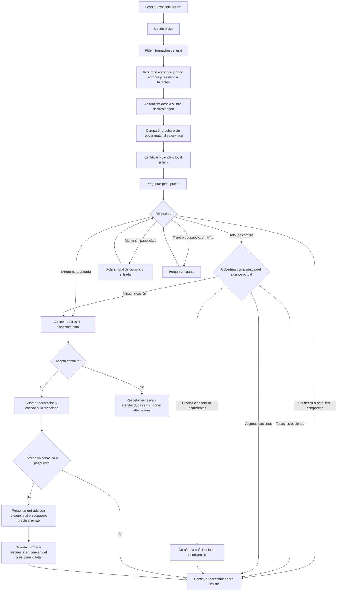
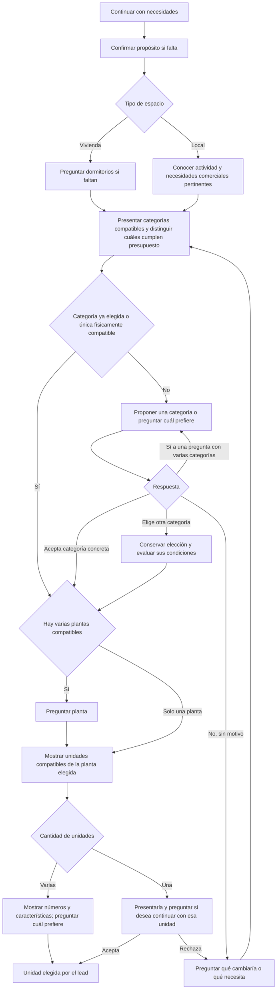

# Mapa de conversación y correcciones pendientes

Referencia del 12 de octubre de 2026 para definir el recorrido de un lead nuevo. Las seis correcciones autorizadas de presupuesto, aceptación con JEP, seguimiento en demostración, planificación antes de proyección, entrada independiente y aviso de precios están incorporadas al código. Los cinco ajustes posteriores de pregunta neutral, presentación y recomendación, dimensiones pertinentes, entrada antes de selección y pregunta contextual sobre el presupuesto también están implementados localmente; su despliegue y las pruebas del chat real siguen pendientes.

El recorrido principal coincide con presupuesto antes de dormitorios, categoría antes de planta y planta antes de unidad. El código permite saltar preguntas respondidas espontáneamente y continuar sin presupuesto. Después de aceptar financiamiento, pregunta la entrada si falta y retoma las necesidades y la selección pendientes; conserva una unidad o entidad ya elegidas. Las verificaciones locales cubren los fallos observados de selección con JEP, evaluación parcial del presupuesto y las nuevas etapas; las conversaciones reales serán la siguiente comprobación.

## Inicio y presupuesto

Este mapa distingue el saludo solo de una solicitud de información general. Se conserva el comportamiento aprobado: un «hola» recibe un saludo breve, como «Hola, ¿en qué podemos ayudarle?». La presentación y la solicitud de nombre y residencia comienzan ante una petición del lead. No se propone cambiar esta regla.

«Todas» y «algunas» corresponden únicamente al conjunto comprobado en ese momento. Todavía no se conocen todos los requisitos del lead. La comparación se actualiza al conocer dormitorios, categoría, planta y unidad; no se vuelve a preguntar el importe conocido. Una búsqueda inicialmente dentro del presupuesto puede quedar fuera al elegir penthouses de tres dormitorios.

Si cubre todas las opciones, se continúa con necesidades sin decirle que puede comprar cualquier cosa. Si cubre algunas, se recomiendan las compatibles con sus necesidades y presupuesto; puede pedir otras categorías. La comprobación corresponde a cada unidad y sus dormitorios, sin excluir una categoría entera por el precio de una de sus unidades. Si no cubre ninguna, se ofrece analizar financiamiento sin prometer aprobación. Aceptar financiamiento conserva preferencias: primero se conoce la entrada si falta y después se retoma la selección. No confirma una unidad ni transforma el presupuesto total en entrada.

Un máximo expresamente indispensable del precio del inmueble se conserva incluso con financiamiento. El presupuesto orientativo y la entrada son datos diferentes. La falta de presupuesto no equivale a insuficiencia.

## Necesidades, categoría, planta y unidad

Vivienda o local identifica el espacio; vivir, invertir o utilizarlo para su negocio identifica el propósito. La pregunta de espacio es neutral: «¿Le interesa una vivienda o un local comercial?». «Busco vivienda» no confirma que vaya a vivir allí; también puede comprarla para arrendarla. El extractor conserva por separado espacio y propósito. En la ruta actual el propósito que falta puede preguntarse después del presupuesto. Si el lead solo dice «inversión», el código puede preguntar presupuesto y aclarar después vivienda o local. Establecer que ambos se aclaren siempre antes del presupuesto es una decisión de flujo aún pendiente.

«Quiero invertir» y «quiero comprar para arrendarlo» pueden declarar propósito de inversión sin identificar el espacio. El extractor interpreta la intención en contexto y debe sustentarla con evidencia del mensaje actual, no solo detectar una palabra. «Quiero un departamento para invertir» declara además una categoría residencial. «¿Es una buena inversión?» es una consulta y no confirma por sí sola el propósito personal de compra. «Quiero arrendar un local para mi negocio» no equivale a comprar un local para arrendarlo a terceros. Un propósito nuevo no borra una categoría o unidad ya elegida.

La suite ya identifica una vivienda de un dormitorio; no hace falta preguntarlo de nuevo. Un local no sigue la rama de dormitorios. Cualquier dato ya declarado se conserva y permite omitir su pregunta.

La presentación y la recomendación tienen alcances distintos. Fuera del resumen inicial aprobado, si se enumeran las opciones residenciales generales se incluyen suites, departamentos y penthouses disponibles y verificados, sin desplegar fichas. Una recomendación con presupuesto y necesidades conocidos puede centrarse en unidades compatibles, sin añadir siempre las categorías que superan el importe. El tipo y los dormitorios se comprueban por unidad; los penthouses de dos y tres dormitorios no constituyen un mismo conjunto de precios.

Al preguntar presupuesto o dormitorios, el escritor recibe una presentación breve sin áreas estructuradas para evitar repetir fichas, salvo una consulta actual de características, cabida, accesibilidad, visualización o comparación pertinente. Las fuentes completas permanecen disponibles para el cálculo y la revisión. Las dimensiones pueden retomarse si el lead las solicita o si ayudan a comparar; no se obliga a repetirlas en cada paso.

«Sí» a «¿Le gustaría explorar los departamentos?» acepta esa categoría para explorar; no elige una unidad. «Sí» a «¿Prefiere departamentos o penthouses?» no identifica cuál. Si el lead ya pidió una categoría o una unidad concreta, no necesita otra aceptación genérica para volver a revisarla.

Cuando el presupuesto recomienda una sola categoría pero existen otras físicamente compatibles, se propone esa recomendación y se pide aceptación antes de planta. Si solo existe una categoría físicamente compatible, el código puede pasar directamente a planta. Exigir una confirmación de categoría en todos los casos sería una regla nueva.

La planta solo se pregunta si existen varias compatibles. Para penthouses exclusivamente en sexta planta, se indica la planta y se pasa a las unidades. Si pide una planta no disponible, se propone una alternativa específica verificada manteniendo dormitorios y presupuesto, y se solicita aceptación del cambio. Rechazar esa planta no permite reducir dormitorios automáticamente. No se pregunta nuevamente planta cuando ya está elegida.

Si no hay coincidencias físicas, financiamiento no resuelve dormitorios, dimensiones o plantas inexistentes. Se explica el requisito no disponible y, si existe una alternativa verificada y no contradice un requisito indispensable, se propone ese cambio concreto antes de avanzar. Una invitación genérica no cambia la búsqueda ni confirma unidad.

Esta aclaración y la aceptación de un ajuste pendiente preceden a la pregunta de entrada. Si una cantidad previa todavía no tiene un papel definido, se aclara si es presupuesto total o entrada antes de proponer reutilizarla; un total ya confirmado no necesita otra aclaración.

La indecisión significa dificultad explícita para elegir entre varias opciones compatibles identificadas. Puede justificar invitar a orientación en el lugar habilitado. Preguntar por precios, distribución o camas no constituye por sí solo indecisión.

## Después de elegir unidad

| Situación | Continuación actual |
| --- | --- |
| Ya aceptó financiamiento | Conservar unidad y entidad conocida. Preguntar entrada si todavía falta; después solicitar la entidad solo si falta y continuar con los datos pendientes. |
| Presupuesto total verificado cubre la unidad y perfil completo | Ofrecer iniciar la solicitud de reserva antes de ofrecer visita por rutina. |
| Presupuesto insuficiente y todavía no aceptó financiamiento | Ofrecer analizar financiamiento. Si acepta, conservar la unidad; si rechaza, respetar la negativa y atender sus dudas. |
| Presupuesto sin definir o pospuesto | Seguir orientando sin exigir cifra ni afirmar cobertura para ofrecer reserva. |
| Revisión financiera favorable vigente que cubre la unidad | Continuar hacia solicitud de reserva; datos recopilados por sí solos no equivalen a revisión favorable. |
| Rechaza la reserva | Puede ofrecerse atención o visita autorizada; no repetir la reserva rechazada. |

El procedimiento financiero actual pide entidad, nombre legal completo, cédula, tipo de trabajo y los datos laborales e ingresos que correspondan. Conserva lo ya respondido y valida lo incompleto. Una entidad elegida espontáneamente, como JEP, no debe volver a preguntarse.

El monto propio para la entrada se solicita como paso independiente después de aceptar continuar con financiamiento, antes de retomar la selección pendiente, únicamente si falta. Después se identifica la unidad de interés y se continúa con la entidad y los datos personales pendientes. Una unidad o entidad ya elegidas se conservan. Una entrada no definida o no compartida queda registrada y permite continuar orientando sin insistir ni inventar cero. No se transforma automáticamente un presupuesto total de 400 mil dólares en una entrada del mismo valor. Si el significado del monto inicial era ambiguo, se aclara al conocerlo, antes de compararlo con precios.

Cuando existe un presupuesto total previo, la pregunta recupera su importe real como referencia: «Antes nos comentó que tenía un presupuesto de $400.000. Para orientar el financiamiento, ¿destinaría ese monto a la entrada inicial del crédito o tendría prevista otra cantidad?». Si no hay un importe previo confirmado, se pregunta directamente cuánto tendría disponible para la entrada. La respuesta registra la entrada por separado; solo una respuesta explícita permite reutilizar como entrada el presupuesto citado.

Aceptar reserva inicia una solicitud para que el equipo gestione condiciones; no confirma una reserva del inventario. Aceptar una invitación a visita tampoco confirma una cita. Las solicitudes expresas de visita o de asesor mantienen sus propias rutas y no necesitan esperar a completar el recorrido comercial.

## Reglas que atraviesan todo el recorrido

- Responder las dudas actuales y retomar después el siguiente dato pendiente.
- Conservar nombre, residencia, propósito, presupuesto y papel del dinero, dormitorios, categoría, planta, unidad, entidad y decisiones válidas ya declaradas.
- Preguntar espacio sin presuponer finalidad: vivienda no significa automáticamente uso personal y local no significa automáticamente negocio propio.
- No convertir una confirmación del lead en una petición de repetir fichas o volver a elegir.
- Comunicar precios cuando se soliciten o cuando una diferencia comprobada sea indispensable para explicar la opción; no recitar precios, ubicación o lanzamiento por costumbre.
- Razonar con datos técnicos verificados sin garantizar cabida a partir de superficie total. Para dos camas hacen falta medidas de la habitación y las camas; puede ofrecerse consulta con el equipo en la oficina sin prometer planos disponibles.
- La demostración mantiene interpretación, flujo y permisos; las observaciones del borrador se registran sin bloquear su envío en el alcance autorizado.

## Correcciones implementadas localmente

1. Unificar afirmaciones de presupuesto por el conjunto exacto de unidades: opciones físicas, opciones dentro del importe, opciones fuera y precios pendientes de verificar. Evitar extender una cobertura parcial a todas las categorías.
2. Reconocer la aceptación actual de continuar con financiamiento y conservar la entidad indicada. Recuperar el acto de la pregunta realmente enviada cuando sus metadatos discrepen, sin convertir cualquier «sí» en autorización.
3. Separar seguimiento conversacional y calidad del borrador en demostración. Un desacuerdo de metadatos no debe borrar decisiones claras del lead ni alterar el flujo del extractor.
4. Planificar con evidencia canónica antes de compactar el contexto. Un catálogo omitido para el redactor no demuestra ausencia de opciones; no debe producir una invitación a flexibilizar requisitos.
5. Separar presupuesto orientativo, capital propio o entrada y límite indispensable de precio. Financiamiento no convierte uno en otro ni elimina un máximo expresamente obligatorio.
6. Incorporar monto de entrada como dato independiente después de aceptar financiamiento y antes de retomar la selección, si falta, sin repetir un papel monetario ya confirmado. La pregunta menciona el presupuesto total previo como referencia cuando existe, sin asumir que sea dinero propio. Presupuesto total, entrada y préstamo mantienen roles separados; la respuesta a la pregunta de entrada no sobreescribe el presupuesto comercial.
7. Añadir un interruptor central del aviso automático de precios referenciales y cambios, separado de mostrar precios y de su condición comercial real. Debe gobernar redactor, plantillas, revisión e inserción automática. Las condiciones se explican si el lead las pregunta.
8. Separar espacio y finalidad tanto en la extracción como en la pregunta: vivienda o local se identifica sin añadir uso personal o negocio propio no declarados.
9. Distinguir presentación general y recomendación según presupuesto y dormitorios. Si enumera la oferta residencial general, incluye las categorías disponibles verificadas fuera del resumen aprobado; una recomendación puede limitarse a las unidades compatibles.
10. Omitir medidas estructuradas del contexto del escritor durante las preguntas de presupuesto o dormitorios cuando no se pidan detalles. Conservar las fuentes completas para planificar y revisar, y permitir dimensiones ante una consulta concreta o comparación pertinente.

El aviso se configura en Automatización → Precios → Mostrar aclaración automática de precios referenciales → Guardar aclaración. Se conserva activado por defecto. Guardarlo controla las próximas respuestas; no modifica mensajes anteriores ni las cifras publicadas. El guardado exige permisos de administrador y evita sobrescribir cambios concurrentes del proyecto.

Las comprobaciones locales están agrupadas en `npm run test:flow-corrections`, además de `test:conversation-regression`, `test:extractor-model` y `test:price-notice`. Incluyen respuestas de IA simuladas, guardado con cliente de datos simulado y controles de interfaz aislados; no certifican la entrega en WhatsApp ni todas las futuras variaciones del modelo. TypeScript y ESLint forman parte de la verificación local. No se realizaron escrituras remotas, commit, push ni despliegue.

## Pendientes para la siguiente revisión

Actualización del 13 de octubre: se implementó únicamente la resolución estructurada de referencias monetarias. El extractor recibe `referencias_monetarias_confirmadas` desde la memoria canónica y devuelve `amount_reference_id` en presupuesto y cantidades financieras. Una referencia como «esos 100» puede conservar el importe confirmado de 100.000 sin repetir «mil»: el código valida el ID, el importe, la evidencia actual y la coherencia entre roles, sin volver a interpretar la cantidad abreviada. Los importes nuevos conservan sus controles y una referencia inexistente o contradictoria requiere reparación. La corrección no añade llamadas de IA; las pruebas usan salidas simuladas. Las demás correcciones de conversación, memoria, redacción y revisión siguen pendientes. Este cambio requiere despliegue del código y no necesita una migración de base de datos.

Revisión posterior del 13 de octubre: el lote «soy carlos» y «pero y que precio tienen los espacios??» confirmó el nombre y mantuvo residencia desconocida, pero `leadIntroductionTurn` planificó simultáneamente `brochure_required=true` y el recordatorio de residencia. La regla actual difiere de esperar hasta recibir la residencia; ajustar esa secuencia sigue pendiente. Los cambios autorizados en esta revisión muestran los datos originales del lead en las capturas nuevas (incluido `null`), conservan el filtro de credenciales y explican fallos de transporte/mantenimiento en la interfaz. El lote de las 12:59 generó tres registros de `KOMMO_UNAVAILABLE` para un único intento de iniciar Salesbot; no se conserva la causa de conexión específica del intento antiguo. Los nuevos registros distinguen conexión, timeout, lectura del cuerpo y respuesta HTTP, sin repetir automáticamente una escritura incierta. La configuración financiera continúa sin cambios: las referencias por defecto no permiten calcular una cuota mensual sin resolver los datos que faltan.

Actualización siguiente del 13 de octubre: se autorizó e implementó la secuencia de perfil antes del brochure. Cuando se pide el dato de presentación faltante, se difiere la entrega automática del material: nombre sin residencia pide solo residencia y entrega después de recibirla. También se aplica a residencia sin nombre. Se conservan las excepciones de solicitud directa del brochure, material previamente enviado, rechazo de datos y límite de un recordatorio. La corrección comprende decisión del servidor, instrucciones compartidas y pruebas; no modifica el cálculo de cuotas ni la recuperación de envíos inciertos. La cuota debe orientarse como crédito de la entidad elegida, que determina las condiciones finales, y no como crédito directo de La Vilet. Los ejemplos de simulación propuestos aún no cambian la política de cálculo.

Pendientes vigentes tras estos cambios:

- Guardado fiable de memoria, evitando el filtro HTTP que incluye todo el resumen; los fallos observados en las aceptaciones de tres dormitorios siguen sin corregirse.
- Conservar las decisiones actuales del lead aunque otro mensaje interrumpa el borrador o falle el envío.
- Registrar la propuesta exacta aceptada y distinguir necesidad original de cinco dormitorios de alternativa activa de tres; preguntar categoría o siguiente dato sin repetir el consentimiento.
- Conservar unidad, presupuesto, entrada y entidad ya confirmados; después de elegir 502/602, completar únicamente el trámite o dato pendiente y avanzar hacia solicitud de reserva o financiamiento según el caso.
- Reducir repeticiones de características y preguntas, conservar lo ya comunicado y no volver a pedir nombre o dormitorios confirmados.
- Validar el significado de las solicitudes del extractor; una petición general no pide automáticamente precios, entrega, financiamiento o recorrido. Reforzar la separación entre memoria histórica y novedades en los demás bloques.
- Asegurar una presentación inicial breve y completa, con su registro según el texto realmente enviado, y simplificar instrucciones y contexto por tarea.
- Mantener la secuencia comercial y las alternativas pertinentes; aún se debe definir si espacio y propósito siempre preceden al presupuesto y si se pide confirmación con una sola categoría compatible.
- Definir cuándo comunicar el precio de una unidad y mantener independientes la consulta atendida, la pregunta pendiente y las observaciones del revisor.
- Vincular precios, características y recomendaciones al conjunto correcto: rangos de dos frente a tres dormitorios, estudio solo donde existe, penthouses compatibles con el presupuesto y filtros exactos de las fuentes.
- Corregir falsos rechazos y reparaciones del revisor que cambian el alcance de una fuente; definir qué contradicciones verificadas bloquean incluso en demostración.
- Reconciliar intentos históricos inciertos, incluido Nathaly, y completar una recuperación de transporte que compruebe el historial antes de reintentar sin duplicados. El intento de Carlos de las 12:59 sigue incierto y su mensaje de las 13:35 quedó pendiente; los diagnósticos nuevos no lo resolvieron.
- Probar ciclos completos con mensajes agrupados, presupuesto, entrada, aceptación de alternativas, elección de unidad, revisión y continuación.
- Definir y autorizar la política de estimaciones mensuales con sus supuestos y límites, dejando la cuota final a la entidad financiera. Los textos más amables siguen como propuestas de estilo.

1. Asegurar la presentación aprobada en la petición inicial general y su registro según contenido efectivamente enviado. El brochure por sí solo no acredita que se haya presentado el resumen. Resolver instrucciones de estilo contradictorias con el resumen aprobado.
2. Continuar la reducción general de instrucciones y datos por tarea con un estado compartido, preservando todas las solicitudes, evidencias actuales y permisos. La planificación ya ocurre antes de la proyección; una reparación parcial debe seguir sin reinterpretar el historial como declaraciones nuevas.
3. Probar chats completos que recorran presupuesto parcial, cambio a penthouse, aceptación con JEP, entrada, elección de unidad y continuación, además de saludos, inversión, preguntas de medidas y rechazos. Las comprobaciones locales no demuestran que se eliminaron todas las posibles variaciones del modelo.

También permanece por definir, sin implementar: si espacio y propósito siempre preceden al presupuesto; y si se requiere confirmar exploración incluso cuando hay una sola categoría físicamente compatible. El saludo breve ante un saludo solo queda confirmado y no requiere modificación.

## Fuentes de código para contrastar el mapa

- `src/lib/integrations/automation/lead-introduction.ts`: saludo solo, presentación, residencia y brochure.
- `src/lib/integrations/automation/commercial-journey.ts`: presupuesto, categorías, plantas, unidades, rechazos, financiamiento, reserva e indecisión.
- `src/lib/integrations/automation/budget-state.ts`: cifra pendiente, presupuesto sin papel claro, total y entrada.
- `src/lib/integrations/automation/purchase-evidence.ts` y `conversation-rules.ts`: separación de espacio y finalidad declarados.
- `src/lib/integrations/automation/financing-entry.ts`: pregunta de entrada, referencia al presupuesto total y conservación del monto independiente.
- `src/lib/integrations/automation/financing-stage.ts`: conservar aceptación y entidad mientras se elige unidad.
- `src/lib/integrations/automation/financing.ts`: consentimiento, entidad y datos pendientes del procedimiento.
- `src/lib/integrations/automation/budget-orientation-rules.ts` y `response-content-scope.ts`: alcance de presentación, recomendaciones y dimensiones pertinentes para el escritor.
- `src/lib/integrations/automation/task-context.ts` y `turn-completeness.ts`: planificación canónica antes de proyectar el contexto enviado al modelo.

El estado de implementación es local. No confirma un nuevo despliegue ni modifica las ejecuciones anteriores.

## Actualización: Luna, cuotas y recuperación de envíos (13 de octubre)

El cambio de modelo no resuelve el guardado fallido de memoria ni sustituye las decisiones del flujo. Siguen siendo necesarias la persistencia fiable, conservar decisiones aunque se interrumpa una respuesta, registrar la propuesta aceptada, avanzar tras elegir unidad y usar precios/características del conjunto correcto. La regla de comunicación de precios y la presentación breve son decisiones comerciales que deben existir con cualquier modelo.

Los antiguos errores de clasificación de solicitudes, uso de historia como evidencia actual, redacción repetitiva y falsos rechazos del revisor deben evaluarse con Luna sobre las mismas conversaciones y el estado real. No se añaden por ahora nuevas reinterpretaciones literales del mensaje ni más remiendos de prompts para casos que Luna ya resuelve. Las repeticiones acreditadas por MEMORY_SAVE_FAILED siguen pendientes de corrección estructural.

Implementado localmente en esta actualización:

- La comprobación exige 3–300 caracteres tanto en pantalla como en servidor y muestra ese requisito. La observación de seis caracteres del caso ya no bloquea el botón.
- Una comprobación resuelve el lote de la misma respuesta, sin confundir otras incidencias del contacto. Puede encolar un solo reintento tras confirmar que no se envió. Guardar de nuevo la misma comprobación no duplica el trabajo.
- El reintento reutiliza el borrador conservado y no repite llamadas a IA ni operaciones comerciales. Respeta pausas, intervención humana, opt-out, ventana original de WhatsApp y cambios de memoria. Un nuevo resultado incierto necesita una nueva comprobación; se admiten como máximo dos reintentos comprobados por cadena.
- Las consultas y la asignación de los mismos campos de Kommo reciben reintentos limitados ante fallos temporales. Un lanzamiento de Salesbot solo se repite automáticamente tras un rechazo HTTP 429 explícito; una respuesta perdida del POST sigue requiriendo comprobar el historial.
- La pantalla muestra los reintentos pendientes y explica los motivos por los que un borrador dejó de ser reenviable. El guardado de memoria por RPC afecta solo a los nuevos reintentos; la corrección global de persistencia continúa pendiente.
- Política de cuotas: La Vilet no ofrece crédito directo; la entidad determina las condiciones y la cuota definitiva. Las cifras se calculan en servidor solo con unidad/precio, monto financiado, tasa y tipo de tasa y plazo verificables. No se configuraron tasas ni plazos hipotéticos. Sin datos suficientes se explica lo pendiente, sin iniciar una solicitud ni pedir documentos por una consulta informativa.

Para activar la recuperación se necesita aplicar `supabase/migrations/20261014100000_confirmed_delivery_retry.sql` y desplegar el código. La preparación local no cancela ni reenvía el intento histórico de Carlos ni otros mensajes. Queda pendiente comprobar esos intentos en producción y validar su recuperación después del despliegue. La búsqueda automática de prueba suficiente en el historial para resolver un POST incierto sigue pendiente; la ausencia de un webhook por sí sola no acredita que no se envió.

## Análisis del recorrido de las 14:00–14:22 (13 de octubre)

Las llamadas registradas usan Luna en extractor, redactor y revisor; el clasificador inicial de alcance conserva 4o-mini. Los turnos observados guardaron memoria correctamente y la aceptación de los $100.000 como entrada avanzó a dormitorios. Este caso no acredita que el problema de memoria de conversaciones más largas esté resuelto.

- Planos: la invitación aprobada del código ya dice «brochure digital completo con los planos». El redactor omitió «planos» en su propuesta inicial, pero el ajuste del código restauró la pregunta aprobada antes de revisar. La fuente `materiales_configurados.brochure` que recibió el revisor solo contiene tipo y URL. Sigue pendiente unificar la descripción aprobada del material entre redactor, ajuste del código y revisor. Declarar que contiene planos no acredita medidas de dormitorios ni que la IA haya examinado esos documentos.
- Aviso de precios: la ejecución conserva `aviso_precios_referenciales=true`; el ajuste guardado de `bot_pricing` solo especifica `launch_prices_visible=true`. La capacidad de desactivar el aviso ya existe, pero en este recorrido se aplica el valor predeterminado activo. No hay todavía una política de aviso único por conversación. Está pendiente resolver la repetición según la preferencia del usuario.
- Calidez: el perfil efectivo ya era elegante, calidez alta y detalle alto. La instrucción transversal, sin embargo, excluía introducciones y justificaciones de preguntas. Se ajustó localmente para permitir reconocer una decisión y explicar brevemente el siguiente paso real, sin imponer una frase ni repetir fichas, importes o muletillas.
- Invitación: se ajustaron el plan comercial y su obligación compartida para preguntar si le gustaría continuar con el financiamiento, sin preguntar por continuar el chat o por un análisis genérico. La función de consentimiento y los datos necesarios mantienen su significado.
- Comparación de precios: el extractor clasificó «los departamentos me interesan más porque los penthouses deben ser más costosos» solo como `property_options`. El contenido de precios quedó prohibido en el turno y el redactor recibió departamentos sin precios y ningún penthouse. Sigue pendiente reconocer comparaciones implícitas relevantes y recuperar un resumen verificado de los conjuntos comparados, conservando la preferencia por departamentos. No requiere enviar el catálogo completo. Al consultar la base, las opciones publicadas y disponibles de tres dormitorios eran departamentos de $250.000–$310.000 y penthouses de $539.900–$550.000. La entrada de $100.000 no acredita que el saldo esté financiado ni se trata como límite del precio total.

El revisor vigente (`business-risk-v2`) excluye tono, elegancia y longitud sugerida. Contrasta hechos del negocio, restricciones/promesas comerciales y obligaciones explícitas del turno; no reescribe el borrador. Quitar sus controles de operación, consentimiento o siguiente paso dejaría pasar respuestas con cifras correctas que prometen trámites no realizados o reinician decisiones ya confirmadas. La propuesta de reducir sus facultades permanece para evaluación; no se modificó su alcance en esta actualización.

## Correcciones anteriores autorizadas y caso de quinta planta

Se implementaron localmente las tres correcciones autorizadas después de ese análisis:

- La descripción aprobada del brochure declara que contiene planos y se comparte con redactor y revisor. No afirma acceso de la IA al PDF ni medidas de habitaciones verificadas.
- El aviso rutinario sobre precios se comunica una vez por conversación, tomando como comprobante las respuestas del bot registradas en el historial y conservando `_price_notice` en la memoria después de aceptar la respuesta. El marcador evita repetirlo cuando el mensaje inicial sale del historial reciente. Un mensaje del cliente o un borrador no lo suprime. Los permisos de precios y su naturaleza aproximada permanecen; las consultas expresas de vigencia y cambios se siguen atendiendo. Una conversación nueva tiene su propio primer aviso.
- El extractor dispone de `catalog_request.price_comparison` para identificar comparaciones de costo por categoría, incluidas las que justifican una preferencia sin signos de pregunta. El código conserva la preferencia y calcula rangos del inventario publicado disponible para los dormitorios conocidos. Los modelos reciben los dos rangos pertinentes; el inventario completo se conserva para verificar sus miembros. Una comparación no autoriza recomendar categorías rechazadas, cambiar unidad ni tratar una entrada como presupuesto total. No se calculan rangos completos con inventario parcial ni precios desconocidos.

Estos cambios son de código y no necesitan una migración nueva. No se ejecutaron llamadas a IA ni se enviaron mensajes al lead durante las pruebas locales.

El nuevo caso de las 14:42–14:44 se analizó solo para opinión, como solicitó el usuario. Los hechos confirmados conservaban tres dormitorios, pero la consulta anterior y la nueva consulta de quinta planta tenían `bedrooms=null`. Por eso se devolvieron el 502 de tres dormitorios y el 504 de dos. El plan ordenó `discover_bedrooms` pese al dato conocido; el redactor intentó resolver la contradicción con «¿mantengo esa preferencia?», y el revisor comparó esa pregunta con la captura errónea del plan. Sigue pendiente resolver esa pérdida del filtro y la coherencia entre hechos confirmados, consulta y siguiente paso; no se corrigieron en esta actualización. Tampoco se modificaron las facultades del revisor ni se añadió una promesa de mejores vistas.

# Ajustes autorizados de descuentos, precio con recorrido y tono — 13 de octubre

El responsable confirmó un descuento de lanzamiento del **10 % ya incluido en los precios publicados**, editable en Automatización → Conocimiento y reglas → Políticas comerciales → Descuentos (`/inmobiliaria/automatizacion/descuentos`). La migración `20261013180000_launch_discount_included_in_catalog.sql` registra esa regla para La Vilet desde el 13 de octubre, durante lanzamiento, sin modificar los precios de las unidades ni otras políticas. Conserva reglas existentes y las ediciones posteriores del administrador; una regla general activa incompatible debe resolverse en el editor antes de migrar. No se ejecutó la migración contra producción.

- Las consultas sobre existencia, porcentaje y aplicación de descuentos usan la política vigente. El porcentaje incluido no se resta otra vez y no requiere una reserva para explicar el precio. Sin precio original autorizado no se inventa el ahorro en dólares ni se reconstruye un precio anterior mediante cálculo inverso.
- El extractor distingue una consulta sobre ofertas publicadas de negociar una rebaja personal. La segunda inicia una derivación real al equipo, incluso con revisión en modo demostración. La consulta informativa no deriva por sí sola ni autoriza reserva, cita o revisión financiera.
- Al enviar el recorrido 360 de una unidad efectivamente seleccionada se exige comunicar su precio publicado autorizado. No abre los precios de otras unidades, no se activa con un recorrido general o una simple propuesta y conserva el aviso referencial una vez por conversación.
- No se añade por rutina la aclaración de que mencionar una reserva no reserva el inventario. Se conserva el estado real y se explica cuando el cliente pregunta por él, supone una reserva inexistente o hay que aclarar una gestión efectuada.
- El redactor no debe sugerir que una distribución podría no cubrir las necesidades de una familia numerosa. Describe características comprobadas para que el cliente valore su adecuación.
- El tono permite dos a cuatro frases y una transición útil, con trato cálido de usted, sin saludo repetido, pregunta de formulario ni relleno para alcanzar una longitud.

Las facultades del revisor y el caso de quinta planta se mantenían pendientes en esta actualización del 13 de octubre. Estos ajustes no sustituyen las correcciones pendientes de continuidad, propuestas y filtros. Se conservan las correcciones anteriores del brochure y de precios. Las pruebas simulan servicios: no realizan llamadas pagadas a IA ni envían mensajes a WhatsApp.

## Revisor limitado a hechos y promesas — 14 de octubre

El usuario autorizó aplicar la separación de responsabilidades. El revisor recibe el alcance `facts-and-promises-v1` y comprueba únicamente datos afirmados y condiciones o promesas comerciales: precios, unidades, superficies, dormitorios, plantas, ubicación, estado publicado, descuentos, financiamiento y operaciones realizadas. El esquema de la revisión comercial excluye `turn_goal` y exige `question=null`. Los controles de flujo y los datos pendientes no se suministran como obligaciones del revisor ni como fuentes factuales.

La pregunta guardada procede del redactor y de los controles del sistema. El revisor ya no puede cambiarla ni activar reparaciones por su clasificación. La captura autorizada y la continuación que el sistema sí puede comprobar se validan antes de llamar al revisor. Los avisos, el brochure, la presentación aprobada y los pasos definidos conservan sus instrucciones y controles propios; el revisor no decide cuándo comunicarlos.

Se limitan también las rutas antiguas: sus campos de pregunta, captura, cobertura, omisiones, presentación y datos faltantes no pueden reintroducir esas facultades ni producir una derivación. Un `turn_goal` histórico devuelto fuera del contrato se registra como ignorado; contradicciones numéricas y promesas sin respaldo conservan sus validaciones y reparación de redacción. Las faltas de información que el redactor identifica siguen pasando por la comprobación de fuentes y las políticas del sistema; no las inventa el revisor.

La interfaz de Pruebas y revisión explica el nuevo alcance. Esta modificación no requiere migración ni cambia los modelos. Las demás correcciones pendientes de propuestas, filtros y planificación, incluido el caso de quinta planta, siguen pendientes. Los tests anteriores que exigían al revisor dirigir el flujo se actualizaron para verificar que esa responsabilidad permanece en el redactor/sistema y que los hechos siguen protegidos.

## Calidez y conservación de la redacción inicial — 14 de octubre

En la ejecución de las 10:35, el redactor escribió «Hola, con gusto le comparto información» y el revisor aprobó el borrador. `protectInitialProjectPresentation` reconstruyó después el mensaje con el resumen y la pregunta fijos, eliminando esa cortesía y la redacción del modelo. La protección se aplicaba también después de la revisión final.

El resumen aprobado sigue siendo fuente de hechos y el contrato exige una presentación breve y la pregunta de perfil pendiente, con redacción libre. La preparación conserva los borradores producidos por el redactor y su procedencia en `initial_presentation`, tanto con revisión activa como en demostración o desactivada. Los controles de datos, enlaces, perfil y continuación mantienen su política habitual; la demostración no certifica aprobación factual. Las plantillas de ruta y recuperación todavía se completan con el resumen aprobado, una apertura amable y los datos realmente pendientes. No se añaden llamadas a IA para comprobar el tono ni se devuelve esa facultad al revisor.

La calidez alta ahora pide una disposición visible al ayudar, una apertura amable en la primera solicitud de información y transiciones útiles en las continuaciones. No exige cortesías en todos los turnos. Se elimina la instrucción obsoleta que pedía al revisor aceptar el estilo. El usuario autorizó seleccionar Cercano con calidez y detalle altos en la configuración editable, conservando el perfil anterior para restaurarlo. Este ajuste no requiere migración.

Verificación reproducible: `npm run test:warm-opening` incluye la redacción original, una paráfrasis de los hechos, las tres modalidades de revisión, las dos preparaciones finales, la pregunta de perfil y la recuperación de una plantilla inválida. Las otras correcciones pendientes continúan registradas sin cambiar su estado.

## Contado, avisos de reserva y diagnóstico de descuentos — 14 de octubre

- Nueva sección Conocimiento y reglas → Políticas comerciales → Pagos al contado (`/inmobiliaria/automatizacion/contado`). Permite definir significado, momento del pago, tratamiento de reserva, gastos y política de descuentos adicionales, con etapa y fuente comprobada. Parte desactivada y sin condiciones financieras inventadas. Un campo vacío queda por confirmar; el proyecto conserva `credito_directo=false`. Los porcentajes siguen en Descuentos: no hay una segunda fuente ni acumulación automática. Los guardados son de administrador y comprueban la versión para conservar otras políticas.
- El bot y su revisión factual reciben `politica_pago_contado`. La configuración desactivada, fuera de etapa o con fuente pendiente de revisión no autoriza comunicar sus condiciones. La política distingue un descuento adicional por contado de un beneficio de lanzamiento ya incluido.
- La pantalla de descuentos añade el diagnóstico de las reglas guardadas, con etapa actual, vigencia, cantidad de unidades aplicables y motivos por los que no pueden comunicarse. Incluye instrucciones para configurar el 10 % ya incluido sin descontarlo dos veces. Un error del diagnóstico no convierte un guardado exitoso en fallido.
- En la prueba de 11:12, el escritor recibió descuentos desactivados. A las 11:14 y 11:17 recibió activación global pero `rules=[]` en las ofertas aplicables. Al revisar después, la configuración guardada tenía `enabled=true` y ninguna regla. Estas observaciones no demuestran cuál de los campos de una eventual regla anterior causó su exclusión; no se reactivó ni se sobrescribió la política del administrador.
- Nueva alerta modal urgente para solicitudes de reserva persistidas y cambios del lead a `reservado`. Solo la recibe su asesor activo dentro del mismo proyecto. Si la solicitud está en cola, avisa al asignar un responsable. El modo de pruebas conserva el destinatario real del flujo existente. No se envían avisos externos ni se reserva inventario al mostrar el modal.
- La alerta se cierra al reconocerla y guardar su lectura, sin Escape ni clic fuera. Un fallo al guardar mantiene el aviso. Las notificaciones se deduplican por evento y destinatario; el listado incluye reservas no leídas aunque sean anteriores a las últimas asignaciones. El borrado de una solicitud durante el reinicio elimina su alerta asociada por clave foránea. Un cambio que deja atrás el estado reservado retira la alerta de confirmación pendiente. Se mantiene el acceso privado de las notificaciones existentes.
- Requiere la migración `20261014180000_urgent_reservation_notifications.sql`, preparada y comprobada localmente, sin ejecutar en producción ni generar notificaciones reales. Las reglas de contado y el diagnóstico usan la estructura de políticas existente.

La forma de retomar el flujo quedó solo analizada, como solicitó el usuario: conservar una aceptación de financiamiento al responder una duda; distinguir una consulta por contado de una elección de esa modalidad; no repetir la captura de entrada tras cada aclaración; y no introducir una estimación de cuotas cuando la duda actual es sobre aprobación. Se propone resolver la duda y usar una transición pertinente cuando corresponda retomar, o responder sin otra pregunta si el cliente sigue aclarando. Esos cambios de planificación y continuidad siguen pendientes; este turno no modifica ese recorrido.

Pruebas: `npm run test:cash-reservation` verifica reglas, acceso, concurrencia, diagnóstico, fuentes para revisión y migración en PostgreSQL aislado. `npm run test:cash-reservation-ui` verifica el editor en escritorio/móvil y el modal, incluido fallo de guardado de lectura, sin usar servicios reales.

## Recomendación, calidez y bucle de dormitorios — análisis y aplicación del 14 de octubre

El usuario pidió primero analizar los casos de 11:47–12:09 y de 12:22–12:27 y guardar sus correcciones. En ese turno solo se documentaron. Posteriormente autorizó aplicar juntas todas las correcciones de estos análisis y las cuatro de continuidad financiera descritas arriba. La implementación local queda descrita al final de este bloque; las demás pendientes anteriores conservan su estado.

### Evidencia del caso anterior: cinco dormitorios y elección de penthouse

- A las 11:47, el extractor entendió cinco dormitorios y dejó `bedrooms_required=null`; «unos cinco cuartos más o menos» no fue declarado indispensable. El plan no creó una alternativa: evaluó los USD 50.000 como `maximum_total` y los usó como límite del precio al proponer otras opciones, pese a que `financiamiento.entry.amount=50000` y el financiamiento estaban aceptados. La pregunta de flexibilización fue una instrucción del plan, no una recomendación omitida espontáneamente por el redactor.
- A las 12:05, el lead aceptó revisar tres dormitorios. La ejecución presentó las opciones 602 y 605, publicadas y disponibles, con 142,09 y 140,53 m² interiores. El revisor produjo un `block/hard_fact` cuya propia justificación decía que los datos estaban respaldados y no había afirmaciones falsas; fue una revisión contradictoria y se observó sin bloqueo.
- A las 12:08, el extractor entendió `category=penthouse`, `operation=select` y una respuesta a `property_category`. La elección llegó junto con comentarios sobre amplitud y familia. La condición de reconocimiento del código dependía de formulaciones literales/cortas, no trató ese conjunto como la elección de categoría ofrecida y devolvió `category_change` con opciones vacías. La consulta posterior mantuvo `scope=offered` sobre ese conjunto vacío. La afirmación de ausencia de penthouses de tres dormitorios procedió de ese resultado defectuoso, no de una comprobación correcta del inventario.
- El estilo Cercano, calidez 2 y detalle 2 sí estaba en las instrucciones efectivas. Seguía habiendo una contradicción: `dialogue-writing-rules.ts` permitía decir que «una distribución puede resultar ajustada según las necesidades», mientras `needs-guidance.ts` prohibía sugerir insuficiencia para una familia numerosa. Las precauciones sobre adecuación se convirtieron en advertencias no solicitadas. El revisor no reescribió ese mensaje; en demostración se envió el borrador.

### Evidencia del caso nuevo: elección del 605 y confirmación repetida

- A las 12:22, «pero si ya escogí los penthouse» llevó a consultar el alcance del catálogo y el escritor presentó correctamente 602 y 605. La pregunta entregada fue cuál de las dos revisar.
- A las 12:24, los dos mensajes «prefiero el que tiene más baños» y «¿qué precio tiene?» se procesaron juntos. El extractor identificó correctamente una selección relativa de `unit_numbers=[605]`, con confianza alta, y la consulta de precio. No era necesario que el lead escribiera el código 605: las opciones ofrecidas diferenciaban inequívocamente dos y tres baños.
- La resolución del código devolvió `category_change`, sin coincidencias ni `selected_ids`, aunque la consulta de precio pudo identificar el 605 y responder USD 539.900. Nombrar correctamente una unidad en el texto no dejó su elección confirmada en el estado.
- Los tres dormitorios seguían en los hechos: `qualification.dormitorios_texto="de 3 opciones me parece bien"` y `housing_quantities` contenía un requisito de tres dormitorios con confianza media aceptada. Sin embargo, la última declaración de categoría había sustituido `memory.property` completo por un objeto con filtros nulos. La consulta activa también tenía `bedrooms=null` y el CRM `preferred_bedrooms=null`. El plan no usó aquella cantidad confirmada y ordenó `discover_bedrooms`.
- El escritor convirtió esa orden en «¿Le funciona esa cantidad de dormitorios?», pese a que ya se estaban revisando tres. La pregunta se guardó como `property_bedrooms/confirm_bedrooms`, sin `proposed_query`, cantidad estructurada, `candidate_ids` ni `target_ids`: quedó sin el referente que un sí necesita confirmar.
- A las 12:26, el extractor reconoció correctamente «si si est abien» como `answer_to_previous.kind=affirmative`, confianza alta, para `property_bedrooms`. La rama de aceptación del código requiere una propuesta estructurada; al faltar, no recuperó los tres dormitorios. El plan volvió a ordenar `discover_bedrooms` y el escritor respondió «Perfecto. ¿Cuántos dormitorios necesita?». El revisor aprobó los hechos de estos mensajes y no fue quien decidió repetir la captura.

### Correcciones autorizadas e implementadas localmente

1. **Roles del dinero:** impedir que una entrada confirmada siga excluyendo alternativas por el viejo límite de precio total. Conservar el historial de declaraciones, pero usar el rol vigente para la decisión comercial, sin asegurar capacidad de crédito.
2. **Recomendación concreta ante ausencia real:** recuperar alternativas verificadas cercanas —por ejemplo, tres dormitorios y mayor amplitud— y explicar por qué merece revisarlas. Una búsqueda exacta sin resultados no debe dejar al cliente sin orientación cuando existen alternativas pertinentes. Respetar negativas y requisitos realmente indispensables, sin prometer que otra distribución satisface todas sus necesidades.
3. **Categoría en mensajes agrupados:** aplicar la elección semántica confirmada a las opciones ofrecidas aunque venga acompañada de comentarios, correcciones o varios mensajes. Mantener dormitorios, exclusiones y requisitos ya aceptados; no vaciar el conjunto al cambiar únicamente la categoría.
4. **Ausencia real frente a conjunto perdido:** distinguir un conjunto de referencias vacío o mal resuelto de una consulta completa sin stock. Recuperar la fuente autorizada pertinente antes de comunicar ausencia o forzar a elegir entre requisitos compatibles.
5. **Estado de preferencias por campo:** una declaración nueva de categoría no debe borrar dormitorios no modificados. Separar hechos confirmados, condiciones activas de búsqueda y preferencias originales de las alternativas aceptadas. Si una consulta de unidad limpia filtros antiguos, los hechos aceptados siguen siendo utilizables para el siguiente paso.
6. **Selección relativa de unidad:** validar una elección como «la de más baños» dentro del conjunto ofrecido y persistir la unidad inequívoca, sin exigir su código literal. Procesar conjuntamente elección y consulta de precio; responder el precio no sustituye la actualización del estado de selección.
7. **Confirmaciones con referente:** guardar qué cantidad, unidad o propuesta corresponde a cada pregunta. Un sí validado debe resolver ese referente y avanzar; no convertirse en una captura abierta del mismo dato. No guardar preguntas de confirmación sin el dato que se confirma.
8. **Plan coherente con decisiones conocidas:** antes de pedir dormitorios, comprobar hechos aceptados, alternativa vigente y unidad seleccionada. No reabrir categoría, dormitorios o planta solo porque un campo transitorio esté vacío. Retomar el siguiente dato real del financiamiento o la gestión autorizada.
9. **Lenguaje comercial positivo:** comunicar una limitación real brevemente y ofrecer una vía concreta comprobada. Evitar narrar «catálogo», «búsqueda», «coincidencias», «filtros» o resultados técnicos al explicar disponibilidad. Esto no prohíbe responder sobre el material llamado catálogo cuando el lead lo pide.
10. **Calidez sin advertencias rutinarias:** eliminar las instrucciones contradictorias sobre familias, describir ventajas verificadas y reconocer sus preferencias con naturalidad. Usar cautelas concretas cuando son pertinentes a la consulta, sin desacreditar una elección ni emitir juicios sobre la familia. Recomendar no equivale a garantizar adecuación, financiación ni reserva.
11. **Revisión contradictoria:** registrar y tratar como defecto de revisión un hallazgo que bloquea mientras su justificación afirma que los mismos hechos son correctos. Mantener el alcance factual del revisor, sin devolverle decisiones de flujo, capturas o tono.

### Implementación conjunta

- Las alternativas usan un límite total declarado cuando corresponde. El importe antiguo que el lead confirmó después como entrada para un financiamiento aceptado no se reutiliza como techo del precio. Se mantienen separados ambos registros; un máximo total actual o independiente conserva su efecto.
- La memoria actualiza preferencias por campo y conserva dormitorios y planta al cambiar de tipo dentro de viviendas. Cambiar a locales inicia sus propias necesidades. La consulta y el plan recuperan los filtros confirmados y la alternativa aceptada cuando faltan en la consulta transitoria.
- La elección de una categoría ofrecida se aplica por su interpretación validada aunque incluya explicaciones o varios mensajes. Una categoría nueva consulta las opciones pertinentes; no busca dentro de la unidad anterior. Una selección relativa valida los identificadores interpretados contra las opciones ofrecidas y disponibles, y conserva la unidad aunque el mismo grupo también pregunte su precio.
- Una confirmación de dormitorios guarda una propuesta con la cantidad y el sujeto verificados. El sí posterior conserva esa cantidad y la unidad previa; no vuelve a abrir la captura. Un conjunto de referencias vacío se trata como referencia por aclarar, no como ausencia acreditada de stock.
- Se retira la instrucción sobre distribución ajustada y familias que comparten habitaciones. El redactor recibe una regla general de recomendación amable: limitación breve, alternativa comprobada y utilidad concreta; sin narrar búsquedas ni añadir cautelas familiares no solicitadas. Las garantías comerciales siguen exigiendo respaldo.
- La aceptación más una duda explicativa conserva el consentimiento, sin aceptar condiciones de aprobación. El extractor distingue consultas sobre contado, procedimiento, aprobación y cuota mensual. Las dudas consecutivas pueden suspender la repetición de la captura: se conserva la última pregunta realmente enviada y se retoma el dato pendiente después. Consultar contado no cambia la modalidad ni revoca el financiamiento. La transición tras la entrada explica que escoger una vivienda permitirá conocer su precio y el saldo por financiar.
- Si un hallazgo factual bloquea citando fuentes cuyos datos numéricos su propia revisión verifica, se solicita una única revisión de sus metadatos sobre el mismo borrador, también en demostración. No se aprueba automáticamente el mensaje ni se borra un rechazo persistente; el revisor debe identificar el error real o corregir su veredicto. Conserva exclusivamente sus facultades sobre hechos y promesas.

Verificación reproducible: `npm run test:conversation-continuity` reproduce cinco dormitorios aproximados → aceptar tres → penthouse con comentarios agrupados → elegir más baños y preguntar precio → sí, conservando USD 50.000 de entrada y el 605. Incluye quinta planta con tres dormitorios, límites totales independientes, referencias inválidas y reparación de revisión contradictoria. La prueba del recorrido real hasta el envío simulado responde dudas consecutivas de procedimiento, aprobación y contado, conserva la pregunta anterior y después avanza al recibir la entrada, tanto en revisión normal como en demostración. Pasaron 73 pruebas de continuidad, 1.125 de regresión general, 82 de controles comerciales y 92 de apertura y calidez; también TypeScript, ESLint y comprobación del diff. Estos conjuntos se superponen. Las pruebas simulan la IA y los servicios; no envían WhatsApp ni realizan llamadas pagadas. Los cambios no requieren migración ni cambian modelos o configuración publicada; necesitan desplegar el código para alcanzar las conversaciones reales. La calidez se orienta mediante instrucciones coherentes y sigue admitiendo redacción libre del modelo.

## Correcciones de saludo, materiales, objetivos y prioridad por amplitud (14 de octubre)

Autorizadas las dos propuestas posteriores al análisis de las capturas de las 12:40–13:24. Implementadas localmente:

1. **El redactor conserva el mensaje completo.** Las etapas posteriores ya no insertan saludos, preguntas del plan, brochure ni avisos de precio en una respuesta del redactor. Aplica a revisión normal, demostración y revisión desactivada. Los materiales necesarios forman parte del contrato del redactor; un enlace omitido se diagnostica y, con revisión normal, se solicita reparar al redactor. No se completa con texto del servidor. Las respuestas de recuperación y los mensajes de sistema que no proceden de un redactor conservan su tratamiento operativo.
2. **Objetivos en vez de preguntas literales.** La proyección enviada al redactor elimina `question`, `next_question`, `suggested_question` y las plantillas de respuesta de los planes. Conserva objetivos, campos pendientes, permisos, IDs y sujetos verificados. El historial real del diálogo permanece como evidencia, sin convertir sus preguntas en plantillas obligatorias. Las palabras de una nueva pregunta y su ficha corresponden al redactor; no se rechazan por comparación de palabras o por un acto deducido con el clasificador limitado del código. Las referencias antiguas sin ficha válida conservan su compatibilidad, sin reescribir el mensaje.
3. **Calidez y saludo único.** Se orienta a hablar de preferencias («le gustaría», «prefiere», «tenía pensado»), explicar la utilidad del siguiente paso cuando ayude y evitar preguntas de formulario. Las cortesías no son prefijos automáticos. Se recupera evitar exclamaciones innecesarias, sin una prohibición absoluta. «Saludos» ya no recibe otro «Hola» añadido después de redactar.
4. **Mención y solicitud de material separadas.** `material_request=none` con confianza aceptada prevalece sobre el antiguo detector de palabras; mencionar el brochure recibido no solicita reenviarlo. La misma decisión se usa al preparar la ruta y al construir el contrato de enlaces. Consultar cobros de acceso se interpreta como `common_area_access`, separado de precio de compra, presupuesto, entrada y envío de material.
5. **Prioridades y restricciones persistidas por separado.** El extractor entrega `selection_preferences` con evidencia actual: dormitorios indiferentes, requisito cambiado y prioridad de amplitud interior. Una indiferencia explícita elimina la restricción de dormitorios y evita resucitarla desde el CRM, la memoria o requisitos de consultas anteriores. El plan puede pasar a departamentos/penthouses y, elegido el tipo, presentar las dos opciones con mayor superficie interior verificada dentro de los requisitos reales. Sus dormitorios son características de las unidades, no una necesidad inventada. «Mínimo dos» conserva `gte=2`, admite tres y mantiene la prioridad de amplitud. Una confirmación de prioridad dispone de `property_priority/confirm_priority`; un sí no depende de una propuesta inexistente de dormitorios.
6. **Búsqueda y planificación comparten el alcance resuelto.** Un cambio actual de restricciones puede consultar el inventario cuando no hay opciones ofrecidas; todos los consumidores reciben ese alcance. Un conjunto relativo perdido sigue siendo una referencia sin resolver: no se convierte en ausencia de stock ni se amplía silenciosamente para responder un ranking entre «estas» opciones.
7. **Política aprobada de áreas comunes.** La migración `20261014160000_common_area_access_policy.sql` registra y publica, únicamente en el proyecto y tenant indicados, el acceso de residentes o propietarios sin cobro adicional por acceder. No define gratuidad de alícuota o mantenimiento ni permisos de visitantes. Se edita en **Conocimiento y reglas → Políticas comerciales → Acceso a áreas comunes**. La migración conserva las demás políticas y no sobrescribe una versión existente, editada o pausada al ejecutarse de nuevo. La antigua instrucción fija de que no existían condiciones verificadas se sustituye por consultar las políticas publicadas.
8. **Resultado de IA separado de controles del sistema.** El flujo muestra por separado la aprobación factual de la IA y las incidencias del control final. Los registros históricos de `commercial_next_question_mismatch` se identifican como observaciones del código; ya no aparentan un rechazo de la IA. El historial de intentos incluye también los códigos conservados en `final_validation.issues`. Una derivación realizada después del primer borrador solicita un mensaje completo actualizado al redactor con su resultado confirmado; no añade un aviso por concatenación.

Verificación: `npm run test:writer-ownership` cubre la secuencia de prioridades, elección de tipo, mínimo de dormitorios, referencias perdidas, texto intacto en los tres modos, mención del brochure, separación de resultados y migración editable e idempotente en PostgreSQL aislado. Pasaron las 1.125 pruebas de regresión conversacional, 92 de apertura/calidez, 82 de controles comerciales y 111 del registro de mensajes. La interfaz se comprobó en navegador aislado en escritorio y móvil, incluida la aprobación de IA con observación del código. No se enviaron mensajes reales ni se hicieron llamadas pagadas a modelos.

**Activación:** desplegar el código y aplicar la migración de áreas comunes. Los registros históricos no se reescriben; la nueva interfaz explica su procedencia. La calidez y la formulación son instrucciones para el redactor, no frases prefijadas ni una garantía de que todas sus respuestas usen las mismas palabras.
