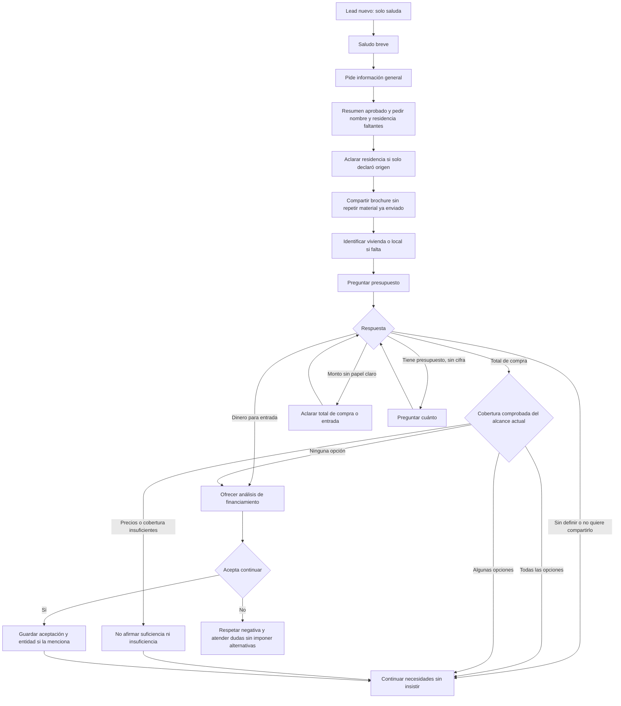
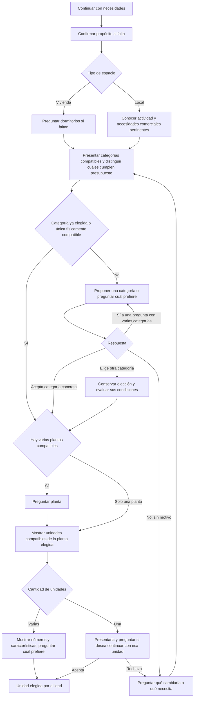

# Mapa de conversación y correcciones pendientes

Referencia del 12 de octubre de 2026 para definir el recorrido de un lead nuevo. Las seis correcciones autorizadas de presupuesto, aceptación con JEP, seguimiento en demostración, planificación antes de proyección, entrada independiente y aviso de precios están implementadas en el código local. El despliegue y las pruebas del chat real siguen pendientes.

El recorrido principal coincide con presupuesto antes de dormitorios, categoría antes de planta y planta antes de unidad. El código permite saltar preguntas respondidas espontáneamente, continuar sin presupuesto y retomar una selección tras aceptar financiamiento. Las verificaciones locales cubren los fallos observados de selección con JEP y evaluación parcial del presupuesto; las conversaciones reales serán la siguiente comprobación.

## Inicio y presupuesto

Este mapa distingue el saludo solo de una solicitud de información general. Se conserva el comportamiento aprobado: un «hola» recibe un saludo breve, como «Hola, ¿en qué podemos ayudarle?». La presentación y la solicitud de nombre y residencia comienzan ante una petición del lead. No se propone cambiar esta regla.

«Todas» y «algunas» corresponden únicamente al conjunto comprobado en ese momento. Todavía no se conocen todos los requisitos del lead. La comparación se actualiza al conocer dormitorios, categoría, planta y unidad; no se vuelve a preguntar el importe conocido. Una búsqueda inicialmente dentro del presupuesto puede quedar fuera al elegir penthouses de tres dormitorios.

Si cubre todas las opciones, se continúa con necesidades sin decirle que puede comprar cualquier cosa. Si cubre algunas, se recomiendan las compatibles con sus necesidades y presupuesto; puede pedir otras categorías. Si no cubre ninguna, se ofrece analizar financiamiento sin prometer aprobación. Aceptar financiamiento conserva preferencias y retoma la selección, no confirma una unidad ni transforma el presupuesto total en entrada.

Un máximo expresamente indispensable del precio del inmueble se conserva incluso con financiamiento. El presupuesto orientativo y la entrada son datos diferentes. La falta de presupuesto no equivale a insuficiencia.

## Necesidades, categoría, planta y unidad

Vivienda o local identifica el espacio; vivir, invertir o utilizarlo para su negocio identifica el propósito. En la ruta actual el propósito que falta puede preguntarse después del presupuesto. Si el lead solo dice «inversión», el código puede preguntar presupuesto y aclarar después vivienda o local. Establecer que ambos se aclaren siempre antes del presupuesto es una decisión de flujo aún pendiente.

«Quiero invertir» y «quiero comprar para arrendarlo» pueden declarar propósito de inversión sin identificar el espacio. El extractor interpreta la intención en contexto y debe sustentarla con evidencia del mensaje actual, no solo detectar una palabra. «Quiero un departamento para invertir» declara además una categoría residencial. «¿Es una buena inversión?» es una consulta y no confirma por sí sola el propósito personal de compra. «Quiero arrendar un local para mi negocio» no equivale a comprar un local para arrendarlo a terceros. Un propósito nuevo no borra una categoría o unidad ya elegida.

La suite ya identifica una vivienda de un dormitorio; no hace falta preguntarlo de nuevo. Un local no sigue la rama de dormitorios. Cualquier dato ya declarado se conserva y permite omitir su pregunta.

«Sí» a «¿Le gustaría explorar los departamentos?» acepta esa categoría para explorar; no elige una unidad. «Sí» a «¿Prefiere departamentos o penthouses?» no identifica cuál. Si el lead ya pidió una categoría o una unidad concreta, no necesita otra aceptación genérica para volver a revisarla.

Cuando el presupuesto recomienda una sola categoría pero existen otras físicamente compatibles, se propone esa recomendación y se pide aceptación antes de planta. Si solo existe una categoría físicamente compatible, el código puede pasar directamente a planta. Exigir una confirmación de categoría en todos los casos sería una regla nueva.

La planta solo se pregunta si existen varias compatibles. Para penthouses exclusivamente en sexta planta, se indica la planta y se pasa a las unidades. Si pide una planta no disponible, se propone una alternativa específica verificada manteniendo dormitorios y presupuesto, y se solicita aceptación del cambio. Rechazar esa planta no permite reducir dormitorios automáticamente. No se pregunta nuevamente planta cuando ya está elegida.

Si no hay coincidencias físicas, financiamiento no resuelve dormitorios, dimensiones o plantas inexistentes. Se explica el requisito no disponible y, si existe una alternativa verificada y no contradice un requisito indispensable, se propone ese cambio concreto antes de avanzar. Una invitación genérica no cambia la búsqueda ni confirma unidad.

La indecisión significa dificultad explícita para elegir entre varias opciones compatibles identificadas. Puede justificar invitar a orientación en el lugar habilitado. Preguntar por precios, distribución o camas no constituye por sí solo indecisión.

## Después de elegir unidad

| Situación | Continuación actual |
| --- | --- |
| Ya aceptó financiamiento | Conservar unidad y entidad conocida; solicitar la entidad solo si falta y continuar con los datos pendientes. |
| Presupuesto total verificado cubre la unidad y perfil completo | Ofrecer iniciar la solicitud de reserva antes de ofrecer visita por rutina. |
| Presupuesto insuficiente y todavía no aceptó financiamiento | Ofrecer analizar financiamiento. Si acepta, conservar la unidad; si rechaza, respetar la negativa y atender sus dudas. |
| Presupuesto sin definir o pospuesto | Seguir orientando sin exigir cifra ni afirmar cobertura para ofrecer reserva. |
| Revisión financiera favorable vigente que cubre la unidad | Continuar hacia solicitud de reserva; datos recopilados por sí solos no equivalen a revisión favorable. |
| Rechaza la reserva | Puede ofrecerse atención o visita autorizada; no repetir la reserva rechazada. |

El procedimiento financiero actual pide entidad, nombre legal completo, cédula, tipo de trabajo y los datos laborales e ingresos que correspondan. Conserva lo ya respondido y valida lo incompleto. Una entidad elegida espontáneamente, como JEP, no debe volver a preguntarse.

El monto propio para la entrada se solicita como paso independiente después de elegir unidad y aceptar continuar con financiamiento, antes de continuar con los datos personales del procedimiento, únicamente si falta. Una entrada no definida o no compartida queda registrada y permite continuar orientando sin insistir ni inventar cero. No se transforma automáticamente un presupuesto total de 400 mil dólares en una entrada del mismo valor. Si el significado del monto inicial era ambiguo, se aclara al conocerlo, antes de compararlo con precios.

Aceptar reserva inicia una solicitud para que el equipo gestione condiciones; no confirma una reserva del inventario. Aceptar una invitación a visita tampoco confirma una cita. Las solicitudes expresas de visita o de asesor mantienen sus propias rutas y no necesitan esperar a completar el recorrido comercial.

## Reglas que atraviesan todo el recorrido

- Responder las dudas actuales y retomar después el siguiente dato pendiente.
- Conservar nombre, residencia, propósito, presupuesto y papel del dinero, dormitorios, categoría, planta, unidad, entidad y decisiones válidas ya declaradas.
- No convertir una confirmación del lead en una petición de repetir fichas o volver a elegir.
- Comunicar precios cuando se soliciten o cuando una diferencia comprobada sea indispensable para explicar la opción; no recitar precios, ubicación o lanzamiento por costumbre.
- Razonar con datos técnicos verificados sin garantizar cabida a partir de superficie total. Para dos camas hacen falta medidas de la habitación y las camas; puede ofrecerse consulta con el equipo en la oficina sin prometer planos disponibles.
- La demostración mantiene interpretación, flujo y permisos; las observaciones del borrador se registran sin bloquear su envío en el alcance autorizado.

## Correcciones implementadas localmente

1. Unificar afirmaciones de presupuesto por el conjunto exacto de unidades: opciones físicas, opciones dentro del importe, opciones fuera y precios pendientes de verificar. Evitar extender una cobertura parcial a todas las categorías.
2. Reconocer la aceptación actual de continuar con financiamiento y conservar la entidad indicada. Recuperar el acto de la pregunta realmente enviada cuando sus metadatos discrepen, sin convertir cualquier «sí» en autorización.
3. Separar seguimiento conversacional y calidad del borrador en demostración. Un desacuerdo de metadatos no debe borrar decisiones claras del lead ni alterar el flujo del extractor.
4. Planificar con evidencia canónica antes de compactar el contexto. Un catálogo omitido para el redactor no demuestra ausencia de opciones; no debe producir una invitación a flexibilizar requisitos.
5. Separar presupuesto orientativo, capital propio o entrada y límite indispensable de precio. Financiamiento no convierte uno en otro ni elimina un máximo expresamente obligatorio.
6. Incorporar monto de entrada como dato independiente del procedimiento después de unidad, si falta, sin repetir un papel monetario ya confirmado. Presupuesto total, entrada y préstamo mantienen roles separados; la respuesta a la pregunta de entrada no sobreescribe el presupuesto comercial.
7. Añadir un interruptor central del aviso automático de precios referenciales y cambios, separado de mostrar precios y de su condición comercial real. Debe gobernar redactor, plantillas, revisión e inserción automática. Las condiciones se explican si el lead las pregunta.
El aviso se configura en Automatización → Precios → Mostrar aclaración automática de precios referenciales → Guardar aclaración. Se conserva activado por defecto. Guardarlo controla las próximas respuestas; no modifica mensajes anteriores ni las cifras publicadas. El guardado exige permisos de administrador y evita sobrescribir cambios concurrentes del proyecto.

Las comprobaciones locales están agrupadas en `npm run test:flow-corrections`, además de `test:conversation-regression`, `test:extractor-model` y `test:price-notice`. Incluyen respuestas de IA simuladas, guardado con cliente de datos simulado y controles de interfaz aislados; no certifican la entrega en WhatsApp ni todas las futuras variaciones del modelo. TypeScript y ESLint forman parte de la verificación local. No se realizaron escrituras remotas, commit, push ni despliegue.

## Pendientes para la siguiente revisión

1. Asegurar la presentación aprobada en la petición inicial general y su registro según contenido efectivamente enviado. El brochure por sí solo no acredita que se haya presentado el resumen. Resolver instrucciones de estilo contradictorias con el resumen aprobado.
2. Continuar la reducción general de instrucciones y datos por tarea con un estado compartido, preservando todas las solicitudes, evidencias actuales y permisos. La planificación ya ocurre antes de la proyección; una reparación parcial debe seguir sin reinterpretar el historial como declaraciones nuevas.
3. Probar chats completos que recorran presupuesto parcial, cambio a penthouse, aceptación con JEP, elección de unidad y continuación, además de saludos y rechazos. Las comprobaciones locales no demuestran que se eliminaron todas las posibles variaciones del modelo.

También permanece por definir, sin implementar: si espacio y propósito siempre preceden al presupuesto; y si se requiere confirmar exploración incluso cuando hay una sola categoría físicamente compatible. El saludo breve ante un saludo solo queda confirmado y no requiere modificación.

## Fuentes de código para contrastar el mapa

- `src/lib/integrations/automation/lead-introduction.ts`: saludo solo, presentación, residencia y brochure.
- `src/lib/integrations/automation/commercial-journey.ts`: presupuesto, categorías, plantas, unidades, rechazos, financiamiento, reserva e indecisión.
- `src/lib/integrations/automation/budget-state.ts`: cifra pendiente, presupuesto sin papel claro, total y entrada.
- `src/lib/integrations/automation/financing-stage.ts`: conservar aceptación y entidad mientras se elige unidad.
- `src/lib/integrations/automation/financing.ts`: consentimiento, entidad y datos pendientes del procedimiento.
- `src/lib/integrations/automation/task-context.ts` y `turn-completeness.ts`: separación pendiente entre la proyección del prompt y la planificación.

El estado de implementación es local. No confirma un nuevo despliegue ni modifica las ejecuciones anteriores.
